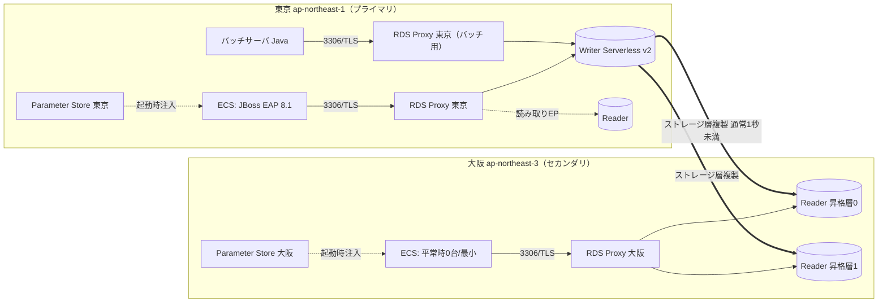

<!-- 生成元: Aurora_MySQL847_GlobalDB_RDSProxy_設計評価.xlsx と同一データ。作成日 2026-10-11 -->

# Aurora MySQL 8.4.7（Serverless v2）× Global Database（東京⇔大阪）× RDS Proxy 設計評価書

作成日: 2026-10-11　／　対象: DR構成・接続方式・RDS Proxy設計・接続経路・Auroraパラメータ・認証・ストレージ　／　フォント: Meiryo UI・モノトーン　／　本書の数値・仕様は作成日時点のAWS API実測値とAWS公式ドキュメントに基づく


### 1. 本書の目的と読み方

本書は、Aurora Global Database を用いて大阪リージョンを災害対策（DR）環境とし、各リージョンに RDS Proxy を置き、リージョン障害時にはコンテナ環境ごと大阪へ切り替える――という設計方針を、最新仕様に照らして『極めて詳しく・厳しく』評価し、RDS Proxy と Aurora（8.4.7 / Serverless v2）の推奨設定を、オンライン（JBoss EAP 8.1）とバッチ（Java直接接続）の両面から示すものです。  
各シートは『登場の歴史と背景 → 動作原理 → 動作イメージ → 評価 → 推奨設定』の順で構成し、専門用語には『やさしい説明（小学生向け）』を併記しました。評価記号は下記の凡例に従います。


### 2. 前提（評価対象の構成）

| 項目 | 内容 |
|---|---|
| プライマリ／セカンダリ | 東京（ap-northeast-1）＝平常時の本番／大阪（ap-northeast-3）＝DR。Aurora Global Database のセカンダリクラスターを大阪に配置 |
| DBエンジン | Aurora MySQL 8.4.7（エンジンバージョン 8.4.mysql_aurora.8.4.7、MySQL 8.4.7互換、パラメータグループファミリー aurora-mysql8.4） |
| インスタンス | Aurora Serverless v2（インスタンスクラス db.serverless。8.4.7 は 0〜256 ACU に対応） |
| 接続方式 | 各リージョンに RDS Proxy を設置し、ターゲットには同一リージョンのリージョナルクラスターを登録（Global Database の writer エンドポイントは使わない）。アプリは自リージョンの RDS Proxy に直接接続 |
| オンライン | コンテナ（Amazon ECS 想定）上の JBoss EAP 8.1。JNDI データソース＋MySQL Connector/J |
| バッチ | バッチサーバ上の Java プログラムから JDBC ドライバを直接指定して接続 |
| 接続先設定 | コンテナイメージは東京・大阪で共用。RDS Proxy のエンドポイントは Parameter Store から取得し、コンテナ起動時に環境に応じた値を自動設定 |
| 運用端末 | 運用端末から TCP 3306 で RDS Proxy エンドポイント、Aurora クラスターの Writer／Reader エンドポイントへ VPC 内部通信で接続し、Security Group で制御 |
| DR方針 | リージョン障害時は Aurora だけでなくコンテナ環境ごと大阪へ切替。切替後も各アプリは自リージョンの RDS Proxy に接続（接続方式は不変） |
| 認証 | IAM データベース認証は使わない（パスワード認証。資格情報は Secrets Manager） |


### 3. 作成日時点でAWS APIから直接確認した事実（東京・大阪）

| 確認項目 | 結果（API実測） | 設計への意味 |
|---|---|---|
| Aurora MySQL 8.4.7 の Global Database 対応 | SupportsGlobalDatabases = true（東京・大阪とも） | 8.4.7 で東京⇔大阪の Global Database を構成できる |
| Serverless v2 の容量範囲 | MinCapacity 0.0 ／ MaxCapacity 256.0 ACU | 0 ACU（自動一時停止）〜256 ACU。ただし RDS Proxy 接続中・Global DB 参加中は自動一時停止しない |
| binlog型クロスリージョンリードレプリカ | SupportsReadReplica = false（8.4.7） | 8.4.7 では binlog ベースのクロスリージョンリードレプリカは使えない。DR は Global Database（ストレージ層複製）一択 |
| 大阪での Serverless v2 | db.serverless が ap-northeast-3a/3b/3c で注文可能。ストレージ種別 aurora（Standard）／aurora-iopt1（I/O-Optimized） | 大阪でも3AZ配置・両ストレージ方式を選べる |
| 次のマイナーバージョン | 8.4.mysql_aurora.8.4.8 が利用可能（8.4.7 からの有効アップグレード先） | aurora_transaction_timeout 等は 8.4.8 以降で有効。Global DB は自動マイナーアップグレード対象外のため計画的に実施 |
| パラメータ数（既定） | DBクラスターパラメータ 131 個／DB（インスタンス）パラメータ 299 個 | 07・08シートで全量の既定値と推奨値を記載 |
| 認証関連の既定 | mysql_native_password = ON（変更不可）／authentication_policy = *:caching_sha2_password | native パスワードは『作れる』が非推奨。新規ユーザー既定は caching_sha2_password |
| TLS関連の既定 | require_secure_transport = ON／tls_version 既定 TLSv1.2,TLSv1.3 | 8.4 は TLS 必須が既定。平文接続はエラー（3159） |
| Write Forwarding | SupportsLocalWriteForwarding = true | 本構成では使わない（使う場合は RDS Proxy の接続枠を減らす必要） |


### 4. 凡例

| 記号 | 意味 |
|---|---|
| ◎ | 優れている（そのまま採用推奨） |
| ○ | 妥当（軽微な補強で採用可） |
| △ | 条件付き（指摘事項の是正が前提） |
| × | 不適切（このままでは採用不可） |
| 致命 | 重大度：放置すると全面停止・情報漏えい・データ消失に直結 |
| 高 | 重大度：障害・セキュリティ事故の可能性が高い |
| 中 | 重大度：運用品質・性能・コストに影響 |
| 低 | 重大度：改善推奨 |
| ★★★／★★／★ | パラメータの重要度（★★★＝必ず設計判断が必要、★★＝要確認、★＝既定で可） |


### 5. シート構成

| シート | 内容 |
|---|---|
| 01_総合評価 | 全評価項目の結論と必須対応事項の一覧 |
| 02_DR構成評価 | Global Database＋大阪セカンダリ＋各リージョンRDS Proxy構成の評価（歴史・仕組み・動作イメージ・推奨構成） |
| 03_切替方針評価 | RDS Proxy直接接続／コンテナ環境ごと大阪へ切替／切替後も自リージョンProxyへ接続、の評価と切替ランブック |
| 04_ParameterStore評価 | 共用コンテナイメージ＋Parameter Storeによるエンドポイント自動設定の評価と設計例 |
| 05_RDSProxy設計 | プロキシ設定〜詳細設定の全項目：デフォルト値と推奨値、接続数計算（計算式入り）、監視 |
| 06_接続経路評価 | 運用端末→TCP3306→Proxy/Writer/Reader の経路を厳格評価。推奨SGマトリクス |
| 07_クラスターPG全量 | DBクラスターパラメータグループ全131項目：既定値／オンライン推奨／バッチ推奨／最終推奨 |
| 08_インスタンスPG全量 | DBパラメータグループ全299項目：既定値／オンライン推奨／バッチ推奨／最終推奨 |
| 09_タイムアウト設計 | アプリ〜Proxy〜DBの階層タイムアウト設計（オンライン／バッチ） |
| 10_JBoss_JDBC設定 | JBoss EAP 8.1 データソース属性・Connector/J プロパティ・設定例・バッチ実装例 |
| 11_認証プラグイン | 8.4.7の認証プラグイン注意点、nativeパスワード可否、代替手段、Secrets Manager運用 |
| 12_ストレージ設計 | ストレージ方式・表領域定義・容量管理・パーティショニング・バックアップ |
| 13_歴史と用語 | 関連技術の登場年表と用語集（やさしい説明付き） |
| 14_出典 | 参照したAWS/Red Hat/MySQL公式情報 |


## 総合評価サマリ

結論：方針（Global DB＋大阪DR、各リージョンRDS Proxy、コンテナ環境ごと切替、Parameter Storeによる接続先注入）はAWSのベストプラクティスに沿っており妥当。ただし『運用端末の接続経路』『RDS Proxyの既定値のまま運用』『大阪側の事前準備（容量・パラメータ・秘密情報・イメージ）』『認証・TLSの8.4新仕様への追随』に是正必須事項がある。

| No | 評価対象 | 評価 | 結論（一言） | 主な強み | 主なリスク・指摘 | 必須対応事項 | 参照シート |
|---|---|---|---|---|---|---|---|
| 1 | Global DB＋大阪セカンダリ（“クロスリージョンリードレプリカ”） | ○ | DR方式として最適。RPOは通常秒、RTOは分単位。8.4.7はbinlog型リードレプリカ非対応のためGlobal DB一択。 | ストレージ層の専用複製（通常1秒未満）／プライマリ性能への影響が小さい／マネージドフェイルオーバーで旧プライマリを自動で再参加 | 設計書の用語『クロスリージョンリードレプリカ』は別機能（binlog型）と混同されるため不正確。大阪のインスタンス無し（headless）不可、ACU・パラメータの東京との同一性、Secrets Managerマネージドマスターパスワード非対応、Backtrack非対応 | 用語を『Global Databaseのセカンダリクラスター』へ修正／大阪に Serverless v2 リーダー2台（昇格層0/1、別AZ）／最大ACUを東京と同値／パラメータグループ・KMS・シークレットを大阪にも同一構成で用意 | 02 |
| 2 | 各リージョンにRDS Proxy、ターゲット＝同一リージョンのクラスター | ◎ | AWS公式の推奨パターン。大阪Proxyは昇格前は読み取りのみ、昇格後は自動で新Writerへ書込みを中継（要求をキューイング）。 | 接続先が変わらない／Proxyが新Writerを自動検出／DNS伝播・DNSキャッシュの影響を受けない | 大阪Proxyの読み書きエンドポイントは昇格前にエラー（The target group doesn't have any associated read/write instances）。Proxyのターゲットは『クラスター』でありエンドポイントではない（Global writer endpointは登録対象外） | 設計書の記述を『同一リージョンのリージョナルクラスターをターゲット登録』に修正／昇格前の大阪Proxyを監視対象から誤検知しない閾値設計 | 02,05 |
| 3 | 接続方式：RDS Proxy直接接続 | ○ | フェイルオーバー耐性・接続プール・秘密情報管理の観点で妥当。 | リージョン内フェイルオーバー時も接続先IPは不変、アイドル接続は維持／コンテナのスケールアウトで接続数が急増してもDBを保護 | ピン留め（プリペアド文・一時表・未追跡SET・16KB超の文）で多重化が効かなくなる／Proxyは最低8ACU分課金／Serverless v2の自動一時停止が無効化／MySQL圧縮プロトコル・デュアルパスワード非対応 | useServerPrepStmts=false、SETはProxy初期化クエリへ集約、オンライン用とバッチ用でProxyを分離（推奨）、ピン留め率をCloudWatchで監視 | 03,05,10 |
| 4 | リージョン障害時はコンテナ環境ごと大阪へ切替 | ◎ | DBだけを切替えて東京のアプリから大阪DBへ越境接続する方式より、遅延・依存関係・障害切り分けの全てで優れる。 | 東京⇔大阪の往復遅延（数ms〜十数ms）がSQL毎に積み上がる問題を回避／依存サービスを全て大阪内で完結（静的安定性） | 大阪の受入れ容量（ECS/Fargateのクォータ・ENI・Proxy上限）、ECRイメージの大阪複製、設定ドリフト、データ損失分（RPO）の業務補正、バッチの二重実行 | 大阪の事前準備チェックリスト（03シート）を整備し、年2回以上のスイッチオーバー訓練（RPO0）で実証 | 03 |
| 5 | 切替後も自リージョンのRDS Proxyへ接続（接続方式不変） | ◎ | AWS仕様上、昇格した大阪クラスターのProxy読み書きエンドポイントは新Writerへ自動中継されるため、アプリの接続方式・URL構造は不変でよい。 | アプリコードの変更ゼロ。接続先ホスト名だけがリージョンごとに異なる（Parameter Storeで吸収） | Global writer endpointの追加的な保護（書込みの安全装置）を使わないため、東京側アプリの書込み停止（フェンシング）を運用で確実に行う必要 | ランブックの最初に東京側の書込み停止（ALB切離し・ECS停止・バッチ停止）を置く／Route 53 ARC等のデータプレーン型切替を検討 | 03 |
| 6 | 共用イメージ＋Parameter Storeで起動時にエンドポイント設定 | ○ | Build once, deploy anywhere の原則に合致。ECSタスク定義のsecretsにパラメータ『名』を書けば自リージョンの値が自動解決される。 | 東京・大阪で同一イメージ・同一タスク定義構造／TLSホスト名検証（VERIFY_IDENTITY）と両立（独自DNS別名だとProxyのホスト名検証が使えない） | 『動的取得』は起動時の1回注入であり、値を変えてもタスク再起動まで反映されない／ARN指定だと大阪タスクが東京のパラメータを読みに行き東京障害時に起動不能／大量同時起動時のAPIスロットリング | 必ずパラメータ名（リージョン非依存）で参照、値はIaCのProxy出力から自動登録、大阪にもVPCエンドポイント（ssm/secretsmanager/kms/ecr/logs/s3）、高スループット設定の検討 | 04 |
| 7 | RDS Proxyの各設定 | △ | 既定値のままでは本構成に不適合な項目がある（TLS必須OFF、借用タイムアウト120秒、アイドル1800秒とアプリプールの関係、認証タイプ）。 | 設定項目は少なく、正しく設定すれば運用負荷は低い | TLS必須OFFのままだと 8.4 の require_secure_transport=ON と噛み合わない／caching_sha2_password はTLS必須／MaxConnectionsPercent=100 だと運用・監視用の接続枠が無い | 05シートの推奨値（TLS必須ON、caching_sha2、借用タイムアウト30/120秒、MaxConnectionsPercent 60/25、初期化クエリで用途別タイムアウト）を適用 | 05 |
| 8 | 運用端末→TCP3306（SG制御）→Proxy／Writer／Reader | × | 『VPC内部通信だから安全』という前提は不十分。端末の所在・認証・監査・TLS・最小権限・直結の是非が未定義で、このままでは承認不可。 | SGでポートを3306に限定している点は正しい出発点 | 送信元をCIDRで許可していると同一セグメントの全資源がDBへ到達可能／共有の管理者ユーザー利用による無証跡化／Writer直結でのDDLによるMDL待ち行列（オンライン全停止）／TLS未強制のツール接続／大阪側の同等経路未整備 | 06シートの是正策（SSM Session Managerポートフォワード、SG参照による送信元指定、個人別DBユーザー＋監査ログ、読み取りは専用リーダー、DDLはlock_wait_timeout短縮、TLS VERIFY_IDENTITY）を実施 | 06 |
| 9 | Aurora 8.4.7 パラメータ設計 | △ | 既定値で概ね動くが、照合順序・時刻帯・TLS・監査・タイムアウト・ロールバック挙動は明示設計が必要。 | Serverless v2が容量連動パラメータ（バッファプール等）を自動管理 | 既定照合順序 utf8mb4_0900_ai_ci の『ハハ＝パパ』問題、lock_wait_timeout既定1年、max_connect_errors既定100によるProxy IPブロック、パラメータグループはリージョン単位で引き継がれない | 07/08シートの最終推奨値でカスタムPGを作成し、東京・大阪の両方へ同一適用（IaC管理） | 07,08,09 |
| 10 | 認証プラグイン（8.4.7） | ○ | caching_sha2_password が既定。native は有効固定で作成可能だが非推奨（MySQL 9.0で削除済）。 | RDS Proxyは2024年12月から caching_sha2_password に対応 | Proxy経由の caching_sha2 はTLS必須／TLSを使わないと Public Key Retrieval エラー／旧クライアント（運用ツール）非対応／Global DBではマネージドマスターパスワード不可 | caching_sha2_password＋TLS（VERIFY_IDENTITY）に統一、Proxyのクライアント認証タイプ＝MYSQL_CACHING_SHA2_PASSWORD、Secrets Manager（自己管理シークレット＋大阪レプリカ）でローテーション | 11 |
| 11 | ストレージ・表領域・容量・パーティション・バックアップ | ○ | Auroraは表領域を自動管理（一般表領域は非提供）。設計の主眼は『ストレージ方式選択』『表設計』『パーティションによる削除方式』『Global DBとは別のバックアップ』。 | 最大256TiBまで自動拡張、使った分だけ課金、空き領域は自動返却（動的サイズ変更） | Global DBはバックアップではない（誤削除も即複製）／Global DBではBacktrack不可／単一表は64TiB上限／表の大量作成・削除で表領域ID上限に注意 | PITR保持期間の設定、AWS Backupで別アカウント・別リージョンへコピー（Vault Lock）、時系列表はRANGEパーティション＋DROP PARTITIONで削除 | 12 |


### やさしい説明（小学生向け）：この構成を一言でいうと

東京にある『本物のノート（データベース）』の中身を、ほぼリアルタイムで大阪の『コピーのノート』に書き写しています。東京で大地震などが起きてノートが使えなくなったら、大阪のコピーを『本物』に昇格させ、お店の人（アプリ＝コンテナ）も全員大阪のお店に引っ越して仕事を続けます。RDS Proxy は各お店の『受付係』で、お客さん（アプリの接続）をまとめて案内し、ノートの担当者が交代しても受付の場所は変わりません。だから大阪のお店でも『自分のお店の受付に行く』という同じやり方で仕事ができます。


## Global Database＋大阪セカンダリ＋各リージョンRDS Proxy 構成の評価

評価対象：大阪リージョンを Global Database に組み込み、クロスリージョンの読み取り専用クラスターを配置。RDS Proxy を各リージョンに置き、ターゲットは同一リージョンのクラスター（Global Databaseのエンドポイントは使わない）。


### A. 登場の歴史と背景（なぜ必要になったか）

| 年 | 出来事 | なぜ必要になったか・背景 |
|---|---|---|
| 2009 | Amazon RDS 登場（MySQL） | DBサーバの構築・パッチ・バックアップを人手から解放するマネージドDBが求められた。 |
| 2014-2015 | Amazon Aurora 発表（2014）・一般提供（2015） | 従来のMySQLは『データを書き込むたびにページを丸ごと書く』『レプリカごとにデータを持つ』ため、大規模化と高可用性に限界があった。Auroraはログ（redo）だけをストレージ層へ送り、3AZ×6コピーで保持する新しい分散ストレージ設計で解決した。 |
| 2018 | Aurora Global Database 登場 | binlogを使ったクロスリージョンレプリカは、DBエンジンが複製を担うため遅延が大きく、プライマリ性能を削り、昇格も手作業だった。Global Databaseはストレージ層の専用インフラで複製し、通常1秒未満の遅延と分単位の復旧を実現した。 |
| 2020 | Amazon RDS Proxy 一般提供 | Lambdaやコンテナのように『大量の短命な接続』を作る実行環境が普及し、DBの接続上限・接続確立コスト・フェイルオーバー時のDNS切替待ちが問題化した。Proxyが接続を束ね（プール・多重化）、フェイルオーバーを肩代わりする。 |
| 2021 | 大阪リージョン（ap-northeast-3）がフルリージョン化 | 国内でリージョンをまたぐDRを法規制・データ所在要件（国内保管）を満たしたまま実現できるようになった。 |
| 2022 | Aurora Serverless v2 一般提供 | v1は拡張が粗く（倍々）・Global DBやリーダーに非対応だった。v2は0.5ACU刻みで瞬時に伸縮し、Global DB・リーダー・RDS Proxyと組み合わせられるようになった。 |
| 2022-2023頃 | Global DB のスイッチオーバー（旧：計画的フェイルオーバー）とマネージド・フェイルオーバー（allow-data-loss） | DR訓練をデータ損失ゼロで日常的に行い、本番障害時も旧プライマリを自動で再参加させるため。 |
| 2024 | Global Database writer エンドポイント／Serverless v2 の 0 ACU 自動一時停止／RDS Proxy の caching_sha2_password 対応 | 切替時の接続先変更を自動化したい、使わない時間の費用を0にしたい、MySQL 8系の標準認証へ追随したい、という要望への対応。 |
| 2025 | Aurora ストレージ上限 256TiB | 単一クラスターで扱うデータ量の増大。 |
| 2026-05 | Aurora MySQL 8.4.7（MySQL 8.4 LTS互換） | MySQL 8.0（コミュニティ版）のサポート終了（2026年4月）を受け、長期サポート版 8.4 への移行先として提供。TLS必須・新認証方針など安全側の既定値へ変化。 |


### B. 動作原理（仕組み）

| No | 仕組み | 説明 | やさしい説明（小学生向け） |
|---|---|---|---|
| 1 | ストレージ層での複製 | プライマリ（東京）のWriterはredoログを東京のストレージ層へ書き、同時にGlobal DB専用のレプリケーション基盤が大阪のストレージ層へ送る。大阪のインスタンスは自分のストレージに届いたログを読んでキャッシュを更新するだけで、SQLを再実行しない。 | 日記の『書いた内容のメモ』だけを大阪へ速達で送る。大阪の人はメモを読んでノートを最新にするだけなので速い。 |
| 2 | セカンダリは読み取り専用 | 大阪クラスターはフェイルオーバー/スイッチオーバーで昇格するまで書込み不可。最大16台のリーダーを置ける（通常クラスターは15台）。最大10のセカンダリリージョン。 | 大阪のコピーは『見るだけ』。書き込めるのは東京の本物だけ。 |
| 3 | 遅延（RPO） | 複製遅延は通常1秒未満。監視は AuroraGlobalDBRPOLag（ミリ秒）。障害時に失うデータは『その瞬間まだ届いていなかった分』（通常は秒）。 | 速達でも途中の数秒分は届いていないことがある。 |
| 4 | スイッチオーバー（計画切替） | 全セカンダリが同期するのを待ってから役割を交換するのでRPO=0。Aurora MySQL 3.09以降の対象バージョンでは読み書き回復が通常30秒未満（8.4系も同等機能を有すると記載。実測で確認）。 | 引っ越しの日を決めて、全部書き写し終わってから交代するのでなくならない。 |
| 5 | フェイルオーバー（障害時切替） | failover-global-cluster --allow-data-loss。同期を待たずに大阪を昇格。東京が復旧すると自動で新しいストレージを作りセカンダリとして再参加。その前に障害時点のスナップショット（rds:unplanned-global-failover-...）の取得を試みる。 | 急いで大阪を本物にする。東京が直ったら東京は自動でコピー係に戻る。届かなかった分は東京の写真（スナップショット）から探せる。 |
| 6 | 書込みフェンシング | マネージド・フェイルオーバー開始時、Auroraはストレージ層で旧プライマリへの書込み停止を試みる（ベストエフォート）。複数AZ障害時は時間内に止められないこともあり、スプリットブレインの可能性はゼロではない。 | 東京のノートに『もう書かないで』と札を下げるが、混乱時は札が間に合わないこともある。 |
| 7 | RDS Proxy と Global DB | プライマリを対象とするProxyは通常どおり（読み書き→Writer、読み取り→Reader）。セカンダリを対象とするProxyは読み取りエンドポイントのみ機能し、読み書きエンドポイントへの要求は『The target group doesn't have any associated read/write instances』エラー。昇格が始まると、Proxyは読み書き要求をキューに貯め、新Writerが使えるようになり次第（切替処理の完了を待たず）送る。 | 大阪の受付係は、普段は『見るだけ』の案内しかできないが、大阪が本物になった瞬間から書き込みの案内も始める。待っている人には順番に案内する。 |
| 8 | Serverless v2 と Global DB | プライマリの最小容量は8ACUが推奨（AWS推奨値）。Global DB参加中、およびRDS Proxyが接続している間は自動一時停止（0ACU）しない。max_connections は最大ACUのメモリから算出され固定。 | 大阪・東京とも『寝ない』ので、最小の大きさを決めておく。最大の大きさで受付できる人数（接続数）が決まる。 |
| 9 | 東京のWriter再起動の影響 | プライマリのWriterが再起動/フェイルオーバーすると、セカンダリのリーダーも再起動し、同期が戻るまで大阪クラスターは利用不可になる。 | 東京の担当者が交代すると、大阪のコピー係も一度読み直しのため手を止める。 |


### C. 動作イメージ（平常時 → 東京リージョン障害 → 大阪で業務継続 → 復旧・切り戻し）

| 段階 | 東京（ap-northeast-1） | 大阪（ap-northeast-3） | アプリ／接続 | ポイント |
|---|---|---|---|---|
| ① 平常時 | Writer＋Reader（Serverless v2）が稼働。東京Proxyの読み書きEP→Writer | セカンダリ（Reader×2）が複製を適用。大阪Proxyは読み取りEPのみ有効 | 東京コンテナ・東京バッチが東京Proxyへ接続。大阪コンテナは0台（またはスタンバイ最小数） | AuroraGlobalDBRPOLagを常時監視 |
| ② 障害発生 | Writer応答なし／リージョン内の複数サービスが不安定 | 複製が停止（最後に届いた時点まで保持） | 東京アプリはエラー。書込みは失敗または不確定 | AZ障害なら域内フェイルオーバーで済む。リージョン障害か判断 |
| ③ 判断・隔離 | （制御可能なら）東京ALBの切離し、ECS/バッチ停止＝書込み隔離 | RPO遅延を確認 | 利用者には障害告知 | スプリットブレイン防止のため隔離を先に |
| ④ DB昇格 | （到達不能でも可） | failover-global-cluster --allow-data-loss を大阪リージョンのAPIで実行→Reader1台がWriterへ昇格 | 大阪Proxyは読み書き要求をキューし新Writerへ送る | 通常、数分以内に昇格 |
| ⑤ アプリ起動 | — | 大阪ECSサービスを本番台数へ。タスクは大阪Parameter Storeから大阪Proxyのエンドポイントを取得 | 大阪コンテナ・大阪バッチが『自リージョンのProxy』へ接続（方式は東京時と同一） | 接続URLの構造は不変 |
| ⑥ 入口切替 | — | Route 53等で利用者の入口を大阪ALBへ | 業務再開 | DNS TTLを短く（60秒等） |
| ⑦ 東京復旧 | Auroraが東京に新ストレージを作り、セカンダリとして自動再参加。障害時点スナップショットを保全 | プライマリとして稼働中 | 未到達データ（RPO分）をスナップショットから調査・補正 | スナップショットは保持期間で消えるため手動コピーで保全 |
| ⑧ 切り戻し | スイッチオーバー（RPO=0）で東京をプライマリへ戻す | セカンダリへ戻る | コンテナ・バッチを東京へ戻し、大阪を縮退 | 計画停止枠で実施 |


### D. 評価（観点別）

| No | 区分 | 観点 | 動作原理・事実（最新仕様） | 評価・リスク | 推奨対応 | やさしい説明（小学生向け） | 評価 |
|---|---|---|---|---|---|---|---|
| 1 | 方式選定 | DR方式の選択 | 候補はGlobal DB／binlog型クロスリージョンリードレプリカ／スナップショットのリージョン間コピー／AWS Backupのクロスリージョンコピー。API実測で8.4.7は SupportsReadReplica=false（binlog型クロスリージョンレプリカ不可）。Global DBはRPO秒・RTO分。 | 最適。スナップショット系はRPOが時間〜日単位、RTOも復元時間（数十分〜数時間）が必要で、要件が厳しいほど不利。 | Global DBを採用。スナップショット/AWS Backupは『論理障害（誤削除）からの復旧用』として併用。 | 大事なノートを毎秒書き写す方法と、1日1回写真を撮る方法がある。今回は毎秒書き写す方法を選んだ。 | ◎ |
| 2 | 用語 | 『クロスリージョンリードレプリカ』という表記 | Auroraで『クロスリージョンリードレプリカ』はbinlogを使う別機能を指す（8.4.7では非対応）。Global DBの大阪側は『セカンダリクラスター（セカンダリDBクラスター）』。 | 設計書・運用手順で別機能と混同すると、手順（昇格方法・監視メトリクス・制約）を誤る。 | 表記を『Aurora Global Database のセカンダリクラスター（大阪）』に統一。 | 似た名前の別の道具を取り違えないように、正しい名前で呼ぶ。 | △ |
| 3 | 構成 | 大阪セカンダリのインスタンス台数 | インスタンス0台（headless）でも複製は維持できるが、切替前にインスタンス追加が必要。RDS Proxyはインスタンスが無いと接続先が無い。 | headlessはRTOが延び、Proxyも機能しない。1台だけだと昇格後にWriterしか残らず、域内HAが失われる。 | 大阪に Serverless v2 リーダー2台（別AZ、昇格層0と1）。昇格後はWriter＋Readerで域内HAを維持。 | 大阪にも最低2人の係を置き、1人が本物担当になっても、もう1人が控えになれるようにする。 | △ |
| 4 | 容量 | Serverless v2 の ACU 範囲（東京・大阪の同一性） | max_connections は『最大ACU』で決まり固定（例：最大64ACU→4,000、128→5,000）。昇格層0/1のリーダーはWriterに合わせて伸縮、2〜15は独立。セカンダリは書込み適用に必要な容量が要る。 | 大阪の最大ACUが東京より小さいと、昇格後の接続上限・Proxyの接続枠・処理能力が不足し、DR時に性能障害。最小ACUが低すぎると複製適用が遅れRPOが悪化。 | 大阪の最小/最大ACUを東京と同値に設定（クラスター単位の設定なのでIaCで一元管理）。プライマリ最小8ACU（AWS推奨）。 | 大阪の机の大きさを東京と同じにしておかないと、引っ越した後に仕事が入りきらない。 | △ |
| 5 | 設定継承 | パラメータグループ・監視の継承 | パラメータグループはリージョン単位で、フェイルオーバー時に引き継がれない（AWS明記）。CloudWatchアラーム・イベント通知も同様。 | 大阪のPGが既定のままだと、昇格後にtime_zone・照合順序・タイムアウト・監査が変わり、時刻ずれや監査ログ欠落が起きる。 | 東京と同一内容のクラスターPG/インスタンスPGを大阪にも作成し適用（IaC）。差分を定期チェック（AWS Config等）。 | 大阪のルールブックを東京と同じにしておく。 | △ |
| 6 | セキュリティ | 暗号化キー・秘密情報 | 暗号化されたGlobal DBは各リージョンのKMSキーを使う。Secrets Managerによるマスターパスワード管理（RDSマネージド）はGlobal DB非対応（追加前に無効化が必要）。RDS Proxyのシークレットはリージョンごとに必要。 | 大阪Proxyが参照するシークレットが無い/古いと、昇格後に認証失敗し全面停止。 | Secrets Manager の自己管理シークレット＋リージョン複製（大阪レプリカ）。ローテーションは東京で実施し大阪へ自動反映。東京障害時は大阪レプリカを昇格。 | 大阪の受付係にも、同じ合言葉を前もって渡しておく。 | △ |
| 7 | 接続 | RDS Proxyを各リージョンに設置しターゲット＝同一リージョンのクラスター | Proxyのターゲットは『DBクラスター』（register-db-proxy-targets --db-cluster-identifiers）。Global writer endpoint はProxyのターゲットにはならない。大阪Proxyは昇格前は読み取りのみ、昇格後は読み書きを自動中継。 | AWS推奨の構成。アプリは自リージョンのProxyを指すだけで済む。 | 設計書の『エンドポイントを登録』は『リージョナルクラスターを登録』に修正。大阪Proxyの読み書きEPを監視する外形監視は『昇格前はエラーが正常』とする。 | 受付係は『どのノートの係か』で決まり、ノートの住所（エンドポイント）を登録するわけではない。 | ◎ |
| 8 | 接続 | Global writer endpoint を使わない判断 | Global writer endpointは切替後も同じ名前で新プライマリを指し、Auroraは書込み損失を減らす追加の安全策を講じる。一方、DNSで切り替わるためアプリ側DNSキャッシュの影響を受け、越境接続も起こり得る。 | コンテナ環境ごと切り替える方針なら、自リージョンProxy直結の方が遅延・依存・切り分けで有利。ただし東京アプリの書込み停止は運用で担保が必要。 | 不採用で妥当。代わりに『東京側の書込み隔離→昇格→大阪起動』の順序をランブックで固定し、自動化（ARC Region switch等の活用を検討）。 | 共通の看板（世界共通の住所）は使わず、各お店の受付を使う。そのかわり東京のお店を確実に閉めてから大阪を開ける。 | ○ |
| 9 | 読み取り利用 | 大阪リーダーの平常時の業務利用 | セカンダリは東京Writerの再起動やフェイルオーバー時に再起動し、同期回復まで使えない。遅延も変動する。 | 平常時の本番参照を大阪に依存させると、東京側の保守で大阪の参照まで止まる。 | 平常時は大阪リーダーを本番業務に使わない（使う場合は遅延・停止を許容する参照系に限定）。 | 大阪のコピーは非常用。普段のお仕事には使わない方が安心。 | ○ |
| 10 | バックアップ | Global DB はバックアップではない | 誤ったDELETE/DROPも1秒未満で大阪に複製される。Global DBではBacktrack非対応。 | 論理障害には無力。 | 自動バックアップ（PITR）＋手動スナップショット＋AWS Backupで別アカウント・大阪へコピー（12シート参照）。 | 書き写しは間違いもそのまま写す。だから写真（バックアップ）も別に撮っておく。 | ○ |
| 11 | バージョン管理 | マイナーバージョンアップグレード | Global DBでは自動マイナーアップグレードが効かない。マネージド切替には主・副の同一メジャー/マイナー（パッチは組合せ表に依存）が必要。 | 東京だけ上げて大阪が古いと、マネージド・フェイルオーバーができず手動の切離し昇格（手順複雑・再構築必要）になる。 | アップグレードは『セカンダリ→プライマリ』の順で計画実施し、同一バージョンを維持。8.4.8（aurora_transaction_timeout等）への計画を立てる。 | 東京と大阪の道具のバージョンをそろえておかないと、交代の儀式ができない。 | △ |
| 12 | 監視 | Global DB／Proxyの監視項目 | AuroraGlobalDBRPOLag、AuroraGlobalDBReplicationLag、AuroraGlobalDBDataTransferBytes、AuroraGlobalDBReplicatedWriteIO、RDSイベント（フェイルオーバー・書込みフェンシング）、Proxyの DatabaseConnectionsBorrowLatency 等。 | RPO悪化に気付かないと、障害時の損失が想定を超える。 | RPOLagに閾値アラーム（例：5秒超が5分継続）。両リージョンに同一ダッシュボード。 | 書き写しが遅れていないか、いつも見張っておく。 | ○ |
| 13 | コスト | 常時稼働コスト | 大阪リーダー（ACU課金）、複製された書込みI/O（Standardストレージの場合）、リージョン間データ転送、大阪Proxy（Serverless v2の場合ACU課金・最低8ACU分）、大阪ストレージ。 | DR用でも寝ていないため、相応の固定費がかかる。 | 大阪リーダーの最小ACUは複製適用に必要な最小限、最大ACUは東京と同値（課金は実使用分）。I/O比率が高ければI/O-Optimizedで複製書込みI/O課金を回避。 | 非常用のお店も電気代はかかる。必要な分だけにする。 | ○ |
| 14 | クォータ | 大阪側のサービスクォータ | RDS Proxyはアカウント・リージョンあたり既定20個、ECS/Fargateの同時vCPU、ENI、ALB等は大阪で個別に上限がある。 | DR発動時に大阪で必要台数を起動できない（大規模障害時は他社も一斉に移動）。 | 大阪のクォータを本番ピーク×1.2以上に事前引上げ。重要系はウォームスタンバイ（最小台数常時起動）も検討。 | 大阪のお店の席の数を前もって増やしておく。 | △ |
| 15 | 訓練 | DR訓練 | スイッチオーバーはRPO=0で、通常30秒未満（対象バージョン）。 | 訓練しない手順は本番で動かない。 | 年2回以上、本番相当でスイッチオーバー＋コンテナ環境切替を実施し、RTO/RPOを実測。 | 避難訓練をしておくと本番であわてない。 | ○ |


### E. 推奨構成（要約）

| 要素 | 東京（プライマリ） | 大阪（セカンダリ） | 備考 |
|---|---|---|---|
| Auroraクラスター | Writer×1（AZ-a）＋Reader×1（AZ-c、昇格層1）＋参照/運用用Reader×1（AZ-d、昇格層2〜15、任意） | Reader×2（AZ-a/AZ-b、昇格層0/1） | 全て db.serverless。大阪はheadless禁止 |
| ACU範囲 | 最小8／最大（負荷試験で決定。例64） | 東京と同値（例：最小8／最大64） | 最大ACUで max_connections が決まる（64ACU→4,000） |
| パラメータグループ | カスタムクラスターPG＋カスタムDB PG（07/08シート） | 東京と同一内容（別リージョンに同名で作成） | IaCで生成し差分ゼロを担保 |
| RDS Proxy | オンライン用・バッチ用（推奨：分離）。ターゲット＝東京クラスター | 同構成。ターゲット＝大阪クラスター | 大阪は昇格前は読み取りEPのみ機能 |
| Proxyエンドポイント | 既定（読み書き）＋読み取り専用EP（任意） | 同左 | 追加EPはPrivateLink課金 |
| 秘密情報 | Secrets Manager（自己管理シークレット、ローテーション有効） | 東京シークレットのレプリカ | RDSマネージドマスターパスワードはGlobal DB非対応 |
| 暗号化 | KMS（東京） | KMS（大阪） | マルチリージョンキーも可 |
| バックアップ | 自動バックアップ（PITR）、AWS Backup（別アカウントへコピー、Vault Lock） | AWS Backupのコピー先 | Global DBとは独立 |





## 接続方式（RDS Proxy直接接続）とDR切替方針（コンテナ環境ごと大阪へ）の評価

評価対象：①エンドポイント接続方式にRDS Proxy直接接続を採用　②リージョン障害時はAuroraのみではなくコンテナ環境ごと大阪へ切替　③切替後もアプリは自リージョンのRDS Proxyへ接続するため接続方式は不変


### A. 背景：なぜ『環境ごと』切り替えるのか

DRの考え方は、AWS Well-Architected（信頼性の柱）で『バックアップ＆リストア』『パイロットライト』『ウォームスタンバイ』『マルチサイト（アクティブ/アクティブ）』の4段階に整理されています。本構成は、DBを常時複製し（Global DB）、アプリ実行環境を大阪に用意しておく『パイロットライト〜ウォームスタンバイ』に当たります。  
DBだけを大阪へ切替え、東京のアプリから大阪のDBへ越境接続する方式は一見手軽ですが、SQL1回ごとに東京⇔大阪の往復遅延（数ms〜十数ms）が上乗せされ、1画面で数十〜数百回SQLを発行するJava EEアプリでは応答時間が数倍に悪化します。また『東京のアプリは生きているのか』『東京の依存サービス（Secrets Manager、Parameter Store、ECR等）は使えるのか』という判断が絡み合い、障害の切り分けが困難になります。そこで、障害の影響範囲（リージョン）とアプリ・DB・依存サービスの境界をそろえ、『大阪の中だけで全てが完結する』状態へ丸ごと移る――これを『静的安定性（Static Stability）』と呼び、AWSが推奨する考え方です。


### B. 評価（観点別）

| No | 区分 | 観点 | 動作原理・事実（最新仕様） | 評価・リスク | 推奨対応 | やさしい説明（小学生向け） | 評価 |
|---|---|---|---|---|---|---|---|
| 1 | 接続方式 | RDS Proxy直接接続の採用 | Proxyはリージョン内フェイルオーバー時も同じIPで接続を受け付け、新Writerへ自動で振り向ける。アイドル接続は維持され、処理中のトランザクション/文のみ取り消される。DNS伝播・ローカルDNSキャッシュ・接続タイムアウト・旧Writerからの応答待ちの影響を受けない（AWS記載）。 | コンテナの台数増減（スケールアウト）で接続数が急増してもDBを保護でき、Serverless v2の接続上限（最大ACU依存）とも相性が良い。 | 採用で妥当。アプリ側でAWS Advanced JDBC Wrapperのフェイルオーバープラグインは不要（Proxyと二重にトポロジ判断をしない）。 | 受付係（Proxy）がいるので、ノートの担当が交代しても、お客さんは同じ受付に並べばよい。 | ○ |
| 2 | 接続方式 | Proxy利用の弱点（ピン留め等） | プリペアド文（SQLテキスト/バイナリ両方）、一時表作成、LOCK TABLES、GET_LOCK、追跡対象外の変数SET、16KB超の文、実行可能コメント（/*! */）でセッションが固定（ピン留め）され多重化が効かなくなる。圧縮プロトコル・デュアルパスワード非対応。init_connectは期待通り動かない場合がある。 | オンラインの多重化効率が落ちると、Proxy→DB接続数がアプリ接続数と同数に近づき、接続枠不足・借用待ち（BorrowLatency）が発生。 | Connector/J は useServerPrepStmts=false（既定）、SETはProxy初期化クエリへ集約、一時表はオンラインで使わない、バッチは専用Proxyへ分離。CloudWatch DatabaseConnectionsCurrentlySessionPinned を監視。 | 受付係は、お客さんが特別な注文（決まった係を指名）をすると、その係を独り占めにしてしまう。特別注文はなるべく減らす。 | △ |
| 3 | 接続方式 | Proxyのコストと副作用 | Serverless v2向けProxyはACU課金で最低8ACU分（料金ページで最新確認）。Proxyが接続を保持するためServerless v2は自動一時停止しない。 | DR側（大阪）もProxyを常設するとその分の固定費。開発環境で0ACU停止を期待していると停止しない。 | 本番・DRは常設（障害時の作成待ち時間・設定ミスを避ける）。開発環境はProxyなしや時間帯停止を検討。 | 受付係はお客さんがいなくても待機しているのでお給料がかかる。 | ○ |
| 4 | 切替方針 | コンテナ環境ごと大阪へ切替 | アプリ・DB・依存サービスをリージョン単位で閉じる（静的安定性）。越境接続による遅延増・依存関係の複雑化を回避。 | 最も推奨されるDR形態の一つ。部分障害時（例：東京のECSは無事でAuroraのみ障害）でも全切替する判断基準を明確にすれば運用がシンプル。 | 『どの事象でリージョン切替を発動するか』の判断表を用意（AZ障害は域内HAで対応しリージョン切替しない、等）。 | 東京のお店が使えなくなったら、店員もお客さんもノートも、まとめて大阪のお店へ引っ越す。 | ◎ |
| 5 | 切替方針 | 切替後も自リージョンのProxyへ接続（方式不変） | 昇格した大阪クラスターに紐づくProxyの読み書きエンドポイントは新Writerへ自動で中継される（要求はキューされ、新Writerが利用可能になり次第送信）。アプリのJDBC URL構造・ドライバ設定・プール設定は東京と同一でよく、ホスト名だけがリージョンで異なる。 | AWSの公式動作と一致し、アプリ改修ゼロでDRを実現できる。 | 接続先ホスト名はParameter Storeで注入（04シート）。大阪起動前に大阪Proxyのターゲット状態（AVAILABLE）を確認する手順を入れる。 | 大阪のお店でも『自分のお店の受付に行く』だけ。行き方は東京と同じ。 | ◎ |
| 6 | 切替方針 | 書込みの隔離（フェンシング） | Global writer endpointを使わないため、Auroraが提供する『グローバルエンドポイント経由の書込みへの追加保護』は受けない。マネージド・フェイルオーバーの書込みフェンシングはベストエフォート。 | 部分障害で東京アプリがまだ東京DBへ書けている状態で大阪を昇格すると、東京側の書込みが失われる（スプリットブレイン）。 | ランブックの最初に『東京の書込み停止』（ALBのリスナー停止/ターゲット解除、ECSサービス desired=0、バッチスケジューラ停止）を置き、停止確認後に昇格。制御プレーン障害に備え、データプレーンで切り替えられる仕組み（Route 53 ARC のルーティングコントロール、ARC Region switch 等）を検討。 | 大阪を本物にする前に、東京のお店のドアを確実に閉める。 | △ |
| 7 | 切替方針 | データ損失分の扱い | フェイルオーバーのRPOは通常秒単位。旧プライマリ復旧時に障害時点スナップショットの取得を試みる。 | 失われた数秒分の取引（受注・入金等）の業務上の扱いが未定義だと、再開後に不整合が残る。 | 業務側で『未到達データの照合・補正手順』を定義（スナップショットを別クラスターに復元して差分抽出）。スナップショットは保持期間で消えるため手動コピーで保全。 | 届かなかった数秒分のメモを、あとで写真から探して書き足す。 | △ |
| 8 | 切替方針 | バッチの二重実行・再実行 | 東京バッチの実行途中で障害が起きると、どこまで処理したか不明になる。 | 大阪で同じジョブを再実行すると二重計上の恐れ。 | ジョブを冪等（何度実行しても同じ結果）に設計、処理済みキーの記録、チェックポイント再開。スケジューラは同時に1リージョンだけ有効。 | 同じ宿題を2回提出しないよう、どこまでやったか印をつけておく。 | △ |
| 9 | 切替方針 | セッション・キャッシュ | JBossのHTTPセッション複製はリージョンをまたがない。 | 利用者は再ログインが必要（通常は許容範囲）。 | 業務的に許容されることを合意。必要ならセッションを外部ストア（ElastiCache Global Datastore等）へ。 | 引っ越し後はもう一度受付で名前を言う。 | ○ |
| 10 | 切替方針 | 切り戻し | 東京復旧後、AuroraはマネージドFO時に東京を自動でセカンダリとして再参加させる。戻す時はスイッチオーバー（RPO=0）。 | 切り戻しでも環境ごと移動が必要。 | 計画停止枠で『大阪の書込み停止→スイッチオーバー→東京起動』を実施。訓練と同じ手順を使う。 | 元のお店に戻るときは、落ち着いて全部書き写してから戻る。 | ○ |


### C. リージョン障害時の切替ランブック（推奨）

| Step | 担当 | 操作 | 確認ポイント | 目安時間 | 失敗時の対応 |
|---|---|---|---|---|---|
| 0 | 監視 | 障害検知：CloudWatchアラーム（東京）、AWS Health、外形監視（大阪から東京ALBを監視） | AZ障害かリージョン障害かを識別 | 〜5分 | — |
| 1 | 責任者 | DR発動判断（判断表に基づく）。自動化する場合も人の承認を1回挟む | 誤発動・フラッピング防止 | 5〜20分 | 判断保留時は域内復旧を待つ |
| 2 | 運用 | 東京の書込み停止：入口（Route 53/ALB）を閉塞、ECSサービス desired=0、バッチスケジューラ停止（制御可能な範囲で） | 東京へ新規書込みが来ないこと | 〜5分 | 制御プレーン不可時はデータプレーン型切替（ARCルーティングコントロール） |
| 3 | DB | AuroraGlobalDBRPOLag（最後の値）を記録 | 想定損失量の把握 | 1分 | メトリクス取得不可でも続行 |
| 4 | DB | 大阪リージョンを指定して failover-global-cluster --allow-data-loss（東京のAPIは使わない） | 大阪クラスターがプライマリ、Writerがavailable | 数分 | マネージド不可時は手動（デタッチ＝スタンドアロン昇格） |
| 5 | DB | 大阪Proxyのターゲット状態確認（describe-db-proxy-targets：Writer が AVAILABLE） | 読み書きEPでSELECT 1／更新テスト | 1〜2分 | Proxy再登録・シークレット確認 |
| 6 | DB | 大阪のPG・監視・アラーム・監査ログ出力が東京と同一か確認 | time_zone・照合順序・監査ON | 5分 | 差分があれば修正（再起動要否確認） |
| 7 | アプリ | 大阪ECSサービスを本番台数へ（タスクは大阪Parameter Storeから大阪Proxyのホスト名を取得） | ヘルスチェック合格・DB接続成功 | 5〜15分 | クォータ不足時は上限緩和申請済みか確認 |
| 8 | バッチ | 大阪バッチサーバのスケジューラ有効化。中断ジョブの再実行判断 | 冪等性・チェックポイント | 随時 | — |
| 9 | ネットワーク | 利用者の入口を大阪ALBへ（Route 53 フェイルオーバー/加重、TTL 60秒） | 外部から大阪で業務可能 | 1〜5分 | — |
| 10 | 業務 | 業務確認・再開宣言。未到達データ（RPO分）の照合開始 | — | — | — |
| 11 | DB | 東京復旧後、自動再参加を確認。障害時点スナップショットを手動コピーで保全 | rds:unplanned-global-failover-... の存在 | 数分〜数時間 | — |
| 12 | 全体 | 計画停止枠でスイッチオーバー（RPO=0）により東京へ切り戻し | 同手順の逆順 | 30分〜 | — |


### D. RTO／RPO の内訳（目安）

| 要素 | 目安 | 短縮策 |
|---|---|---|
| 検知・判断 | 10〜30分（人の判断が支配的） | 判断表の事前合意、ARC Region switch 等による実行の自動化（承認は人） |
| Aurora昇格 | 数分（マネージド・フェイルオーバー） | 大阪にリーダーを常設（headless禁止）、ACUを東京と同値 |
| Proxy利用可能化 | 昇格完了直後（読み書き要求はキュー） | Proxyを常設・ターゲット登録済みにしておく |
| アプリ起動 | 5〜15分（イメージ取得・JBoss起動） | ECRを大阪へ複製、ウォームスタンバイ（最小台数常時起動）、JBoss起動時間の短縮 |
| 入口切替 | 1〜5分（DNS TTL依存） | TTL 60秒、ヘルスチェック連動 |
| 合計RTO | 30〜60分程度（目標値は訓練で実測し合意） | — |
| RPO | 通常秒（AuroraGlobalDBRPOLagに依存） | 書込み負荷の平準化、遅延監視 |


### E. 大阪側の事前準備チェックリスト

| 区分 | 準備項目 | 理由 |
|---|---|---|
| コンテナ | ECRのクロスリージョンレプリケーション（東京→大阪） | 東京障害時に東京ECRからイメージを取得できない |
| コンテナ | ECSクラスター・サービス・タスク定義（大阪）、ALB、ターゲットグループ | 障害時に作るのは時間がかかり失敗しやすい |
| 設定 | Parameter Store（大阪）に同名パラメータ・大阪の値 | タスクは自リージョンの値を読む |
| 秘密情報 | Secrets Managerのレプリカシークレット（大阪）、ローテーション設計 | 大阪Proxy・アプリの認証 |
| DB | 大阪のカスタムPG（クラスター/インスタンス）、KMSキー、Proxy（ターゲット登録済み） | フェイルオーバー時に設定は継承されない |
| ネットワーク | VPC、サブネット（3AZ）、SG、NACL、VPCエンドポイント（ecr.api/ecr.dkr/s3/logs/ssm/secretsmanager/kms/sts）、NAT | 大阪内で完結させる |
| IAM | タスク実行ロール・タスクロールのポリシーに大阪のARN（パラメータ・シークレット・KMS）を含める | ARNはリージョンごとに異なる |
| クォータ | ECS/Fargate vCPU、ENI、RDS Proxy数、ALB等の上限引上げ | DR発動時に起動不能を防ぐ |
| 監視 | CloudWatchダッシュボード・アラーム・ログ保持・監査ログ（大阪） | 昇格後に監視の空白を作らない |
| バッチ | バッチサーバ（AMI/起動テンプレート）、スケジューラ（無効状態で待機）、入力ファイル（S3クロスリージョン複製） | 二重実行防止と再開 |
| 運用 | 運用端末の大阪経路（SSM、SG）、手順書、連絡体制 | 06シート参照 |


## 共用コンテナイメージ＋Parameter Store によるエンドポイント自動設定の評価

評価対象：コンテナイメージを東京/大阪で共用し、RDS ProxyのエンドポイントをParameter Storeから取得する構成とし、コンテナ起動時に環境に応じたエンドポイントが自動的に設定される。


### A. 登場の歴史と背景

| 年 | 出来事 | なぜ必要になったか |
|---|---|---|
| 2011頃 | The Twelve-Factor App（設定は環境変数に） | 『同じ成果物（イメージ）を環境ごとに作り直す』と、試験したものと本番で動くものが変わってしまう。設定をコードから分離し、成果物は1つにする考え方が広まった。 |
| 2013-2014 | Docker・コンテナの普及、Amazon ECS 登場 | 『一度ビルドしたイメージをどこでも動かす（Build once, run anywhere）』が標準に。 |
| 2016-2017 | AWS Systems Manager Parameter Store | 設定値・秘密情報を階層名で一元管理し、IAMで読取権限を制御するため。 |
| 2018 | ECSタスク定義の secrets で Parameter Store / Secrets Manager を参照可能に | アプリにSDKコードを書かなくても、起動時に環境変数として安全に注入できるようにするため。 |


### B. 動作原理と動作イメージ

| 順序 | 誰が | 何をする | やさしい説明（小学生向け） |
|---|---|---|---|
| 1 | ECS（大阪でタスク起動） | タスク定義の secrets[].valueFrom にパラメータ名（例：/myapp/prod/db/proxy-rw-endpoint）が書かれているのを読む | お弁当箱（イメージ）は東京も大阪も同じ。中に入れるおかず（設定）は、その日いる場所で詰める。 |
| 2 | ECS（タスク実行ロール） | 同じリージョン（大阪）のParameter Storeへ ssm:GetParameters を呼び、値（大阪Proxyのホスト名）を取得。名前で指定した場合は自リージョンの値が使われる | 大阪にいるときは大阪の冷蔵庫からおかずを出す。 |
| 3 | ECS | 取得値を環境変数 DB_PROXY_RW_HOST としてコンテナへ注入して起動 | お弁当におかずを入れてふたをする。 |
| 4 | JBoss EAP 8.1 | standalone.xml のデータソース connection-url に書いた ${env.DB_PROXY_RW_HOST} を起動時に展開し、JNDIデータソースを生成 | お弁当を開けたら、ちゃんと大阪のおかずが入っている。 |
| 5 | アプリ | JNDI（java:jboss/datasources/AppDS）からConnectionを取得し、大阪Proxyへ接続 | 大阪の受付に行く。 |


### C. 評価（観点別）

| No | 区分 | 観点 | 動作原理・事実（最新仕様） | 評価・リスク | 推奨対応 | やさしい説明（小学生向け） | 評価 |
|---|---|---|---|---|---|---|---|
| 1 | 設計原則 | イメージ共用（Build once, deploy anywhere） | 同一イメージを両リージョンへ配布し、差分は外部設定だけにする。 | 試験済みの成果物がそのままDRでも動く。リージョン別ビルドによる差異・取り違えを排除。 | 採用。イメージのダイジェスト（sha256）で両リージョン同一を確認する仕組みを入れる。 | 同じお弁当箱を使うので、どちらでも同じように食べられる。 | ◎ |
| 2 | 取得タイミング | 『動的取得』の正確な意味 | ECSのsecrets注入は『タスク起動時に1回』。起動後にパラメータ値を変えても、実行中のタスクには反映されない（新しいデプロイで反映）。 | 設計書に『動的』とあると、値変更が即時反映されると誤解されやすい。 | 表記を『コンテナ起動時に自リージョンの値を自動注入』に修正。値変更時は ECS の新デプロイ（強制再デプロイ）を手順化。 | おかずはお弁当を詰めるときに入れる。食べている途中では入れ替わらない。 | ○ |
| 3 | 参照方法 | パラメータ名 vs ARN | 同一リージョンのパラメータは名前でもARNでも参照可。別リージョンのパラメータはARN必須（＝ARNを書くと、そのリージョンに固定される）。 | 東京のARNを書いたタスク定義を大阪で使うと、大阪のタスクが東京のParameter Storeを読みに行き、東京障害時に起動できない（DRの致命的な落とし穴）。 | valueFrom には必ずパラメータ『名』を書く。IAMポリシーは両リージョンのARNを許可。 | 『大阪の冷蔵庫』と書けば大阪で開けられる。『東京の冷蔵庫』と書くと、東京が使えないとき困る。 | ○ |
| 4 | TLS | TLSホスト名検証との相性 | RDS ProxyはAWS Certificate Managerのワイルドカード証明書を使う。独自DNS（Route 53の別名CNAME等）ではSSLホスト名検証が使えない（AWS制限事項）。 | 『両リージョンで同じ名前（db.internal 等）に解決させる』方式はTLSのVERIFY_IDENTITYと両立しない。Parameter Storeで実ホスト名を注入する方式はVERIFY_IDENTITYと両立する。 | Parameter Store方式を採用し、JDBCは sslMode=VERIFY_IDENTITY（JavaのcacertsにAmazon Root CAが含まれるため追加の証明書配布は通常不要）。 | 本物の名札を見せてもらうので、なりすましを見抜ける。 | ◎ |
| 5 | 依存関係 | 大阪タスクの依存先が大阪内で完結するか | Parameter Store・Secrets Manager・ECR・CloudWatch Logs・KMSはリージョンサービス。 | 東京サービスへの依存が1つでも残ると、東京障害時に大阪で起動できない。 | 大阪にVPCエンドポイント（ssm、secretsmanager、kms、ecr.api、ecr.dkr、s3ゲートウェイ、logs、sts）、ECR複製、シークレット複製。 | 大阪のお店で必要な道具は、大阪の倉庫に全部そろえておく。 | ○ |
| 6 | データ型 | パラメータの型と保護 | エンドポイントは秘密情報ではない（String）。パスワードは Secrets Manager。 | SecureStringにすると不要なKMS呼出しが増える。逆にパスワードをStringに置くのは不可。 | String：ホスト名・ポート・DB名・JDBCオプション。Secrets Manager：ユーザー名/パスワード（ECS secretsでSecrets ManagerのARNを参照。ARNはリージョン別なのでタスク定義はIaCでリージョンごとに生成）。 | 住所はふつうの紙に、合言葉は金庫に。 | ○ |
| 7 | 整合性 | 値のドリフト・誤設定 | 人手でパラメータを登録すると、東京と大阪で名前や値の形式がずれる。 | DR発動時に初めて誤りが発覚する。 | IaC（CloudFormation/CDK/Terraform）でProxyを作成した出力（エンドポイント属性）をそのままParameter Storeへ登録。両リージョンのキー一覧を定期比較。 | おかずの名前を東京と大阪でそろえて、自動で詰める。 | ○ |
| 8 | スケール | 大量同時起動時のAPI制限 | Parameter Store（標準スループット）は1秒あたりの取得回数に上限がある。DR時に多数のタスクが一斉起動すると制限にかかり得る。 | 起動遅延・失敗でRTOが延びる。 | パラメータ数を最小化（GetParametersでまとめて取得）、大阪の『高スループット』設定を検討、ECSのデプロイを段階的に。 | 一度にたくさんの人が冷蔵庫を開けると混むので、順番に。 | ○ |
| 9 | バッチ | バッチサーバでの取得 | バッチはECSのsecrets注入を使えない場合が多い。 | 取得方法が別実装になると不整合の元。 | ジョブ起動ラッパーで aws ssm get-parameters（自インスタンスのリージョン＝IMDSから取得）を実行し環境変数へ設定。同じパラメータ名を使用。 | バッチの人も同じ名前のおかずを自分で取りに行く。 | ○ |


### D. 代替案との比較

| 方式 | 概要 | 利点 | 欠点 | 評価 |
|---|---|---|---|---|
| (a) ECS secrets＋Parameter Store（名前参照） | 起動時に自リージョンの値を環境変数へ注入 | コード不要、リージョン非依存、TLSホスト名検証と両立 | 起動時のみ反映 | ◎ 推奨 |
| (b) アプリがSDKで起動時に取得 | JBoss起動スクリプト/アプリがGetParameterを呼ぶ | 柔軟（再取得ロジックも書ける） | SDK依存・IAM・リトライ・起動順序の実装負担 | ○ |
| (c) Route 53 プライベートホストゾーンで同名CNAME | 両VPCで db.internal を各Proxyに向ける | 設定値が両リージョンで完全同一 | RDS Proxyは独自DNSでSSLホスト名検証不可（VERIFY_IDENTITY不可） | △ |
| (d) Global writer endpoint | Aurora共通の書込みEP | 切替時の接続先変更が自動 | RDS Proxyのターゲットにならない（Proxy利用と両立しない）／越境接続の可能性 | ×（本構成とは不整合） |
| (e) AWS AppConfig | 設定の段階展開・検証付き配布 | 動的な設定変更に強い | 接続先程度には過剰 | ○（他の動的設定と合わせるなら） |
| (f) リージョン別イメージ | ビルド時に接続先を埋込み | 単純 | 成果物が2つになり試験の意味が薄れる | × |


### E. 推奨パラメータ設計（例）

| パラメータ名（両リージョン同名） | 型 | 東京の値（例） | 大阪の値（例） | 利用者 |
|---|---|---|---|---|
| /myapp/prod/db/online-proxy-rw-host | String | myapp-prd-onl-tyo.proxy-xxxxxxxx.ap-northeast-1.rds.amazonaws.com | myapp-prd-onl-osa.proxy-yyyyyyyy.ap-northeast-3.rds.amazonaws.com | JBoss（オンライン） |
| /myapp/prod/db/online-proxy-ro-host | String | myapp-prd-onl-tyo-ro.endpoint.proxy-xxxxxxxx.ap-northeast-1.rds.amazonaws.com | （大阪の読み取り専用EP） | 参照系（任意） |
| /myapp/prod/db/batch-proxy-rw-host | String | myapp-prd-bat-tyo.proxy-xxxxxxxx.ap-northeast-1.rds.amazonaws.com | myapp-prd-bat-osa.proxy-yyyyyyyy.ap-northeast-3.rds.amazonaws.com | バッチ |
| /myapp/prod/db/port | String | 3306 | 3306 | 共通 |
| /myapp/prod/db/name | String | appdb | appdb | 共通 |
| （Secrets Manager）myapp/prod/db/app-online | Secret | 東京プライマリ | 大阪レプリカ | JBoss |
| （Secrets Manager）myapp/prod/db/app-batch | Secret | 東京プライマリ | 大阪レプリカ | バッチ |


### F. 設定例

**ECSタスク定義（抜粋）：valueFrom はパラメータ『名』。Secrets Manager はリージョン別ARNのため、タスク定義はIaCでリージョンごとに生成する。**

```json
"secrets": [
  { "name": "DB_PROXY_RW_HOST", "valueFrom": "/myapp/prod/db/online-proxy-rw-host" },
  { "name": "DB_NAME",          "valueFrom": "/myapp/prod/db/name" },
  { "name": "DB_USER",     "valueFrom": "arn:aws:secretsmanager:<region>:<account>:secret:myapp/prod/db/app-online-XXXX:username::" },
  { "name": "DB_PASSWORD", "valueFrom": "arn:aws:secretsmanager:<region>:<account>:secret:myapp/prod/db/app-online-XXXX:password::" }
]
```

**JBoss EAP 8.1（standalone.xml のデータソース URL 抜粋）：${env.変数名} は起動時に展開される。XML内の & は &amp; と書く。**

```xml
<connection-url>jdbc:mysql://${env.DB_PROXY_RW_HOST}:3306/${env.DB_NAME}?sslMode=VERIFY_IDENTITY&amp;connectTimeout=10000&amp;socketTimeout=60000&amp;characterEncoding=UTF-8</connection-url>
```

**バッチサーバ（ジョブ起動ラッパーの例）：自インスタンスのリージョンを IMDSv2 から取得し、同名パラメータを読む。**

```bash
TOKEN=$(curl -s -X PUT "http://169.254.169.254/latest/api/token" -H "X-aws-ec2-metadata-token-ttl-seconds: 60")
REGION=$(curl -s -H "X-aws-ec2-metadata-token: $TOKEN" http://169.254.169.254/latest/meta-data/placement/region)
export DB_PROXY_BATCH_HOST=$(aws ssm get-parameter --region "$REGION" --name /myapp/prod/db/batch-proxy-rw-host --query Parameter.Value --output text)
java -jar batch-job.jar
```


## RDS Proxy 設計：全設定項目のデフォルト値と推奨値

構成の推奨：各リージョンに『オンライン用Proxy』『バッチ用Proxy』の2つ（計4つ）を置き、ターゲットはいずれも同一リージョンのリージョナルクラスター。コスト優先で1つに統合する場合は『単一Proxy共用時』列の値を使う。値は東京・大阪で同一（名前・シークレットARNのみリージョン別）。


### A. 登場の背景と動作原理

| 用語 | 仕組み | やさしい説明（小学生向け） |
|---|---|---|
| 背景 | コンテナ・Lambdaのように多数の短命なプロセスが一斉にDB接続を作ると、MySQLは接続ごとにスレッド・メモリ・TLS処理を消費し、接続上限・CPUを圧迫する。またフェイルオーバー時、アプリはDNSの切替（キャッシュ）を待たされる。2020年、これを肩代わりする管理型プロキシとしてRDS Proxyが一般提供された。 | たくさんのお客さんが一度に受付に来ても、受付係がまとめて案内するので、ノートの係（DB）が疲れない。 |
| 接続プール | ProxyがDBとの接続を開いたまま保持し、使い回す（Writer用・Reader用を別々に管理）。 | 席をあらかじめ用意しておく。 |
| 多重化（マルチプレクシング） | トランザクション単位でDB接続を貸し借りする。autocommit=ONなら1文ごと、OFFならCOMMIT/ROLLBACKまで同じ接続を使い、終われば別のクライアントへ貸す（借用＝Borrow）。 | 1つの席を、用事が終わった人から次の人へ回す。 |
| ピン留め | セッション状態（未追跡のSET、一時表、プリペアド文、ロック、16KB超の文 等）を検知すると、そのクライアントにDB接続を固定し、セッション終了まで他へ貸さない。 | 特別な注文をした人には、その席を最後まで貸しっぱなしにする。 |
| 追跡される変数 | AUTOCOMMIT、AUTO_INCREMENT_INCREMENT、CHARACTER SET系、COLLATION系、INTERACTIVE_TIMEOUT、NAMES、NET_WRITE_TIMEOUT、QUERY_CACHE_TYPE、SESSION_TRACK_SCHEMA、SQL_MODE、TIME_ZONE、TRANSACTION_ISOLATION、TRANSACTION_READ_ONLY、WAIT_TIMEOUT と USE/DROP DATABASE 文。これらはSETしてもピン留めせず、同じ値の接続を再利用する。※TRANSACTION_ISOLATION/READ_ONLYを『次のトランザクションだけ』設定（SET TRANSACTION）するとピン留め。 | 決まった種類の注文なら覚えておけるので、席を独り占めしない。 |
| フェイルオーバー | DBのWriterが交代しても、Proxyは同じIPで接続を受け付け続け、新Writerへ自動で振り向ける。アイドル中のアプリ接続は切れず、処理中のトランザクション/文だけが取り消される。Writer不在の間は要求をキューに貯める（ConnectionBorrowTimeoutまで）。 | 係が交代しても受付の場所は変わらない。交代中は少し待ってもらう。 |
| 予約接続 | Proxyはヘルスチェック・高速フェイルオーバーのために一部の接続を予約する（MaxDatabaseConnectionsAllowedには含まれない）。DBユーザー rdsproxyadmin を自動作成（8.4.7から保護ユーザー）。 | 受付係用の席も少し必要。 |


### B. 全設定項目（デフォルト値と推奨値）

| 区分 | 設定項目（コンソール） | API／CLI名 | デフォルト | 設定範囲・選択肢 | 推奨：オンライン用Proxy | 推奨：バッチ用Proxy | 推奨：単一Proxy共用時 | 理由・動作原理 | やさしい説明 |
|---|---|---|---|---|---|---|---|---|---|
| プロキシ設定 | エンジンファミリー | EngineFamily | なし（必須選択） | MYSQL／POSTGRESQL／SQLSERVER | MYSQL | MYSQL | MYSQL | Aurora MySQLはMYSQL。作成後は変更不可。MySQL系のProxyは常にポート3306で待ち受け、DB側へは設定ポートで接続する。 | 受付係が話す言葉を決める。 |
| プロキシ設定 | プロキシ識別子 | DBProxyName | なし（必須） | 英字始まり・英数字とハイフン・最大63文字、アカウント×リージョンで一意 | myapp-prd-onl-tyo／-osa | myapp-prd-bat-tyo／-osa | myapp-prd-tyo／-osa | 名前がエンドポイントのホスト名の先頭になる（<名前>.proxy-xxxx.<リージョン>.rds.amazonaws.com）。用途・環境・リージョン略号を入れ、監視・障害対応で取り違えないようにする。 | 受付係の名札。 |
| プロキシ設定 | アイドルクライアント接続のタイムアウト | IdleClientTimeout | 1,800秒（30分） | 1秒〜28,800秒（8時間） | 1,800（JBossの idle-timeout-minutes=10 より長い） | 7,200（ジョブ内で接続を握ったまま無通信になる最長時間より長い） | 3,600 | アプリ→Proxyの接続が無通信のまま経過するとProxyが切断する（DB側の接続はプールへ戻る）。アプリ側プールのアイドル破棄時間を必ずこれより短くし、Proxyに先に切られて『Communications link failure』になるのを防ぐ。なおProxyはクライアント接続の寿命を最大24時間に固定（変更不可）。 | 話しかけないまま長く待つと受付係が席を片付ける。その前に自分で席を立つ。 |
| ターゲットグループの設定 | データベース | register-db-proxy-targets --db-cluster-identifiers | なし（必須） | 同一VPCの互換Auroraクラスター（1つ） | 同一リージョンのリージョナルクラスター（東京＝プライマリ、大阪＝セカンダリ） | 同左 | 同左 | Proxyは1つのクラスターだけを担当し、全インスタンスを自動でターゲット登録、Writer交代を自動検出。Global writer endpointは登録対象ではない（エンドポイントではなくクラスターを登録する）。大阪Proxyは昇格前は読み取りのみ機能。 | 受付係が担当するノートを1冊決める。 |
| ターゲットグループの設定 | 接続プールの最大接続数 | MaxConnectionsPercent | 100（%） | 1〜100 | 60 | 25 | 85 | DBの max_connections に対する割合。100だと運用者の直接接続・監視・予備の余地が無い。AWSは直近の最大使用量より30%以上の余裕を推奨（内部の再配分のため）。オンラインとバッチでProxyを分けると、バッチの大量接続がオンラインの枠を食い潰さない。例：最大64ACU（max_connections=4,000）→オンライン2,400／バッチ1,000／残り600（運用・監視・予備）。 | 受付係が使ってよい席の割合。全部使うと先生の席がなくなる。 |
| ターゲットグループの設定 | 最大アイドル接続数（CLI/APIのみ） | MaxIdleConnectionsPercent | MaxConnectionsPercentの50% | 0〜MaxConnectionsPercent | 30（急なピークがあるなら40） | 10 | 40 | 使っていないDB接続をどれだけ残すか。DB接続が無活動5分でアイドル扱い。高いと急増に強いが、Serverless v2では接続もメモリ＝ACUを消費する。 | 空いている席をいくつ取っておくか。 |
| 追加のターゲットグループの設定 | セッションピン留めフィルター | SessionPinningFilters | なし | EXCLUDE_VARIABLE_SETS | なし | なし | なし | 有効にするとSET文でピン留めしなくなるが、あるクライアントのSETが別のクライアントへ漏れ、誤動作・データ不整合の恐れ。本構成は『SETは初期化クエリへ集約』で多重化を確保するため不要。 | 特別注文をしても席を独り占めしない設定。前の人の注文が次の人に混ざる危険がある。 |
| 追加のターゲットグループの設定 | 接続の借用タイムアウト | ConnectionBorrowTimeout | 120秒 | 0〜300秒（最大5分） | 30 | 120〜180 | 60 | プール満杯時やフェイルオーバー中（Writer不在）に、Proxyが空き接続を待つ時間。オンラインは利用者を長く待たせず早く失敗させる（JTA・ALBのタイムアウトより短く）。バッチは域内フェイルオーバー（通常数十秒）を吸収して継続させたい。 | 席が空くのを待つ時間。お客さん（オンライン）は短く、宿題（バッチ）は長く待てる。 |
| 追加のターゲットグループの設定 | 初期化クエリ | InitQuery | なし | SQL（複数変数はカンマ、複数文はセミコロン区切り） | SET SESSION innodb_lock_wait_timeout=10, SESSION lock_wait_timeout=30, SESSION max_execution_time=30000 | SET SESSION innodb_lock_wait_timeout=120, SESSION lock_wait_timeout=600 | （空）または両者に共通の値のみ | ProxyがDBへ新しい接続を開くたびに実行される。アプリからSETするとピン留めになる変数（innodb_lock_wait_timeout等は追跡対象外）を、多重化を保ったまま用途別に与えられる＝Proxy分離の最大の利点。機密情報は書かない（ターゲットグループ設定を見られる人に見える）。DBのinit_connectはProxy利用時に期待通り動かない可能性があるため使わない。sql_auto_is_nullを有効にしないこと。 | 受付係が席を用意するたびに机に貼るルール表。 |
| 認証 | IAMロール | RoleArn | （コンソールで自動作成可） | — | Proxy専用ロール：secretsmanager:GetSecretValue（対象シークレットのみ）＋kms:Decrypt（kms:ViaService条件） | 同左 | 同左 | Proxyがシークレットを読むための権限。IAMはグローバルだがシークレットARNはリージョン別のため、東京・大阪のARNを明示列挙。 | 受付係が合言葉の金庫を開ける鍵。 |
| 認証 | Secrets Managerシークレット | Auth[].SecretArn | —（DefaultAuthScheme=NONEでは必須） | 1プロキシ最大200 | アプリ用DBユーザー（例：app_online）。大阪はレプリカシークレットのARN | バッチ用DBユーザー（例：app_batch） | 両方 | ProxyはシークレットのユーザーでDBへログインし、クライアントにも同じユーザー名/パスワードを要求。Global DBではRDSマネージドのマスターパスワードが使えないため、自己管理シークレット＋大阪へのレプリカ。マスターユーザーはProxyに登録しない（最小権限）。 | 合言葉は金庫に。大阪にも同じ金庫を置く。 |
| 認証 | クライアント認証タイプ | Auth[].ClientPasswordAuthType | 未指定時 caching_sha2_password（2024年12月以降） | MYSQL_NATIVE_PASSWORD／MYSQL_CACHING_SHA2_PASSWORD | MYSQL_CACHING_SHA2_PASSWORD | 同左 | 同左 | アプリ→Proxy間の認証方式。8.4の既定（caching_sha2_password）に合わせる。Proxyで caching_sha2_password を使うにはTLS接続が必須（AWS制限事項）。コンソールでは全シークレット共通、シークレットごとに変える場合はCLI/API。 | 合言葉の確かめ方。新しく安全な方式。 |
| 認証 | IAM認証 | Auth[].IAMAuth | 許可しない（DISABLED） | 必須（REQUIRED）／許可しない（DISABLED） | 許可しない（前提：IAM認証不使用） | 同左 | 同左 | 将来、人の運用アクセスをIAMで統制したい場合は運用専用Proxy（またはシークレット単位でREQUIRED）を検討。 | — |
| 認証 | デフォルト認証スキーム | DefaultAuthScheme | なし（NONE） | NONE／IAM_AUTH（エンドツーエンドIAM） | NONE | NONE | NONE | IAM_AUTHではProxy→DBもIAM認証となりシークレット登録が不要になる（DB側でIAM DB認証の有効化が必要）。本構成の前提ではNONE。 | — |
| 認証 | IAM認証用のデータベースアカウント | （コンソールのみ） | — | — | 対象外 | 対象外 | 対象外 | デフォルト認証スキーム=IAM認証、かつIAMロールを新規作成する時だけ表示される。 | — |
| 接続 | Transport Layer Security が必要 | RequireTLS | 無効 | 有効／無効 | 有効 | 有効 | 有効 | 有効にするとクライアント接続にTLSを強制し、Proxy→DB接続にも同じ暗号化設定を使う。8.4はDB側 require_secure_transport=ON が既定、caching_sha2_passwordのProxy利用もTLSが条件のため必須。ProxyはACMの証明書を使うので、クライアントへRDSのCA証明書を配る必要はない（Amazon Trust Servicesのルートで検証。Javaの標準cacertsに含まれる）。 | 受付との会話を暗号にする。 |
| 接続 | サブネット | VpcSubnetIds | VPCの全サブネット（自動入力） | 異なるAZで2つ以上 | DB/Proxy専用プライベートサブネット（3AZ） | 同左 | 同左 | 既定エンドポイントは選んだサブネットのうち2AZに配置。追加エンドポイントは指定した全AZ。Proxyは同一VPCのみ・パブリック不可。 | 受付を置く場所。 |
| 接続 | VPCセキュリティグループ | VpcSecurityGroupIds | （未指定時はVPCのデフォルトSG） | — | sg-proxy-online（Inbound 3306←ECSタスクSG・運用SG／Outbound 3306→Aurora SG） | sg-proxy-batch（Inbound 3306←バッチSG・運用SG／Outbound 3306→Aurora SG） | sg-proxy（上記を統合） | SGはクライアント→Proxyの入口とProxy→DBの出口の両方に効く。デフォルトSGは使わない。送信元はCIDRではなくSG参照。ProxyサブネットのNACLは『エンジンポートの送信』『全ポートの受信』をAZ間で許可する必要がある（AWS記載）。 | 受付に入れる人を名簿で決める。 |
| 追加の接続設定 | ターゲット接続ネットワークタイプ | TargetConnectionNetworkType | IPv4 | IPv4／IPv6 | IPv4 | IPv4 | IPv4 | IPv6はDBがデュアルスタックの場合のみ。 | — |
| 追加の接続設定 | エンドポイントネットワークタイプ | EndpointNetworkType | IPv4 | IPv4／IPv6／デュアルスタック | IPv4 | IPv4 | IPv4 | VPC/サブネットがIPv6対応の場合のみ変更。 | — |
| 追加の接続設定 | 追加のプロキシエンドポイント | create-db-proxy-endpoint（TargetRole） | 既定エンドポイント（読み書き）のみ | READ_WRITE／READ_ONLY、最大20個、別VPCも可 | 読み取り専用EP（参照画面用・任意） | 不要（参照系バッチを分けるなら読み取り専用EP） | 読み取り専用EP（任意） | 読み取り専用EPはリーダーへ振り分け、リーダー障害時は別リーダーへ切替。追加EPは指定した全AZに配置され、PrivateLink料金が発生。大阪では昇格前でも読み取り専用EPは機能。 | 見るだけのお客さん専用の受付窓口。 |
| 詳細設定 | 拡張ログ記録を有効化 | DebugLogging | 無効 | 有効／無効 | 無効（障害解析時のみ一時有効） | 同左 | 同左 | SQL文を含む詳細ログを出す。機密情報が残り得るため常用しない。有効化から24時間で自動無効。 | 調べものの時だけ、詳しい日記をつける。 |
| 詳細設定 | タグ | Tags | なし | — | System/Env/Region/Role/Owner/CostCenter | 同左 | 同左 | コスト配分・権限制御（ABAC）・運用識別。 | 名札に所属を書く。 |
| 詳細設定（運用） | 削除・変更の保護 | （機能なし） | — | — | IAM/SCPで本番の rds:DeleteDBProxy・ModifyDBProxy・ModifyDBProxyTargetGroup を限定 | 同左 | 同左 | RDS Proxyには削除保護の設定項目が無い。誤削除＝全面停止。 | 大事な受付をうっかり片付けられないよう鍵をかける。 |
| 詳細設定（運用） | パラメータ変更の反映 | — | — | — | DBパラメータ変更をProxyへ反映するにはインスタンス再起動（クラスターPGはクラスター全体の再起動）が必要 | 同左 | 同左 | AWS制限事項。即時適用でも再起動しないとProxy側に反映されない。 | — |


### C. TLS暗号スイートの互換性（Aurora 8.4.7 既定 × RDS Proxy 対応）

| TLS | Aurora 8.4.7 既定（API実測） | RDS Proxyが対応するもの（AWS記載・抜粋） | 判定 |
|---|---|---|---|
| TLS 1.2 | ECDHE-ECDSA-AES128-GCM-SHA256, ECDHE-ECDSA-AES256-GCM-SHA384, ECDHE-RSA-AES128-GCM-SHA256, ECDHE-RSA-AES256-GCM-SHA384 | ECDHE-RSA-AES256-GCM-SHA384, ECDHE-RSA-AES128-GCM-SHA256, DHE-RSA-AES256/128-GCM ほか（ECDSA系は非対応） | 互換（ECDHE-RSA-AES-GCMで合意）。ECDSA系だけに絞る変更は禁止 |
| TLS 1.3 | TLS_AES_128_GCM_SHA256, TLS_AES_256_GCM_SHA384 | TLS_AES_256_GCM_SHA384, TLS_AES_128_GCM_SHA256 | 互換 |
| 補足 | DBに設定した暗号スイートは Proxy→DB間に適用され、ProxyはアプリとProxy間にも同じ許可リストを適用する | ハイブリッド耐量子鍵交換（ML-KEM）はProxy非対応（古典方式で合意） | Java 17/21 は既定で対応 |


### D. 接続数の計算（網掛けの入力値を変更すると自動再計算）

Serverless v2 の max_connections は最大ACUのメモリから算出され固定される（AWS公表表）。表の中間のACUは下側の値で近似。

| 最大ACU | max_connections |
|---|---|
| 1 | 90 |
| 4 | 135 |
| 8 | 1,000 |
| 16 | 2,000 |
| 32 | 3,000 |
| 64 | 4,000 |
| 128 | 5,000 |
| 192 | 6,000 |
| 256 | 6,000 |

計算例（最大64ACU）：max_connections=4,000 → オンライン用Proxy 60%＝2,400、バッチ用Proxy 25%＝1,000、残り600（15%）。オンラインはECS 40タスク×プール50＝2,000クライアント接続で、全接続がピン留めされても枠内。


### E. 監視（CloudWatchメトリクスと推奨アラーム）

| メトリクス | 意味 | 推奨アラーム（例） | やさしい説明 |
|---|---|---|---|
| DatabaseConnectionsCurrentlySessionPinned | ピン留め中のDB接続数 | オンライン用Proxyで DatabaseConnections の30%超が15分継続 | 席を独り占めしている人の数 |
| DatabaseConnectionsBorrowLatency | DB接続の借用待ち時間 | p99が1秒超（オンライン） | 席が空くのを待った時間 |
| DatabaseConnections ／ MaxDatabaseConnectionsAllowed | 使用中DB接続／許容上限 | 使用率80%超 | 使っている席と最大の席 |
| ClientConnections ／ ClientConnectionsReceived | アプリ→Proxyの接続数／受付数 | 急増（平常の2倍） | 受付に来た人の数 |
| ClientConnectionsSetupFailedAuth | 認証失敗 | 1分に10件超（シークレット不整合・攻撃） | 合言葉を間違えた回数 |
| ClientConnectionsNoTLS／QueryRequestsNoTLS | TLSなしの接続・要求 | 0超（RequireTLS有効なら発生しない） | 暗号を使わずに話した回数 |
| DatabaseConnectionsSetupFailed | Proxy→DB接続の失敗 | 1件以上（パスワード不一致・DB停止） | 受付係がノート係に会えなかった回数 |
| QueryDatabaseResponseLatency ／ QueryResponseLatency | DB応答時間／Proxy全体の応答時間 | 平常の3倍 | 返事の速さ |
| AvailabilityPercentage | ターゲットグループの可用性 | 100%未満（東京）※大阪は昇格前の読み書き系を除外 | 受付が開いているか |


### F. Proxyを『オンライン用』『バッチ用』に分けるべきか

| 観点 | 単一Proxy（現設計） | 分離（推奨） |
|---|---|---|
| 接続枠の隔離 | バッチの大量接続・ピン留めがオンラインの枠を圧迫し得る | MaxConnectionsPercentで枠を物理的に分けられる |
| タイムアウト等の用途別設定 | InitQuery・借用タイムアウト・アイドルタイムアウトが共通（どちらかに妥協） | 用途別に最適値（05-B参照） |
| ピン留めの影響 | バッチのプリペアド文・一時表・16KB超の文によるピン留めが同じプールで発生 | バッチ側に閉じ込められ、オンラインの多重化効率を守れる |
| 監視・切り分け | メトリクスが混在 | 用途別に明確 |
| コスト | 1リージョン1Proxy | 1リージョン2Proxy（Serverless v2向けはACU課金・最低8ACU分×Proxy数。料金ページで確認） |
| 管理対象 | 少ない | 東京2＋大阪2＝4（IaCで同一定義から生成すれば負担は小さい） |
| 結論 | 小規模・低負荷なら可 | 本番は分離を推奨。少なくとも『単一Proxy共用時』の推奨値で運用し、ピン留め率を監視 |


## 接続経路（運用端末 → TCP3306 → RDS Proxy／Writer／Reader）の厳格評価

評価対象：『運用端末よりTCP3306にてSecurity Groupで制御し、RDS ProxyエンドポイントとAurora Serverless v2クラスターのWriter/ReaderエンドポイントにVPC内部通信で接続する』。総合判定：×（このままでは承認不可）→ 下記の是正を行えば ○。


### A. 総評

SGでポートを3306に絞るのは正しい出発点ですが、評価対象の記述は『どこから』『誰が』『何の権限で』『どう記録され』『どの経路で』接続するのかが定義されておらず、セキュリティ（ゼロトラスト・最小権限・監査）と可用性（オンラインへの影響・DR時の同等性）の両面で不十分です。特に『VPC内部通信だから安全』という前提は、同一VPC内の侵害されたリソースからの横展開（ラテラルムーブメント）を考慮しておらず、また運用者のWriter直結はRDS Proxyの保護を迂回して、DDLのメタデータロック待ちによるオンライン全停止という典型的な事故の入口になります。


### B. 指摘事項（重大度順）

| No | 重大度 | 指摘事項 | 問題の理由（障害・攻撃シナリオ） | 是正策（推奨） | やさしい説明（小学生向け） |
|---|---|---|---|---|---|
| 1 | 致命 | 運用端末の所在・到達経路・端末自体の保護が未定義 | 『VPC内部通信』と言えるのは端末がVPC内にある場合のみ。オンプレの端末からVPN/Direct Connect経由なら、経路上の暗号化・送信元IP・境界の責任分界が別途必要。踏み台EC2にSSH(22)/RDP(3389)を開けると、それ自体が攻撃の入口になる。 | 運用端末はプライベートサブネットのEC2（インバウンド全閉）とし、AWS Systems Manager Session Manager で接続（IAM＋MFA、セッションログをS3/CloudWatch Logsへ）。手元PCのツールを使う場合は Session Manager のポートフォワード（AWS-StartPortForwardingSessionToRemoteHost）で Proxy/DB の3306へ中継。踏み台へのSSH/RDP開放は禁止。 | 家のかぎを玄関マットの下に置かない。入口は1つ、出入りは全部記録する。 |
| 2 | 高 | SGの送信元をCIDR（VPC/サブネット範囲）で許可している可能性 | CIDR許可だと、同じ範囲にある全リソース（侵害されたコンテナ、誤設定のEC2等）からDBへ到達できる。IPの再利用で意図しない端末が許可されることもある。 | 送信元は『SG参照』（sg-ops 等のSG ID）で指定。Aurora SGのInboundは sg-proxy-online／sg-proxy-batch／sg-ops の3つだけ。0.0.0.0/0・VPC CIDR全体の許可は禁止（AWS Config ルールで検知）。 | 『この建物の人なら誰でも』ではなく『名簿にのっている人だけ』入れる。 |
| 3 | 高 | Writer/Readerエンドポイントへの直結がRDS Proxyの保護を迂回し、オンライン全停止を招き得る | 運用者の長時間トランザクションや、DDL（ALTER TABLE等）がメタデータロック（MDL）待ちになると、後続の全DML（オンラインの更新・参照）がMDL待ちで行列化し、数分でオンライン全停止に至る（lock_wait_timeout既定は1年）。直結はProxyの接続数制御・フェイルオーバー吸収も受けない。 | 直結は『DDL・統計更新・Proxyでピン留めになる管理作業』に限定し、変更作業は承認制・時間帯指定。DDLセッションは必ず SET SESSION lock_wait_timeout=5; を先に実行し、事前に information_schema.innodb_trx で長時間トランザクションが無いことを確認。参照（調査）はProxyの読み取り専用EP、または運用専用リーダー（昇格層2〜15）のカスタムエンドポイントへ。 | 工事をするときは、お客さんの通り道をふさがないよう短時間だけ・合図してから行う。 |
| 4 | 高 | 共有の管理者ユーザー（マスターユーザー等）での運用 | 誰が何をしたか追跡できず、漏えい時の被害が最大。退職・異動時のパスワード変更も困難。 | 個人別DBユーザー（参照ロール／運用ロール／DDLロールに分離した最小権限）。マスターユーザーはSecrets Managerに封印し、緊急時のみ承認付きで取り出す（ブレークグラス）。server_audit で人の操作を全記録し、CloudWatch Logsのメトリクスフィルタで DROP/GRANT/ALTER を検知・通知。将来は人の認証をIAM（運用専用Proxyで IAMAuth=REQUIRED）へ。 | みんなで同じかぎを使うと、誰が開けたか分からない。一人ひとりに自分のかぎを渡す。 |
| 5 | 高 | TLS・証明書検証が運用ツール任せ | 8.4は require_secure_transport=ON のため平文接続は拒否されるが、ツール側が sslMode=REQUIRED（証明書を検証しない）だと、なりすまし（中間者攻撃）を防げない。caching_sha2_password非対応の古いツールは接続できない。 | ツールは VERIFY_IDENTITY（証明書とホスト名を検証）。Aurora直結は RDS の CA バンドル（global-bundle.pem。8.4.7対応CA：rds-ca-rsa2048-g1／rds-ca-rsa4096-g1／rds-ca-ecc384-g1）、Proxy接続は Amazon Trust Services のルートCAで検証。ツールを MySQL 8.4 対応版へ更新。 | 電話の相手が本物か、声紋（証明書）で確かめる。 |
| 6 | 中 | 運用端末SGのアウトバウンドが全開（既定） | 端末が侵害された場合に、VPC内外の任意の宛先へ通信でき、横展開・情報持ち出しが容易。 | sg-ops のOutboundを『3306→sg-proxy-online/sg-proxy-batch/sg-aurora』『443→VPCエンドポイントSG』に限定。インターネット向けはプロキシ経由・許可リスト制。 | 出口も見張る。 |
| 7 | 中 | ProxyとAuroraで同一SGを共用（自己参照） | どちらかに付けた許可が両方に効き、境界が曖昧になる。AWSもProxy SGはクライアント入口とDB出口の両方に効くと注意喚起。 | sg-proxy-online／sg-proxy-batch／sg-aurora を分離し、Aurora側はProxy SGからの3306のみ許可。 | 受付と金庫室のドアは別々のかぎにする。 |
| 8 | 中 | 接続数枠の消費 | 運用者の直結はRDS Proxyの MaxConnectionsPercent の外側で max_connections を消費する。調査ツールの多重接続で枠が尽きると、Proxyの新規DB接続も作れなくなる。 | Proxyの割当（例：60%＋25%）の残り（例：15%）を運用・監視用として確保。運用ユーザーに CREATE USER ... WITH MAX_USER_CONNECTIONS 5 等の上限。interactive_timeout=3600で放置セッションを回収。 | 先生用の席を残しておく。1人で何席も使わない。 |
| 9 | 中 | Readerエンドポイントの使い方 | Readerエンドポイントは接続ごとにDNSでリーダーへ振り分ける。重い調査SQLが昇格層0/1のリーダー（Writer障害時の受け皿）に当たると、そのキャッシュ・性能を乱し、フェイルオーバー直後の性能に影響する。 | 運用・分析用は昇格層2〜15の専用リーダー（Serverless v2で独立スケール）を作り、カスタムエンドポイント経由で接続。 | 控えの選手に重い荷物を持たせない。 |
| 10 | 中 | DNSキャッシュによる切替後の誤接続 | Writerエンドポイントへ直結したツールは、フェイルオーバー後も旧WriterのIPをキャッシュし、『read only』エラーや接続不能になる。 | 直結ツールはDNS TTLを短く（Javaなら networkaddress.cache.ttl=30 程度）、切替後は再接続。日常の参照・補正はProxy経由（IP不変）。 | 引っ越した友だちの古い住所に手紙を出さない。 |
| 11 | 中 | DR時（大阪）の運用経路が未定義 | SGはリージョンをまたいで参照できず、SSM・運用端末・IAM・監査設定も大阪に別途必要。 | 大阪にも同等の運用端末・SG・Session Manager設定・監査ログ出力・手順を用意し、DR訓練で使う。 | 大阪のお店にも同じ入口と記録ノートを。 |
| 12 | 中 | NACLの考慮漏れ | RDS ProxyはAZ間通信のため、Proxyサブネットで『エンジンポートの送信』『全ポートの受信』を許可する必要がある（AWS記載）。厳しすぎるNACLはProxyの不安定化を招く。 | NACLはProxy要件（同一NACLならVPC CIDRからのTCP受信・VPC CIDRへの3306送信）を満たす形で明記。 | 通路のルールが厳しすぎると、受付係同士が連絡できない。 |
| 13 | 中 | 権限と個人情報 | 参照・更新・DDLを同じ権限で実行すると、誤操作の影響が最大化。本番の個人情報を端末へ持ち出せる。 | ロール分離、SELECTは必要な列・ビューに限定（マスキングビュー）、結果のファイル出力（INTO OUTFILE/クリップボード）運用規程、操作は2名体制（変更系）。 | 見るだけの人と、直す人を分ける。 |
| 14 | 低 | ポート番号の変更による防御 | 3306以外へ変えても、スキャンで容易に特定でき効果は限定的。MySQL系Proxyは3306でのみ待ち受ける。 | 3306のままとし、SG参照・認証・TLS・監査で守る。 | 看板の番号を変えても、泥棒には分かってしまう。 |
| 15 | 低 | 通信の可視化 | 想定外の送信元からの3306接続に気付けない。 | VPC Flow Logs（DB/Proxyサブネット）を有効化し、3306の送信元を定期集計・異常検知。GuardDuty RDS Protection（ログイン異常検知）の有効化を検討。 | 防犯カメラを付ける。 |


### C. 推奨セキュリティグループ・マトリクス（東京・大阪で同一構成）

| SG名 | 付与先 | Inbound（許可） | Outbound（許可） | 備考 |
|---|---|---|---|---|
| sg-alb | ALB | 443 ← 利用者（CloudFront/WAF経由等） | 8080等 → sg-ecs-online | — |
| sg-ecs-online | ECSタスク（JBoss） | 8080等 ← sg-alb | 3306 → sg-proxy-online／443 → sg-vpce | インターネット直出しはNAT経由のみ・必要最小限 |
| sg-batch | バッチサーバ | なし（Session Managerで管理） | 3306 → sg-proxy-batch／443 → sg-vpce | — |
| sg-ops | 運用端末（EC2） | なし（Session Manager） | 3306 → sg-proxy-online／sg-proxy-batch／sg-aurora、443 → sg-vpce | sg-aurora直結はDDL・管理作業のみ |
| sg-proxy-online | オンライン用RDS Proxy | 3306 ← sg-ecs-online、sg-ops | 3306 → sg-aurora | — |
| sg-proxy-batch | バッチ用RDS Proxy | 3306 ← sg-batch、sg-ops | 3306 → sg-aurora | — |
| sg-aurora | Auroraクラスター | 3306 ← sg-proxy-online、sg-proxy-batch、sg-ops | なし（S3/Lambda連携を使う場合のみ443） | CIDR許可・自己参照は禁止 |
| sg-vpce | VPCエンドポイント（ssm, ssmmessages, ec2messages, secretsmanager, kms, logs, ecr.api, ecr.dkr, sts） | 443 ← sg-ecs-online、sg-batch、sg-ops | — | S3はゲートウェイ型 |


### D. 用途別の推奨接続先

| 用途 | 接続先 | 経路・認証 | 備考 |
|---|---|---|---|
| 参照・調査 | オンライン用Proxyの読み取り専用EP、または運用専用リーダーのカスタムEP | Session Manager→sg-ops→3306、個人ユーザー（参照ロール） | 昇格層0/1のリーダーへ重いSQLを流さない |
| データ補正（DML） | オンライン用Proxyの読み書きEP | 承認制、2名体制、個人ユーザー（運用ロール） | トランザクションは短く、autocommit運用に注意 |
| DDL・統計更新・管理 | クラスター（Writer）エンドポイント直結 | 承認制、閑散時間帯、SET SESSION lock_wait_timeout=5 | ピン留め回避・セッション設定のため直結が適切 |
| 特定インスタンスの障害解析 | インスタンスエンドポイント | 承認制 | 読み取りのみ |
| 性能監視 | CloudWatch／Database Insights（Performance Insights） | DB接続不要 | DBへの常時接続ツールは避ける |


## DBクラスターパラメータグループ（aurora-mysql8.4）全項目：既定値と推奨値

出典：aws rds describe-engine-default-cluster-parameters --db-parameter-group-family aurora-mysql8.4（2026-10-11取得、全131項目）。『AWS既定（PG表示値）』が（エンジン既定）の項目は、MySQL 8.4.7／Aurora の既定値を『実効既定値』列に記載。クラスターPGは東京・大阪の両クラスターに同一内容で作成・適用すること（フェイルオーバー時に引き継がれない）。

| パラメータ名 | 適用 | 変更可否 | AWS既定（PG表示値） | 実効既定値（MySQL 8.4.7／Aurora） | 重要度 | 推奨：オンライン（JBoss EAP 8.1 JNDI） | 推奨：バッチ（Java直接） | 推奨：最終設定値（RDS Proxy経由・両立） | 理由・動作原理 |
|---|---|---|---|---|---|---|---|---|---|
| aurora_binlog_replication_max_yield_seconds | 動的 | 可 | （エンジン既定） | 0 | ★ | 既定のまま | 既定のまま | 既定のまま（変更不要） | 本構成ではbinlogは無効（binlog_format=OFF）。Global DBはストレージ層の物理レプリケーションでbinlog不要のため既定のまま。外部CDC・binlogレプリケーションを導入する時だけ再検討。 |
| aurora_enable_staggered_replica_restart | 動的 | 可 | （エンジン既定） | （v3以降は存在するが未使用とAWS記載） | ★ | 既定のまま | 既定のまま | 既定のまま（変更不要） | Aurora既定値を推奨。 |
| aurora_enable_validate_password_component | 動的 | 可 | 0 | 0 | ★★★ | 1（有効） | 1（有効） | 1 | 8.4で新設。validate_passwordコンポーネントをPGだけで有効化できる（INSTALL COMPONENT不要）。人が作るDBユーザーの弱いパスワードを機械的に拒否する。Secrets Managerのローテーション生成パスワードもこの規則を満たす長さ・文字種にすること。 |
| aurora_enhanced_binlog | 静的（再起動） | 可 | （エンジン既定） | 0（無効） | ★ | 既定のまま | 既定のまま | 0（既定） | 拡張binlog。binlogを使わないので無効のまま。 |
| aurora_full_double_precision_in_json | 動的 | 可 | 0 | 0 | ★ | 既定のまま | 既定のまま | 既定(0) | JSON内の浮動小数点を完全精度で扱うか。 |
| aurora_fwd_writer_idle_timeout | 動的 | 可 | 60 | 60 | ★ | 既定のまま | 既定のまま | 既定(60) | 書込み転送（write forwarding）用。本構成は書込み転送を使わないため変更不要。 |
| aurora_fwd_writer_max_connections_pct | 動的 | 可 | 10 | 10 | ★★ | 既定のまま | 既定のまま | 既定(10)※書込み転送を使う場合はRDS ProxyのMaxConnectionsPercentをこの分減らす | 本構成では書込み転送は使わない（大阪はフェイルオーバーまで読み取り専用）。 |
| aurora_lambda_request_timeout | 動的 | 可 | （エンジン既定） | エンジン既定（Lambda連携時のみ使用） | ★ | 既定のまま | 既定のまま | 既定のまま（変更不要） | S3/Lambda/ML/CloudWatch Logs等の連携機能を使う場合のみIAMロールARNを設定。未使用なら空のまま。 |
| aurora_ml_inference_timeout | 動的 | 可 | 3000 | 3000 | ★ | 既定のまま | 既定のまま | 既定(3000) | Aurora ML未使用。 |
| aurora_read_replica_read_committed | 動的 | 可 | OFF | OFF | ★★ | OFF | OFF（長時間の参照バッチをリーダーで流しパージ遅延が問題化した場合のみON検討） | OFF（既定） | リーダーでREAD COMMITTEDを使えるようにする設定。結果の一貫性が変わるため理解の上で使う。 |
| auto_increment_increment | 動的 | 可 | （エンジン既定） | 1 | ★ | 1 | 1 | 1（既定） | Global DBは単一Writerのため採番の衝突はない。マルチライター用の設定は不要。 |
| auto_increment_offset | 動的 | 可 | （エンジン既定） | 1 | ★ | 1 | 1 | 1（既定） | 同上。 |
| aws_default_bedrock_role | 動的 | 可 | （エンジン既定） | （空） | ★ | 既定のまま | 既定のまま | 既定のまま（変更不要） | S3/Lambda/ML/CloudWatch Logs等の連携機能を使う場合のみIAMロールARNを設定。未使用なら空のまま。 |
| aws_default_comprehend_role | 動的 | 可 | （エンジン既定） | （空） | ★ | 既定のまま | 既定のまま | 既定のまま（変更不要） | S3/Lambda/ML/CloudWatch Logs等の連携機能を使う場合のみIAMロールARNを設定。未使用なら空のまま。 |
| aws_default_lambda_role | 動的 | 可 | （エンジン既定） | （空） | ★ | 既定のまま | 既定のまま | 既定のまま（変更不要） | S3/Lambda/ML/CloudWatch Logs等の連携機能を使う場合のみIAMロールARNを設定。未使用なら空のまま。 |
| aws_default_logs_role | 動的 | 可 | （エンジン既定） | （空） | ★ | 既定のまま | 既定のまま | 既定のまま（変更不要） | S3/Lambda/ML/CloudWatch Logs等の連携機能を使う場合のみIAMロールARNを設定。未使用なら空のまま。 |
| aws_default_s3_role | 動的 | 可 | （エンジン既定） | （空） | ★ | 既定のまま | 既定のまま | 既定のまま（変更不要） | S3/Lambda/ML/CloudWatch Logs等の連携機能を使う場合のみIAMロールARNを設定。未使用なら空のまま。 |
| aws_default_sagemaker_role | 動的 | 可 | （エンジン既定） | （空） | ★ | 既定のまま | 既定のまま | 既定のまま（変更不要） | S3/Lambda/ML/CloudWatch Logs等の連携機能を使う場合のみIAMロールARNを設定。未使用なら空のまま。 |
| binlog-do-db | 静的（再起動） | 可 | （エンジン既定） | （空） | ★ | 既定のまま | 既定のまま | 既定のまま（変更不要） | 本構成ではbinlogは無効（binlog_format=OFF）。Global DBはストレージ層の物理レプリケーションでbinlog不要のため既定のまま。外部CDC・binlogレプリケーションを導入する時だけ再検討。 |
| binlog-ignore-db | 静的（再起動） | 可 | （エンジン既定） | （空） | ★ | 既定のまま | 既定のまま | 既定のまま（変更不要） | 本構成ではbinlogは無効（binlog_format=OFF）。Global DBはストレージ層の物理レプリケーションでbinlog不要のため既定のまま。外部CDC・binlogレプリケーションを導入する時だけ再検討。 |
| binlog_backup | 静的（再起動） | 可 | 1 | 1 | ★ | 既定のまま | 既定のまま | 1（既定） | 拡張binlog(aurora_enhanced_binlog)不使用時は1のまま。 |
| binlog_checksum | 動的 | 可 | （エンジン既定） | CRC32 | ★ | 既定のまま | 既定のまま | 既定のまま（変更不要） | 本構成ではbinlogは無効（binlog_format=OFF）。Global DBはストレージ層の物理レプリケーションでbinlog不要のため既定のまま。外部CDC・binlogレプリケーションを導入する時だけ再検討。 |
| binlog_error_action | 動的 | 可 | （エンジン既定） | ABORT_SERVER | ★ | 既定のまま | 既定のまま | 既定のまま（変更不要） | 本構成ではbinlogは無効（binlog_format=OFF）。Global DBはストレージ層の物理レプリケーションでbinlog不要のため既定のまま。外部CDC・binlogレプリケーションを導入する時だけ再検討。 |
| binlog_format | 静的（再起動） | 可 | OFF | OFF | ★★★ | OFF（既定） | OFF（既定） | OFF | binlogは無効が既定。Global DBはストレージ層の物理レプリケーションでbinlog不要。binlogを有効にすると書込みオーバーヘッドとメモリ消費が増える。外部CDC（DMS等）が必要になった時のみ ROW で有効化。 |
| binlog_group_commit_sync_delay | 動的 | 可 | （エンジン既定） | 0 | ★ | 既定のまま | 既定のまま | 既定のまま（変更不要） | 本構成ではbinlogは無効（binlog_format=OFF）。Global DBはストレージ層の物理レプリケーションでbinlog不要のため既定のまま。外部CDC・binlogレプリケーションを導入する時だけ再検討。 |
| binlog_group_commit_sync_no_delay_count | 動的 | 可 | （エンジン既定） | 0 | ★ | 既定のまま | 既定のまま | 既定のまま（変更不要） | 本構成ではbinlogは無効（binlog_format=OFF）。Global DBはストレージ層の物理レプリケーションでbinlog不要のため既定のまま。外部CDC・binlogレプリケーションを導入する時だけ再検討。 |
| binlog_replication_globaldb | 静的（再起動） | 可 | 1 | 1 | ★ | 既定のまま | 既定のまま | 1（既定） | 拡張binlog不使用時は1のまま（binlog自体を使わないので影響なし）。 |
| binlog_row_image | 動的 | 可 | （エンジン既定） | full | ★ | 既定のまま | 既定のまま | 既定のまま（変更不要） | 本構成ではbinlogは無効（binlog_format=OFF）。Global DBはストレージ層の物理レプリケーションでbinlog不要のため既定のまま。外部CDC・binlogレプリケーションを導入する時だけ再検討。 |
| binlog_row_metadata | 動的 | 可 | （エンジン既定） | MINIMAL | ★ | 既定のまま | 既定のまま | 既定のまま（変更不要） | 本構成ではbinlogは無効（binlog_format=OFF）。Global DBはストレージ層の物理レプリケーションでbinlog不要のため既定のまま。外部CDC・binlogレプリケーションを導入する時だけ再検討。 |
| binlog_row_value_options | 動的 | 可 | （エンジン既定） | （空） | ★ | 既定のまま | 既定のまま | 既定のまま（変更不要） | 本構成ではbinlogは無効（binlog_format=OFF）。Global DBはストレージ層の物理レプリケーションでbinlog不要のため既定のまま。外部CDC・binlogレプリケーションを導入する時だけ再検討。 |
| binlog_rows_query_log_events | 動的 | 可 | （エンジン既定） | OFF | ★ | 既定のまま | 既定のまま | 既定のまま（変更不要） | 本構成ではbinlogは無効（binlog_format=OFF）。Global DBはストレージ層の物理レプリケーションでbinlog不要のため既定のまま。外部CDC・binlogレプリケーションを導入する時だけ再検討。 |
| binlog_transaction_dependency_history_size | 動的 | 可 | （エンジン既定） | 25000 | ★ | 既定のまま | 既定のまま | 既定のまま（変更不要） | 本構成ではbinlogは無効（binlog_format=OFF）。Global DBはストレージ層の物理レプリケーションでbinlog不要のため既定のまま。外部CDC・binlogレプリケーションを導入する時だけ再検討。 |
| character_set_client | 動的 | 可 | （エンジン既定） | utf8mb4 | ★★ | utf8mb4 | utf8mb4 | utf8mb4（明示設定） | クライアント⇔サーバ間の文字コードを utf8mb4 に統一し文字化けを防ぐ。JDBCは characterEncoding=UTF-8 で SET NAMES utf8mb4 相当となる（RDS Proxyの追跡対象のためピン留めなし）。 |
| character_set_connection | 動的 | 可 | （エンジン既定） | utf8mb4 | ★★ | utf8mb4 | utf8mb4 | utf8mb4（明示設定） | クライアント⇔サーバ間の文字コードを utf8mb4 に統一し文字化けを防ぐ。JDBCは characterEncoding=UTF-8 で SET NAMES utf8mb4 相当となる（RDS Proxyの追跡対象のためピン留めなし）。 |
| character_set_database | 動的 | 可 | （エンジン既定） | utf8mb4 | ★★ | utf8mb4 | utf8mb4 | utf8mb4（明示設定） | クライアント⇔サーバ間の文字コードを utf8mb4 に統一し文字化けを防ぐ。JDBCは characterEncoding=UTF-8 で SET NAMES utf8mb4 相当となる（RDS Proxyの追跡対象のためピン留めなし）。 |
| character_set_filesystem | 動的 | 可 | （エンジン既定） | binary | ★ | 既定のまま | 既定のまま | 既定(binary) | ファイル名の文字コード。変更不要。 |
| character_set_results | 動的 | 可 | （エンジン既定） | utf8mb4 | ★★ | utf8mb4 | utf8mb4 | utf8mb4（明示設定） | クライアント⇔サーバ間の文字コードを utf8mb4 に統一し文字化けを防ぐ。JDBCは characterEncoding=UTF-8 で SET NAMES utf8mb4 相当となる（RDS Proxyの追跡対象のためピン留めなし）。 |
| character_set_server | 動的 | 可 | （エンジン既定） | utf8mb4 | ★★★ | utf8mb4 | utf8mb4 | utf8mb4（明示設定） | 絵文字・異体字（4バイト文字）を含め全て格納可能。utf8(=utf8mb3)は非推奨。既定もutf8mb4だが設計書上は明示。 |
| check_proxy_users | 動的 | 可 | （エンジン既定） | OFF | ★ | 既定のまま | 既定のまま | 既定のまま（変更不要） | セキュリティ基準に従う。特記なき項目は既定値で問題なし。 |
| collation_connection | 動的 | 可 | （エンジン既定） | utf8mb4_0900_ai_ci | ★★ | collation_serverと同一 | 同左 | collation_serverと同一 | 接続側の照合順序。JDBCの connectionCollation と一致させる。RDS Proxyは COLLATION_CONNECTION を追跡するためピン留めは起きない。 |
| collation_server | 動的 | 可 | （エンジン既定） | utf8mb4_0900_ai_ci | ★★★ | 業務要件で決定（推奨: utf8mb4_bin） | 同左 | utf8mb4_bin（または日本語照合が必要なら utf8mb4_ja_0900_as_cs_ks） | 既定 utf8mb4_0900_ai_ci は『アクセント・大小・かな種別を区別しない』ため『ハハ＝パパ＝はは』が一致し、一意キー重複や検索ヒット過多が起きる（日本語システムでの代表的な落とし穴）。厳密一致が必要な業務キーは utf8mb4_bin、日本語の並び順も必要なら utf8mb4_ja_0900_as_cs_ks。移行元の照合順序と合わせること。 |
| completion_type | 動的 | 可 | （エンジン既定） | NO_CHAIN(0) | ★ | 既定のまま | 既定のまま | 既定(NO_CHAIN) | COMMIT後の動作。変更するとアプリの前提が崩れる。 |
| default_password_lifetime | 動的 | 可 | 0 | 0 | ★★ | 0（無期限） | 0（無期限） | 0（既定）※人のアカウントは個別に PASSWORD EXPIRE INTERVAL 90 DAY | グローバルに期限を付けるとアプリ/バッチ/rdsproxyadmin系の資格情報が突然失効し全面停止の危険。期限管理は『Secrets Managerの自動ローテーション（アプリ/バッチ）』と『人のアカウントへの個別期限』で行う。 |
| default_storage_engine | 動的 | 不可 | InnoDB | InnoDB | ★ | （変更不可） | （変更不可） | InnoDB（固定） | Auroraの永続データはInnoDBのみ実用。 |
| disconnect_on_expired_password | 静的（再起動） | 可 | （エンジン既定） | ON | ★ | 既定のまま | 既定のまま | 既定(ON) | 期限切れ時は接続を切る（安全側）。 |
| enforce_gtid_consistency | 静的（再起動） | 可 | （エンジン既定） | OFF | ★ | 既定のまま | 既定のまま | 既定のまま（変更不要） | 本構成ではbinlogは無効（binlog_format=OFF）。Global DBはストレージ層の物理レプリケーションでbinlog不要のため既定のまま。外部CDC・binlogレプリケーションを導入する時だけ再検討。 |
| event_scheduler | 動的 | 可 | （エンジン既定） | ON（MySQL 8.4既定。Aurora実効値は SHOW VARIABLES で要確認） | ★★ | OFF | OFF | OFF（ジョブはバッチサーバのスケジューラで一元管理） | Aurora MySQL 3以降はクラスターレベル。イベントはWriter上でのみ動き、フェイルオーバー後は大阪で動き出す。ジョブ管理をバッチサーバへ一元化すると二重実行・実行漏れの管理が容易。使う場合はON。 |
| generated_random_password_length | 動的 | 可 | 20 | 20 | ★ | 既定のまま | 既定のまま | 既定(20) | CREATE USER ... IDENTIFIED BY RANDOM PASSWORD の長さ。 |
| gtid-mode | 静的（再起動） | 可 | OFF_PERMISSIVE | OFF_PERMISSIVE | ★ | 既定のまま | 既定のまま | OFF_PERMISSIVE（既定） | binlog不使用のため変更不要。 |
| gtid_executed_compression_period | 動的 | 可 | （エンジン既定） | 0 | ★ | 既定のまま | 既定のまま | 既定のまま（変更不要） | 本構成ではbinlogは無効（binlog_format=OFF）。Global DBはストレージ層の物理レプリケーションでbinlog不要のため既定のまま。外部CDC・binlogレプリケーションを導入する時だけ再検討。 |
| gtid_purged | 動的 | 不可 | （エンジン既定） | （実行時値） | ★ | （変更不可） | （変更不可） | 変更不可（AWS管理値） | 本構成ではbinlogは無効（binlog_format=OFF）。Global DBはストレージ層の物理レプリケーションでbinlog不要のため既定のまま。外部CDC・binlogレプリケーションを導入する時だけ再検討。 |
| innodb_adaptive_hash_index | 動的 | 可 | 0 | 0 | ★ | 0（既定） | 0（既定） | 0 | Auroraでは既定OFF。リーダーでは非対応。 |
| innodb_adaptive_hash_index_parts | 静的（再起動） | 可 | （エンジン既定） | 8 | ★ | 既定のまま | 既定のまま | 既定のまま（変更不要） | Auroraではストレージ層が担う機能が多く、既定推奨。 |
| innodb_aurora_instant_alter_column_allowed | 動的 | 可 | （エンジン既定） | エンジン既定（INSTANT許可） | ★ | 既定のまま | 既定のまま | 既定 | ALTER COLUMNでINSTANTアルゴリズムを許可するか。既定のまま。 |
| innodb_autoextend_increment | 動的 | 可 | （エンジン既定） | 64 | ★ | 既定のまま | 既定のまま | 既定のまま（変更不要） | Auroraではストレージ層が担う機能が多く、既定推奨。 |
| innodb_autoinc_lock_mode | 静的（再起動） | 可 | （エンジン既定） | 2（インターリーブ） | ★ | 2 | 2 | 2（既定） | 最も並行性が高い方式。バッチの一括INSERTでも連番に隙間が出るだけで一意性は保証。binlog無効のため1にする理由はない。 |
| innodb_checksum_algorithm | 動的 | 不可 | none | none | ★ | （変更不可） | （変更不可） | none（固定） | 整合性検証はAuroraストレージ層が担う。 |
| innodb_commit_concurrency | 静的（再起動） | 可 | （エンジン既定） | 0 | ★ | 既定のまま | 既定のまま | 既定のまま（変更不要） | Auroraではストレージ層が担う機能が多く、既定推奨。 |
| innodb_data_home_dir | 静的（再起動） | 不可 | （エンジン既定） | （AWS管理） | ★ | （変更不可） | （変更不可） | 変更不可（AWS管理値） | AWSが管理するパス・システム値。変更不可／変更不要。 |
| innodb_default_row_format | 動的 | 可 | （エンジン既定） | DYNAMIC | ★ | DYNAMIC | DYNAMIC | DYNAMIC（既定） | 長い可変長列をページ外に格納し、索引キー長3072バイトまで使える。 |
| innodb_doublewrite | 静的（再起動） | 不可 | 0 | 0 | ★ | （変更不可） | （変更不可） | 0（固定） | Auroraはページを書かずログ（redo）だけをストレージへ送るためダブルライト不要。 |
| innodb_file_per_table | 静的（再起動） | 可 | （エンジン既定） | ON | ★★ | ON | ON | ON（既定） | 表ごとに独立した表領域（.ibd論理ファイル）。DROP/TRUNCATE時に容量がクラスターボリュームへ返却されやすい。Auroraは一般表領域（CREATE TABLESPACE）を提供しないため、表領域設計はこれが基本。 |
| innodb_fill_factor | 動的 | 可 | （エンジン既定） | 100 | ★ | 既定のまま | 既定のまま | 既定のまま（変更不要） | Auroraではストレージ層が担う機能が多く、既定推奨。 |
| innodb_flush_log_at_trx_commit | 動的 | 可 | （エンジン既定） | 1 | ★★★ | 1（既定） | 1（既定） | 1 | コミット毎に耐久化。Auroraでは1以外にするには innodb_trx_commit_allow_data_loss=1 が必要で、障害時にコミット済みデータを失う。DR設計（RPO）と矛盾するため変更禁止。 |
| innodb_ft_max_token_size | 静的（再起動） | 可 | （エンジン既定） | 84 | ★ | 既定のまま | 既定のまま | 既定のまま（変更不要） | FULLTEXT索引を使う場合のみ検討。日本語はngramパーサー（ngram_token_size=2既定）を使用。 |
| innodb_ft_min_token_size | 静的（再起動） | 可 | （エンジン既定） | 3 | ★ | 既定のまま | 既定のまま | 既定のまま（変更不要） | FULLTEXT索引を使う場合のみ検討。日本語はngramパーサー（ngram_token_size=2既定）を使用。 |
| innodb_ft_num_word_optimize | 動的 | 可 | （エンジン既定） | 2000 | ★ | 既定のまま | 既定のまま | 既定のまま（変更不要） | FULLTEXT索引を使う場合のみ検討。日本語はngramパーサー（ngram_token_size=2既定）を使用。 |
| innodb_ft_sort_pll_degree | 静的（再起動） | 可 | （エンジン既定） | 2 | ★ | 既定のまま | 既定のまま | 既定のまま（変更不要） | FULLTEXT索引を使う場合のみ検討。日本語はngramパーサー（ngram_token_size=2既定）を使用。 |
| innodb_online_alter_log_max_size | 動的 | 可 | （エンジン既定） | 134217728（128MiB） | ★ | 既定のまま | 大規模表のオンラインDDL時は1GiBへ拡大を検討 | 既定（128MiB）※大規模ALTER前に一時拡大 | オンラインDDL中の変更を貯める一時ログ上限。更新が多い大表のALTERで超過するとDDLが失敗する。 |
| innodb_optimize_fulltext_only | 動的 | 可 | （エンジン既定） | OFF | ★ | 既定のまま | 既定のまま | 既定のまま（変更不要） | Auroraではストレージ層が担う機能が多く、既定推奨。 |
| innodb_page_cleaners | 静的（再起動） | 可 | （エンジン既定） | BPインスタンス数に連動（自動） | ★ | 既定のまま | 既定のまま | 既定のまま（変更不要） | Auroraではストレージ層が担う機能が多く、既定推奨。 |
| innodb_page_size | 静的（再起動） | 不可 | （エンジン既定） | 16384（16KiB・固定） | ★ | （変更不可） | （変更不可） | 変更不可（AWS管理値） | Auroraではストレージ層が担う機能が多く、既定推奨。 |
| innodb_purge_batch_size | 動的 | 可 | （エンジン既定） | 300 | ★ | 既定のまま | 既定のまま | 既定のまま（変更不要） | Auroraではストレージ層が担う機能が多く、既定推奨。 |
| innodb_purge_threads | 静的（再起動） | 可 | （エンジン既定） | 自動（Serverless v2はスケールに応じAuroraが調整） | ★ | 既定のまま | 既定のまま | 既定のまま（変更不要） | Auroraではストレージ層が担う機能が多く、既定推奨。 |
| innodb_rollback_on_timeout | 静的（再起動） | 可 | （エンジン既定） | OFF | ★★ | ON | ON | ON（作成時に設定・static） | 既定OFFではロック待ちタイムアウト時に『その文だけ』取り消され、トランザクションは継続する。アプリが例外を握りつぶすと部分コミットの危険。ONでトランザクション全体を取り消し、整合性を守る。 |
| innodb_rollback_segments | 動的 | 可 | （エンジン既定） | 128 | ★ | 既定のまま | 既定のまま | 既定のまま（変更不要） | Auroraではストレージ層が担う機能が多く、既定推奨。 |
| innodb_spin_wait_delay | 動的 | 可 | （エンジン既定） | 6 | ★ | 既定のまま | 既定のまま | 既定のまま（変更不要） | Auroraではストレージ層が担う機能が多く、既定推奨。 |
| innodb_stats_include_delete_marked | 動的 | 可 | （エンジン既定） | OFF | ★ | 既定のまま | 既定のまま | 既定(OFF) | 大量削除後の統計の歪みが問題になる場合のみON。 |
| innodb_strict_mode | 動的 | 可 | （エンジン既定） | ON | ★ | ON | ON | ON（既定） | 不正なCREATE TABLEオプションを警告ではなくエラーにする。 |
| innodb_sync_array_size | 静的（再起動） | 可 | （エンジン既定） | 1 | ★ | 既定のまま | 既定のまま | 既定のまま（変更不要） | Auroraではストレージ層が担う機能が多く、既定推奨。 |
| innodb_sync_spin_loops | 動的 | 可 | 30 | 30 | ★ | 既定のまま | 既定のまま | 既定(30) | Aurora既定。変更不要。 |
| innodb_table_locks | 動的 | 可 | （エンジン既定） | ON | ★ | 既定のまま | 既定のまま | 既定のまま（変更不要） | Auroraではストレージ層が担う機能が多く、既定推奨。 |
| innodb_trx_commit_allow_data_loss | 動的 | 可 | 0 | 0 | ★★ | 0（既定） | 0（既定） | 0 | 上記の安全装置。0固定。 |
| innodb_undo_directory | 静的（再起動） | 不可 | （エンジン既定） | （AWS管理） | ★ | （変更不可） | （変更不可） | 変更不可（AWS管理値） | AWSが管理するパス・システム値。変更不可／変更不要。 |
| lc_time_names | 動的 | 可 | （エンジン既定） | en_US | ★ | 既定のまま | 既定のまま | 既定(en_US) | DATE_FORMATの曜日・月名を日本語にしたい場合のみ ja_JP。 |
| lower_case_table_names | 静的（再起動） | 可 | （エンジン既定） | 0 | ★★★ | 0（推奨） | 0（推奨） | 0（作成時に確定。Windows由来の大小無視命名を移行する場合のみ1） | Aurora MySQL 3以降はクラスター作成時にしか設定できない（後から変更不可）。Global DBのセカンダリはプライマリと同一。 |
| mandatory_roles | 動的 | 可 | （エンジン既定） | （空） | ★ | 既定のまま | 既定のまま | （空） | 全ユーザーへ強制付与するロール。最小権限の観点で使わない。 |
| mysql_native_password | 静的（再起動） | 不可 | ON | ON | ★★★ | （変更不可：ON） | （変更不可：ON） | ON（Auroraが固定。変更不可） | コミュニティ版MySQL 8.4では既定無効だが、Aurora 8.4では既存ユーザー互換のため有効固定。つまり mysql_native_password のユーザーは『作れる・使える』。ただし非推奨で、MySQL 9.0以降で削除済のため将来の移行障害になる。 |
| mysql_native_password_proxy_users | 動的 | 可 | （エンジン既定） | OFF | ★ | 既定のまま | 既定のまま | 既定のまま（変更不要） | セキュリティ基準に従う。特記なき項目は既定値で問題なし。 |
| ngram_token_size | 静的（再起動） | 可 | （エンジン既定） | 2 | ★ | 既定のまま | 既定のまま | 既定のまま（変更不要） | FULLTEXT索引を使う場合のみ検討。日本語はngramパーサー（ngram_token_size=2既定）を使用。 |
| partial_revokes | 動的 | 不可 | 0 | 0 | ★ | （変更不可） | （変更不可） | 0（固定） | 部分的REVOKE。Auroraでは変更不可。 |
| password_history | 動的 | 可 | （エンジン既定） | 0 | ★ | 既定のまま | 既定のまま | 5（人のアカウント向け。ランダム生成のローテーションには影響しない） | 同じパスワードの再利用を防ぐ。 |
| password_require_current | 動的 | 可 | （エンジン既定） | OFF | ★ | 既定のまま | 既定のまま | 既定(OFF) | ONにすると変更時に現パスワード要求。Secrets Managerローテーション（マスター権限で変更）に影響しないが、人の自己変更手順に合わせて判断。 |
| password_reuse_interval | 動的 | 可 | （エンジン既定） | 0 | ★ | 既定のまま | 既定のまま | 365（日） | 再利用禁止期間。 |
| read_only | 動的 | 可 | 0 | 0 | ★ | 既定のまま | 既定のまま | {TrueIfClusterReplica}（既定） | Auroraが役割に応じて自動制御。変更しない。 |
| relay-log-space-limit | 静的（再起動） | 可 | （エンジン既定） | 0 | ★ | 既定のまま | 既定のまま | 既定のまま（変更不要） | 本構成ではbinlogは無効（binlog_format=OFF）。Global DBはストレージ層の物理レプリケーションでbinlog不要のため既定のまま。外部CDC・binlogレプリケーションを導入する時だけ再検討。 |
| replica-skip-errors | 静的（再起動） | 可 | （エンジン既定） | OFF | ★ | 既定のまま | 既定のまま | 既定のまま（変更不要） | 本構成ではbinlogは無効（binlog_format=OFF）。Global DBはストレージ層の物理レプリケーションでbinlog不要のため既定のまま。外部CDC・binlogレプリケーションを導入する時だけ再検討。 |
| replica_parallel_type | 動的 | 可 | （エンジン既定） | LOGICAL_CLOCK | ★ | 既定のまま | 既定のまま | 既定のまま（変更不要） | 本構成ではbinlogは無効（binlog_format=OFF）。Global DBはストレージ層の物理レプリケーションでbinlog不要のため既定のまま。外部CDC・binlogレプリケーションを導入する時だけ再検討。 |
| replica_preserve_commit_order | 動的 | 可 | （エンジン既定） | ON | ★ | 既定のまま | 既定のまま | 既定のまま（変更不要） | 本構成ではbinlogは無効（binlog_format=OFF）。Global DBはストレージ層の物理レプリケーションでbinlog不要のため既定のまま。外部CDC・binlogレプリケーションを導入する時だけ再検討。 |
| replica_transaction_retries | 動的 | 可 | （エンジン既定） | 10 | ★ | 既定のまま | 既定のまま | 既定のまま（変更不要） | 本構成ではbinlogは無効（binlog_format=OFF）。Global DBはストレージ層の物理レプリケーションでbinlog不要のため既定のまま。外部CDC・binlogレプリケーションを導入する時だけ再検討。 |
| replica_type_conversions | 静的（再起動） | 可 | （エンジン既定） | （空） | ★ | 既定のまま | 既定のまま | 既定のまま（変更不要） | 本構成ではbinlogは無効（binlog_format=OFF）。Global DBはストレージ層の物理レプリケーションでbinlog不要のため既定のまま。外部CDC・binlogレプリケーションを導入する時だけ再検討。 |
| replicate-do-db | 動的 | 可 | （エンジン既定） | （空） | ★ | 既定のまま | 既定のまま | 既定のまま（変更不要） | 本構成ではbinlogは無効（binlog_format=OFF）。Global DBはストレージ層の物理レプリケーションでbinlog不要のため既定のまま。外部CDC・binlogレプリケーションを導入する時だけ再検討。 |
| replicate-do-table | 動的 | 可 | （エンジン既定） | （空） | ★ | 既定のまま | 既定のまま | 既定のまま（変更不要） | 本構成ではbinlogは無効（binlog_format=OFF）。Global DBはストレージ層の物理レプリケーションでbinlog不要のため既定のまま。外部CDC・binlogレプリケーションを導入する時だけ再検討。 |
| replicate-ignore-db | 動的 | 可 | （エンジン既定） | （空） | ★ | 既定のまま | 既定のまま | 既定のまま（変更不要） | 本構成ではbinlogは無効（binlog_format=OFF）。Global DBはストレージ層の物理レプリケーションでbinlog不要のため既定のまま。外部CDC・binlogレプリケーションを導入する時だけ再検討。 |
| replicate-ignore-table | 動的 | 可 | （エンジン既定） | （空） | ★ | 既定のまま | 既定のまま | 既定のまま（変更不要） | 本構成ではbinlogは無効（binlog_format=OFF）。Global DBはストレージ層の物理レプリケーションでbinlog不要のため既定のまま。外部CDC・binlogレプリケーションを導入する時だけ再検討。 |
| replicate-wild-do-table | 動的 | 可 | （エンジン既定） | （空） | ★ | 既定のまま | 既定のまま | 既定のまま（変更不要） | 本構成ではbinlogは無効（binlog_format=OFF）。Global DBはストレージ層の物理レプリケーションでbinlog不要のため既定のまま。外部CDC・binlogレプリケーションを導入する時だけ再検討。 |
| replicate-wild-ignore-table | 動的 | 可 | （エンジン既定） | （空） | ★ | 既定のまま | 既定のまま | 既定のまま（変更不要） | 本構成ではbinlogは無効（binlog_format=OFF）。Global DBはストレージ層の物理レプリケーションでbinlog不要のため既定のまま。外部CDC・binlogレプリケーションを導入する時だけ再検討。 |
| require_secure_transport | 動的 | 可 | ON | ON | ★★★ | ON（既定維持） | ON（既定維持） | ON | 8.4では既定でON＝TLS必須（Aurora MySQL 3までは既定OFF）。平文接続はエラー3159で拒否される。RDS Proxy側も『TLSを必須にする』を有効にし、Proxy→DB間も暗号化させる。caching_sha2_password をProxy経由で使う条件もTLS。 |
| restrict_fk_on_non_standard_key | 動的 | 可 | 1 | 1 | ★ | 1（既定） | 1（既定） | 1 | 8.4新規。非一意キー参照の外部キーを禁止（標準SQLに準拠）。 |
| rpl_read_size | 動的 | 可 | （エンジン既定） | 8192 | ★ | 既定のまま | 既定のまま | 既定のまま（変更不要） | 本構成ではbinlogは無効（binlog_format=OFF）。Global DBはストレージ層の物理レプリケーションでbinlog不要のため既定のまま。外部CDC・binlogレプリケーションを導入する時だけ再検討。 |
| server_audit_events | 動的 | 可 | （エンジン既定） | （空＝監査対象イベントなし） | ★★★ | CONNECT,QUERY_DCL,QUERY_DDL | 同左 | CONNECT,QUERY_DCL,QUERY_DDL,QUERY_DML（※DMLは excl_users でアプリ・バッチ用ユーザーを除外し人の操作のみ記録） | 全ユーザーのDMLを記録すると量が膨大でACU・コストを圧迫。人（運用者）の操作は全て、アプリ/バッチは接続とDDL/DCLのみ、というメリハリをつける。 |
| server_audit_excl_users | 動的 | 可 | （エンジン既定） | （空） | ★★ | — | — | アプリ用・バッチ用DBユーザー（例: app_online,app_batch） | 監査対象から除外するユーザー。incl_usersと同時指定時はincl_usersが優先される点に注意。 |
| server_audit_incl_users | 動的 | 可 | （エンジン既定） | （空） | ★ | — | — | （空） | excl_users方式を採用するため空。 |
| server_audit_logging | 動的 | 可 | （エンジン既定） | 0（無効） | ★★★ | 1 | 1 | 1（有効） | Advanced Auditing。誰がいつ何をしたか（特に運用端末からの直接操作）を記録する。CloudWatch Logsへ出力し改ざん困難な場所に保管。 |
| server_audit_logs_upload | 動的 | 可 | 0 | 0 | ★★★ | 1 | 1 | 1 | 監査ログをCloudWatch Logsへアップロード。保持期間・KMS暗号化・メトリクスフィルタ（DROP/GRANT検知）を設定。 |
| server_audit_query_log_limit | 動的 | 可 | （エンジン既定） | 1024 | ★ | 4096 | 4096 | 4096 | 記録するSQL文字列長。既定1024では長いSQLが途中で切れる。 |
| server_id | 動的 | 不可 | {ServerId} | {ServerId} | ★ | （変更不可） | （変更不可） | {ServerId}（自動） | Auroraが自動採番。 |
| skip_name_resolve | 静的（再起動） | 不可 | 1 | 1 | ★ | （変更不可） | （変更不可） | 1（固定） | DNS逆引きをしない（接続高速化）。ユーザーのホスト部はIP/CIDRパターンで書く。 |
| source_verify_checksum | 動的 | 可 | （エンジン既定） | OFF | ★ | 既定のまま | 既定のまま | 既定のまま（変更不要） | 本構成ではbinlogは無効（binlog_format=OFF）。Global DBはストレージ層の物理レプリケーションでbinlog不要のため既定のまま。外部CDC・binlogレプリケーションを導入する時だけ再検討。 |
| ssl_cipher | 動的 | 可 | ECDHE-ECDSA-AES128-GCM-SHA256,ECDHE-ECDSA-AES256-GCM-SHA384,ECDHE-RSA-AES128-GCM-SHA256,ECDHE-RSA-AES256-GCM-SHA384 | ECDHE-ECDSA-AES128-GCM-SHA256,ECDHE-ECDSA-AES256-GCM-SHA384,ECDHE-RSA-AES128-GCM-SHA256,ECDHE-RSA-AES256-GCM-SHA384 | ★★ | 既定維持 | 既定維持 | 既定（ECDHE-ECDSA/RSA-AES-GCM の4種） | RDS Proxyが対応する暗号スイートは限定的（TLS1.2では ECDHE-RSA-AES128/256-GCM 等）。既定値は Proxy 対応の ECDHE-RSA-AES-GCM を含むため互換。ECDSA系だけに絞る等の変更をすると Proxy 経由接続が失敗する恐れ。 |
| time_zone | 動的 | 可 | （エンジン既定） | UTC（Aurora既定） | ★★★ | Asia/Tokyo | Asia/Tokyo | Asia/Tokyo（国内業務。UTC運用方針なら UTC で統一） | Auroraの既定はUTC。NOW()/CURRENT_TIMESTAMPやログ・DATETIME既定値を日本時間で扱う業務なら Asia/Tokyo。東京・大阪の両クラスターPGで同一値にすること（不一致だとフェイルオーバー後に時刻がずれる）。RDS Proxyは TIME_ZONE を追跡するためセッション設定してもピン留めされない。 |
| tls_ciphersuites | 動的 | 可 | TLS_AES_128_GCM_SHA256,TLS_AES_256_GCM_SHA384 | TLS_AES_128_GCM_SHA256,TLS_AES_256_GCM_SHA384 | ★ | 既定維持 | 既定維持 | TLS_AES_128_GCM_SHA256,TLS_AES_256_GCM_SHA384（既定） | TLS1.3用。RDS Proxy対応の2種と一致。 |
| tls_version | 動的 | 可 | （エンジン既定） | TLSv1.2,TLSv1.3 | ★★ | TLSv1.2,TLSv1.3（既定） | 同左 | TLSv1.2,TLSv1.3 | Java 17/21 と Connector/J 8.4以降は TLS1.3 対応。RDS ProxyはDB側にTLS1.3で接続可能。TLS1.3のみに絞るのは全クライアント（運用ツール含む）検証後。 |
| validate_password.changed_characters_percentage | 動的 | 可 | （エンジン既定） | 0 | ★ | 既定のまま | 既定のまま | 既定(0) | パスワード変更時に変更が必要な文字の割合。運用規程があれば設定。 |
| validate_password.check_user_name | 動的 | 可 | （エンジン既定） | ON | ★ | ON | ON | ON（既定） | ユーザー名を含むパスワードを拒否。 |
| validate_password.dictionary_file | 動的 | 不可 | （エンジン既定） | （空） | ★ | （変更不可） | （変更不可） | 変更不可（AWS管理値） | セキュリティ基準に従う。特記なき項目は既定値で問題なし。 |
| validate_password.length | 動的 | 可 | （エンジン既定） | 8 | ★★ | 14 | 14 | 14 | 既定8は短い。人手で扱う運用ユーザーを想定し14文字以上。アプリ/バッチ用はSecrets Managerで32文字程度のランダム値を生成。 |
| validate_password.mixed_case_count | 動的 | 可 | （エンジン既定） | 1 | ★ | 1 | 1 | 1 | 既定どおり大文字・小文字を各1以上。 |
| validate_password.number_count | 動的 | 可 | （エンジン既定） | 1 | ★ | 1 | 1 | 1 | 既定どおり数字1以上。 |
| validate_password.policy | 動的 | 可 | （エンジン既定） | MEDIUM | ★★ | MEDIUM | MEDIUM | MEDIUM（Auroraは LOW/MEDIUM のみ） | Aurora 8.4では辞書チェックのSTRONGは非対応。MEDIUM＝長さ＋大小英字＋数字＋記号。 |
| validate_password.special_char_count | 動的 | 可 | （エンジン既定） | 1 | ★ | 1 | 1 | 1 | 既定どおり記号1以上。Secrets Managerのローテーション関数の ExcludeCharacters と矛盾しないこと（記号を全部除外すると作成失敗）。 |

集計：全131項目（うち重要度★★★：12項目、変更不可：12項目）。見出し行のフィルターで『重要度』『分類』『変更可否』を絞り込める。


## DB（インスタンス）パラメータグループ（aurora-mysql8.4）全項目：既定値と推奨値

出典：aws rds describe-engine-default-parameters --db-parameter-group-family aurora-mysql8.4（2026-10-11取得、全299項目）。インスタンスPGは東京・大阪の全インスタンス（Writer/Reader、Serverless v2）に同一内容で適用。オンライン/バッチで値を変えたいセッション変数は、PGではなく RDS Proxy の初期化クエリ（用途別Proxy）で与える。

| パラメータ名 | 適用 | 変更可否 | AWS既定（PG表示値） | 実効既定値（MySQL 8.4.7／Aurora） | 重要度 | 推奨：オンライン（JBoss EAP 8.1 JNDI） | 推奨：バッチ（Java直接） | 推奨：最終設定値（RDS Proxy経由・両立） | 理由・動作原理 |
|---|---|---|---|---|---|---|---|---|---|
| activate_all_roles_on_login | 動的 | 可 | 0 | 0 | ★ | 1（ロールで権限管理する場合） | 同左 | 1（ロール運用時）／0（ロール未使用時） | ロールベース権限管理で、ログイン時に付与済みロールを自動有効化。 |
| allow-suspicious-udfs | 静的（再起動） | 不可 | （エンジン既定） | OFF | ★ | （変更不可） | （変更不可） | 変更不可（AWS管理値） | セキュリティ基準に従う。特記なき項目は既定値で問題なし。 |
| aurora_binlog_replication_sec_index_parallel_workers | 動的 | 可 | （エンジン既定） | 0（無効） | ★ | 既定のまま | 既定のまま | 既定のまま（変更不要） | 本構成ではbinlogは無効（binlog_format=OFF）。Global DBはストレージ層の物理レプリケーションでbinlog不要のため既定のまま。外部CDC・binlogレプリケーションを導入する時だけ再検討。 |
| aurora_enable_memory_management | 動的 | 可 | （エンジン既定） | エンジン既定（自動メモリ管理） | ★ | 既定のまま | 既定のまま | 既定（自動） | Auroraの自動メモリ管理。 |
| aurora_in_memory_relaylog | 動的 | 可 | OFF | OFF | ★ | 既定のまま | 既定のまま | 既定のまま（変更不要） | 本構成ではbinlogは無効（binlog_format=OFF）。Global DBはストレージ層の物理レプリケーションでbinlog不要のため既定のまま。外部CDC・binlogレプリケーションを導入する時だけ再検討。 |
| aurora_jemalloc_background_thread | 動的 | 可 | （エンジン既定） | 0 | ★ | 既定のまま | 既定のまま | 既定のまま（変更不要） | Aurora既定値を推奨。 |
| aurora_jemalloc_dirty_decay_ms | 動的 | 可 | （エンジン既定） | 10000 | ★ | 既定のまま | 既定のまま | 既定のまま（変更不要） | Aurora既定値を推奨。 |
| aurora_jemalloc_tcache_enabled | 動的 | 可 | （エンジン既定） | 1 | ★ | 既定のまま | 既定のまま | 既定のまま（変更不要） | Aurora既定値を推奨。 |
| aurora_oom_response | 動的 | 可 | （エンジン既定） | エンジン既定（実機で要確認） | ★ | 既定のまま | 既定のまま | 既定 | メモリ逼迫時の動作。aurora_enable_memory_management（自動管理）に委ねる。 |
| aurora_parallel_query | 動的 | 可 | （エンジン既定） | エンジン既定（実機で要確認） | ★ | 0 | 0（分析系の大量集計がある場合のみ検証の上で検討） | 0 | パラレルクエリ。OLTP主体のため無効。 |
| aurora_replica_read_consistency | 動的 | 可 | （エンジン既定） | （空＝書込転送未使用） | ★ | （空） | （空） | （空） | 書込み転送用。RDS ProxyはSESSION値非対応。本構成では未使用。 |
| aurora_tmptable_enable_per_table_limit | 動的 | 可 | （エンジン既定） | OFF | ★ | 既定のまま | 既定のまま | 0（既定） | TempTableにtmp_table_sizeを表単位上限として適用するか。 |
| aurora_transaction_timeout | 動的 | 可 | （エンジン既定） | 0（無効）※8.4.8以降で有効 | ★★ | （8.4.8以降で検討） | （8.4.8以降で検討） | 0（8.4.7では未対応。8.4.8へ上げた後に最長バッチトランザクション＋余裕で設定を検討） | AWSドキュメント上 8.4.8以降で有効な新パラメータ。放置トランザクション（ロック・undo肥大の原因）を強制ロールバックできる安全網。 |
| aurora_use_vector_instructions | 動的 | 可 | （エンジン既定） | ON | ★ | 既定のまま | 既定のまま | 既定のまま（変更不要） | Aurora既定値を推奨。 |
| authentication_policy | 動的 | 可 | *:caching_sha2_password | *:caching_sha2_password | ★★★ | *:caching_sha2_password（既定） | *:caching_sha2_password（既定） | *:caching_sha2_password | 8.4新設（default_authentication_pluginの後継）。CREATE USERでプラグイン未指定時の既定とマスターユーザーのプラグインを決める。Aurora 8.4で指定できるのは *:caching_sha2_password と *:mysql_native_password の2値のみ。後者にするとSecrets Managerローテーション時にマスターユーザーも native に変わる。 |
| autocommit | 動的 | 可 | （エンジン既定） | ON | ★ | ON（既定。JTAが制御） | ON（既定。プログラムでfalse） | ON | JBossはトランザクション境界でautocommitを切替。RDS Proxyは AUTOCOMMIT を追跡（ピン留めなし）。 |
| automatic_sp_privileges | 動的 | 可 | （エンジン既定） | ON | ★ | 既定のまま | 既定のまま | 既定のまま（変更不要） | セキュリティ基準に従う。特記なき項目は既定値で問題なし。 |
| back_log | 静的（再起動） | 可 | （エンジン既定） | 自動（max_connectionsに連動） | ★ | 既定のまま | 既定のまま | 既定（自動） | 既定推奨（Serverless v2の自動調整対象を含む）。 |
| basedir | 静的（再起動） | 不可 | /rdsdbbin/oscar | /rdsdbbin/oscar | ★ | （変更不可） | （変更不可） | 変更不可（AWS管理値） | AWSが管理するパス・システム値。変更不可／変更不要。 |
| binlog_cache_size | 動的 | 可 | 32768 | 32768 | ★ | 既定のまま | 既定のまま | 32768（既定） | binlog不使用。 |
| binlog_max_flush_queue_time | 動的 | 可 | （エンジン既定） | 0（非推奨パラメータ） | ★ | 既定のまま | 既定のまま | 既定のまま（変更不要） | 本構成ではbinlogは無効（binlog_format=OFF）。Global DBはストレージ層の物理レプリケーションでbinlog不要のため既定のまま。外部CDC・binlogレプリケーションを導入する時だけ再検討。 |
| binlog_order_commits | 動的 | 可 | （エンジン既定） | ON | ★ | 既定のまま | 既定のまま | 既定のまま（変更不要） | 本構成ではbinlogは無効（binlog_format=OFF）。Global DBはストレージ層の物理レプリケーションでbinlog不要のため既定のまま。外部CDC・binlogレプリケーションを導入する時だけ再検討。 |
| binlog_stmt_cache_size | 動的 | 可 | （エンジン既定） | 32768 | ★ | 既定のまま | 既定のまま | 既定のまま（変更不要） | 本構成ではbinlogは無効（binlog_format=OFF）。Global DBはストレージ層の物理レプリケーションでbinlog不要のため既定のまま。外部CDC・binlogレプリケーションを導入する時だけ再検討。 |
| binlog_transaction_compression | 動的 | 可 | （エンジン既定） | OFF | ★ | 既定のまま | 既定のまま | 既定のまま（変更不要） | 本構成ではbinlogは無効（binlog_format=OFF）。Global DBはストレージ層の物理レプリケーションでbinlog不要のため既定のまま。外部CDC・binlogレプリケーションを導入する時だけ再検討。 |
| binlog_transaction_compression_level_zstd | 動的 | 可 | （エンジン既定） | 3 | ★ | 既定のまま | 既定のまま | 既定のまま（変更不要） | 本構成ではbinlogは無効（binlog_format=OFF）。Global DBはストレージ層の物理レプリケーションでbinlog不要のため既定のまま。外部CDC・binlogレプリケーションを導入する時だけ再検討。 |
| bulk_insert_buffer_size | 動的 | 可 | （エンジン既定） | 8388608 | ★ | 既定のまま | 既定のまま | 既定のまま（変更不要） | InnoDB専用運用（default_storage_engine=InnoDB固定）のため実質影響なし。既定のまま。 |
| concurrent_insert | 動的 | 可 | （エンジン既定） | AUTO(1) | ★ | 既定のまま | 既定のまま | 既定のまま（変更不要） | InnoDB専用運用（default_storage_engine=InnoDB固定）のため実質影響なし。既定のまま。 |
| connect_timeout | 動的 | 可 | （エンジン既定） | 10（秒） | ★ | 既定のまま | 既定のまま | 10（既定） | ハンドシェイク待ち。 |
| core-file | 静的（再起動） | 不可 | （エンジン既定） | OFF | ★ | （変更不可） | （変更不可） | 変更不可（AWS管理値） | セッション毎に確保されるバッファ等。グローバル拡大は接続数倍のメモリ消費となるため既定推奨。 |
| cte_max_recursion_depth | 動的 | 可 | （エンジン既定） | 1000 | ★ | 既定のまま | 既定のまま | 1000（既定） | 再帰CTEの上限。 |
| datadir | 静的（再起動） | 不可 | /rdsdbdata/db/ | /rdsdbdata/db/ | ★ | （変更不可） | （変更不可） | 変更不可（AWS管理値） | AWSが管理するパス・システム値。変更不可／変更不要。 |
| default_time_zone | 静的（再起動） | 不可 | （エンジン既定） | （AWS管理：UTC） | ★ | （変更不可） | （変更不可） | 変更不可（AWS管理値） | AWSが管理するパス・システム値。変更不可／変更不要。 |
| default_tmp_storage_engine | 静的（再起動） | 可 | InnoDB | InnoDB | ★ | 既定のまま | 既定のまま | InnoDB（既定） | CREATE TEMPORARY TABLEの既定エンジン。※一時表の作成はRDS Proxyでピン留めになる。 |
| default_week_format | 動的 | 可 | （エンジン既定） | 0 | ★ | 既定のまま | 既定のまま | 既定のまま（変更不要） | アプリ仕様に影響するため、変更時はアプリ試験を必須とする。 |
| delay_key_write | 動的 | 可 | （エンジン既定） | ON | ★ | 既定のまま | 既定のまま | 既定のまま（変更不要） | InnoDB専用運用（default_storage_engine=InnoDB固定）のため実質影響なし。既定のまま。 |
| delayed_insert_limit | 動的 | 可 | （エンジン既定） | 100 | ★ | 既定のまま | 既定のまま | 既定のまま（変更不要） | InnoDB専用運用（default_storage_engine=InnoDB固定）のため実質影響なし。既定のまま。 |
| delayed_insert_timeout | 動的 | 可 | （エンジン既定） | 300 | ★ | 既定のまま | 既定のまま | 既定のまま（変更不要） | InnoDB専用運用（default_storage_engine=InnoDB固定）のため実質影響なし。既定のまま。 |
| delayed_queue_size | 動的 | 可 | （エンジン既定） | 1000 | ★ | 既定のまま | 既定のまま | 既定のまま（変更不要） | InnoDB専用運用（default_storage_engine=InnoDB固定）のため実質影響なし。既定のまま。 |
| div_precision_increment | 動的 | 可 | （エンジン既定） | 4 | ★ | 既定のまま | 既定のまま | 既定のまま（変更不要） | 既定推奨。グローバル変更は全SQLの実行計画へ影響するため、個別SQLはヒント句・索引で対処。 |
| end_markers_in_json | 動的 | 可 | （エンジン既定） | OFF | ★ | 既定のまま | 既定のまま | 既定のまま（変更不要） | 既定推奨。グローバル変更は全SQLの実行計画へ影響するため、個別SQLはヒント句・索引で対処。 |
| eq_range_index_dive_limit | 動的 | 可 | （エンジン既定） | 200 | ★ | 既定のまま | 既定のまま | 既定のまま（変更不要） | 既定推奨。グローバル変更は全SQLの実行計画へ影響するため、個別SQLはヒント句・索引で対処。 |
| explain_format | 動的 | 可 | （エンジン既定） | TRADITIONAL | ★ | 既定のまま | 既定のまま | 既定のまま（変更不要） | 既定推奨。グローバル変更は全SQLの実行計画へ影響するため、個別SQLはヒント句・索引で対処。 |
| explicit_defaults_for_timestamp | 静的（再起動） | 可 | 1 | 1 | ★ | 既定のまま | 既定のまま | 1（既定） | TIMESTAMP列の暗黙DEFAULTを無効化（標準的挙動）。 |
| flush | 動的 | 不可 | （エンジン既定） | OFF | ★ | （変更不可） | （変更不可） | 変更不可（AWS管理値） | セッション毎に確保されるバッファ等。グローバル拡大は接続数倍のメモリ消費となるため既定推奨。 |
| flush_time | 動的 | 可 | （エンジン既定） | 0 | ★ | 既定のまま | 既定のまま | 既定のまま（変更不要） | セッション毎に確保されるバッファ等。グローバル拡大は接続数倍のメモリ消費となるため既定推奨。 |
| ft_boolean_syntax | 動的 | 不可 | （エンジン既定） | + -><()~*:""&\| | ★ | （変更不可） | （変更不可） | 変更不可（AWS管理値） | FULLTEXT索引を使う場合のみ検討。日本語はngramパーサー（ngram_token_size=2既定）を使用。 |
| ft_max_word_len | 静的（再起動） | 可 | （エンジン既定） | 84 | ★ | 既定のまま | 既定のまま | 既定のまま（変更不要） | FULLTEXT索引を使う場合のみ検討。日本語はngramパーサー（ngram_token_size=2既定）を使用。 |
| ft_min_word_len | 静的（再起動） | 可 | （エンジン既定） | 4 | ★ | 既定のまま | 既定のまま | 既定のまま（変更不要） | FULLTEXT索引を使う場合のみ検討。日本語はngramパーサー（ngram_token_size=2既定）を使用。 |
| ft_query_expansion_limit | 静的（再起動） | 可 | （エンジン既定） | 20 | ★ | 既定のまま | 既定のまま | 既定のまま（変更不要） | FULLTEXT索引を使う場合のみ検討。日本語はngramパーサー（ngram_token_size=2既定）を使用。 |
| ft_stopword_file | 静的（再起動） | 可 | （エンジン既定） | （組込みストップワード） | ★ | 既定のまま | 既定のまま | 既定のまま（変更不要） | FULLTEXT索引を使う場合のみ検討。日本語はngramパーサー（ngram_token_size=2既定）を使用。 |
| general_log | 動的 | 可 | （エンジン既定） | OFF | ★★ | 0 | 0 | 0（障害解析時のみ一時的に1） | 全SQLを記録し非常に重い。監査は server_audit を使う。 |
| general_log_file | 動的 | 不可 | /rdsdbdata/log/general/mysql-general.log | /rdsdbdata/log/general/mysql-general.log | ★ | （変更不可） | （変更不可） | 変更不可（AWS管理値） | AWSが管理するパス・システム値。変更不可／変更不要。 |
| group_concat_max_len | 動的 | 可 | （エンジン既定） | 1024 | ★ | 既定のまま | 既定のまま | 1024（既定）※アプリがGROUP_CONCATで長い一覧を返すなら拡大 | 既定を超えると黙って切り詰め（警告のみ）。 |
| histogram_generation_max_mem_size | 動的 | 可 | （エンジン既定） | 20000000 | ★ | 既定のまま | 既定のまま | 既定のまま（変更不要） | 既定推奨。グローバル変更は全SQLの実行計画へ影響するため、個別SQLはヒント句・索引で対処。 |
| host_cache_size | 動的 | 可 | （エンジン既定） | 自動 | ★ | 既定のまま | 既定のまま | 既定のまま（変更不要） | 既定推奨（Serverless v2の自動調整対象を含む）。 |
| information_schema_stats_expiry | 動的 | 可 | （エンジン既定） | 86400（秒） | ★ | 既定のまま | 既定のまま | 86400（既定） | 運用で最新の行数等が必要なら ANALYZE TABLE 実行。 |
| init_connect | 動的 | 可 | （エンジン既定） | （空） | ★★ | （空） | （空） | （空） | RDS Proxy利用時、init_connectでセッション状態を設定すると期待通り動かない可能性がある（AWS制限事項）。初期化はProxyの初期化クエリで行う。 |
| innodb_adaptive_flushing | 動的 | 可 | （エンジン既定） | ON（Aurora非適用） | ★ | 既定のまま | 既定のまま | 既定のまま（変更不要） | Auroraではストレージ層が担う機能が多く、既定推奨。 |
| innodb_adaptive_max_sleep_delay | 動的 | 可 | （エンジン既定） | 150000 | ★ | 既定のまま | 既定のまま | 既定のまま（変更不要） | Auroraではストレージ層が担う機能が多く、既定推奨。 |
| innodb_aurora_max_partitions_for_range | 動的 | 可 | 0 | 0 | ★ | 既定のまま | 既定のまま | 既定のまま（変更不要） | Auroraではストレージ層が担う機能が多く、既定推奨。 |
| innodb_buffer_pool_dump_at_shutdown | 動的 | 不可 | 0 | 0 | ★ | （変更不可） | （変更不可） | 0（固定） | Auroraはキャッシュをストレージ層から高速に温め直す仕組みを持つ。 |
| innodb_buffer_pool_dump_now | 動的 | 不可 | （エンジン既定） | OFF | ★ | （変更不可） | （変更不可） | 変更不可（AWS管理値） | Auroraではストレージ層が担う機能が多く、既定推奨。 |
| innodb_buffer_pool_filename | 動的 | 不可 | （エンジン既定） | （AWS管理） | ★ | （変更不可） | （変更不可） | 変更不可（AWS管理値） | AWSが管理するパス・システム値。変更不可／変更不要。 |
| innodb_buffer_pool_load_abort | 動的 | 不可 | （エンジン既定） | OFF | ★ | （変更不可） | （変更不可） | 変更不可（AWS管理値） | Auroraではストレージ層が担う機能が多く、既定推奨。 |
| innodb_buffer_pool_load_at_startup | 静的（再起動） | 不可 | 0 | 0 | ★ | （変更不可） | （変更不可） | 0（固定） | 同上。 |
| innodb_buffer_pool_load_now | 動的 | 不可 | （エンジン既定） | OFF | ★ | （変更不可） | （変更不可） | 変更不可（AWS管理値） | Auroraではストレージ層が担う機能が多く、既定推奨。 |
| innodb_buffer_pool_size | 静的（再起動） | 可 | {DBInstanceClassMemory*3/4} | {DBInstanceClassMemory*3/4} | ★★ | （Serverless v2が自動管理） | （自動管理） | 設定しない（設定しても無視される） | Serverless v2はACUの増減に合わせてバッファプールを動的に伸縮する。最小ACUを低くし過ぎると、よく使うデータがキャッシュから追い出され、再読み込みのI/Oが増える。 |
| innodb_change_buffer_max_size | 動的 | 不可 | （エンジン既定） | 25（Aurora非適用） | ★ | （変更不可） | （変更不可） | 変更不可（AWS管理値） | Auroraではストレージ層が担う機能が多く、既定推奨。 |
| innodb_concurrency_tickets | 動的 | 可 | （エンジン既定） | 5000 | ★ | 既定のまま | 既定のまま | 既定のまま（変更不要） | Auroraではストレージ層が担う機能が多く、既定推奨。 |
| innodb_deadlock_detect | 動的 | 可 | ON | ON | ★ | ON（既定） | ON（既定） | ON | デッドロック自動検出。 |
| innodb_flush_log_at_timeout | 動的 | 不可 | （エンジン既定） | 1（Aurora非適用） | ★ | （変更不可） | （変更不可） | 変更不可（AWS管理値） | タイムアウト設計シートの階層設計に従う。 |
| innodb_flush_method | 静的（再起動） | 不可 | O_DIRECT | O_DIRECT | ★ | （変更不可） | （変更不可） | O_DIRECT（固定・Aurora非適用） | Auroraのストレージ方式では意味を持たない。 |
| innodb_flush_neighbors | 動的 | 不可 | （エンジン既定） | 0（Aurora非適用） | ★ | （変更不可） | （変更不可） | 変更不可（AWS管理値） | Auroraではストレージ層が担う機能が多く、既定推奨。 |
| innodb_flushing_avg_loops | 動的 | 不可 | （エンジン既定） | 30 | ★ | （変更不可） | （変更不可） | 変更不可（AWS管理値） | Auroraではストレージ層が担う機能が多く、既定推奨。 |
| innodb_force_load_corrupted | 静的（再起動） | 不可 | （エンジン既定） | OFF | ★ | （変更不可） | （変更不可） | 変更不可（AWS管理値） | Auroraではストレージ層が担う機能が多く、既定推奨。 |
| innodb_ft_aux_table | 動的 | 可 | （エンジン既定） | （空） | ★ | 既定のまま | 既定のまま | 既定のまま（変更不要） | FULLTEXT索引を使う場合のみ検討。日本語はngramパーサー（ngram_token_size=2既定）を使用。 |
| innodb_ft_cache_size | 静的（再起動） | 可 | （エンジン既定） | 8000000 | ★ | 既定のまま | 既定のまま | 既定のまま（変更不要） | FULLTEXT索引を使う場合のみ検討。日本語はngramパーサー（ngram_token_size=2既定）を使用。 |
| innodb_ft_enable_stopword | 動的 | 可 | （エンジン既定） | ON | ★ | 既定のまま | 既定のまま | 既定のまま（変更不要） | FULLTEXT索引を使う場合のみ検討。日本語はngramパーサー（ngram_token_size=2既定）を使用。 |
| innodb_ft_server_stopword_table | 動的 | 可 | （エンジン既定） | （空） | ★ | 既定のまま | 既定のまま | 既定のまま（変更不要） | FULLTEXT索引を使う場合のみ検討。日本語はngramパーサー（ngram_token_size=2既定）を使用。 |
| innodb_ft_user_stopword_table | 動的 | 可 | （エンジン既定） | （空） | ★ | 既定のまま | 既定のまま | 既定のまま（変更不要） | FULLTEXT索引を使う場合のみ検討。日本語はngramパーサー（ngram_token_size=2既定）を使用。 |
| innodb_io_capacity | 動的 | 不可 | （エンジン既定） | 10000（MySQL 8.4既定。Aurora非適用） | ★ | （変更不可） | （変更不可） | 変更不可（AWS管理値） | Auroraではストレージ層が担う機能が多く、既定推奨。 |
| innodb_io_capacity_max | 動的 | 不可 | （エンジン既定） | 2×innodb_io_capacity（Aurora非適用） | ★ | （変更不可） | （変更不可） | 変更不可（AWS管理値） | Auroraではストレージ層が担う機能が多く、既定推奨。 |
| innodb_lock_wait_timeout | 動的 | 可 | （エンジン既定） | 50（秒） | ★★★ | 10秒（オンライン用ProxyのInitQueryで設定） | 120秒（バッチ用ProxyのInitQuery、またはセッション設定） | 50（既定のまま） | 行ロック待ちの上限。オンラインは画面応答を守るため短く、バッチは待てる。グローバルは既定50秒とし、用途別の値をProxyのInitQueryで与える。この変数はProxyの追跡対象外のため、アプリからSETするとピン留めになる点に注意。 |
| innodb_log_compressed_pages | 動的 | 不可 | （エンジン既定） | ON | ★ | （変更不可） | （変更不可） | 変更不可（AWS管理値） | Auroraではストレージ層が担う機能が多く、既定推奨。 |
| innodb_lru_scan_depth | 動的 | 可 | （エンジン既定） | 1024 | ★ | 既定のまま | 既定のまま | 既定 | Auroraではストレージ層が担う機能が多く、既定推奨。 |
| innodb_max_dirty_pages_pct | 動的 | 可 | （エンジン既定） | 90（Aurora非適用） | ★ | 既定のまま | 既定のまま | 既定のまま（変更不要） | Auroraではストレージ層が担う機能が多く、既定推奨。 |
| innodb_max_purge_lag | 動的 | 可 | （エンジン既定） | 0 | ★ | 既定のまま | 既定のまま | 既定のまま（変更不要） | Auroraではストレージ層が担う機能が多く、既定推奨。 |
| innodb_max_purge_lag_delay | 動的 | 可 | （エンジン既定） | 0 | ★ | 既定のまま | 既定のまま | 既定のまま（変更不要） | Auroraではストレージ層が担う機能が多く、既定推奨。 |
| innodb_monitor_disable | 動的 | 可 | （エンジン既定） | （空） | ★ | 既定のまま | 既定のまま | 既定のまま（変更不要） | Auroraではストレージ層が担う機能が多く、既定推奨。 |
| innodb_monitor_enable | 動的 | 可 | （エンジン既定） | （空） | ★ | 既定のまま | 既定のまま | 既定のまま（変更不要） | Auroraではストレージ層が担う機能が多く、既定推奨。 |
| innodb_monitor_reset | 動的 | 可 | （エンジン既定） | （空） | ★ | 既定のまま | 既定のまま | 既定のまま（変更不要） | Auroraではストレージ層が担う機能が多く、既定推奨。 |
| innodb_monitor_reset_all | 動的 | 可 | （エンジン既定） | （空） | ★ | 既定のまま | 既定のまま | 既定のまま（変更不要） | Auroraではストレージ層が担う機能が多く、既定推奨。 |
| innodb_old_blocks_pct | 動的 | 可 | （エンジン既定） | 37 | ★ | 既定のまま | 既定のまま | 既定のまま（変更不要） | Auroraではストレージ層が担う機能が多く、既定推奨。 |
| innodb_old_blocks_time | 動的 | 可 | （エンジン既定） | 1000 | ★ | 既定のまま | 既定のまま | 既定のまま（変更不要） | Auroraではストレージ層が担う機能が多く、既定推奨。 |
| innodb_open_files | 静的（再起動） | 可 | （エンジン既定） | -1（自動） | ★ | 既定のまま | 既定のまま | 既定のまま（変更不要） | Auroraではストレージ層が担う機能が多く、既定推奨。 |
| innodb_parallel_read_threads | 動的 | 可 | （エンジン既定） | 4 | ★ | 既定のまま | 既定のまま | 既定のまま（変更不要） | Auroraではストレージ層が担う機能が多く、既定推奨。 |
| innodb_print_all_deadlocks | 動的 | 可 | （エンジン既定） | OFF | ★★★ | 1 | 1 | 1 | デッドロックを全てエラーログへ記録。オンラインとバッチの競合分析に必須。 |
| innodb_read_io_threads | 静的（再起動） | 不可 | （エンジン既定） | 自動（Aurora変更不可） | ★ | （変更不可） | （変更不可） | 変更不可（AWS管理値） | Auroraではストレージ層が担う機能が多く、既定推奨。 |
| innodb_read_only | 静的（再起動） | 不可 | （エンジン既定） | OFF | ★ | （変更不可） | （変更不可） | 変更不可（AWS管理値） | Auroraではストレージ層が担う機能が多く、既定推奨。 |
| innodb_replication_delay | 動的 | 可 | （エンジン既定） | 0 | ★ | 既定のまま | 既定のまま | 既定のまま（変更不要） | 本構成ではbinlogは無効（binlog_format=OFF）。Global DBはストレージ層の物理レプリケーションでbinlog不要のため既定のまま。外部CDC・binlogレプリケーションを導入する時だけ再検討。 |
| innodb_sort_buffer_size | 静的（再起動） | 可 | （エンジン既定） | 1048576 | ★ | 既定のまま | 既定のまま | 既定のまま（変更不要） | Auroraではストレージ層が担う機能が多く、既定推奨。 |
| innodb_spin_wait_pause_multiplier | 動的 | 可 | （エンジン既定） | 50 | ★ | 既定のまま | 既定のまま | 既定のまま（変更不要） | Auroraではストレージ層が担う機能が多く、既定推奨。 |
| innodb_stats_auto_recalc | 動的 | 可 | （エンジン既定） | ON | ★ | 既定のまま | 既定のまま | ON（既定） | 表の10%以上変更で統計自動再計算。 |
| innodb_stats_method | 動的 | 可 | （エンジン既定） | nulls_equal | ★ | 既定のまま | 既定のまま | 既定のまま（変更不要） | Auroraではストレージ層が担う機能が多く、既定推奨。 |
| innodb_stats_on_metadata | 動的 | 可 | （エンジン既定） | OFF | ★ | 既定のまま | 既定のまま | 既定のまま（変更不要） | Auroraではストレージ層が担う機能が多く、既定推奨。 |
| innodb_stats_persistent | 動的 | 可 | （エンジン既定） | ON | ★ | 既定のまま | 既定のまま | 既定のまま（変更不要） | Auroraではストレージ層が担う機能が多く、既定推奨。 |
| innodb_stats_persistent_sample_pages | 動的 | 可 | （エンジン既定） | 20 | ★ | 既定のまま | 大表の一括ロード後は ANALYZE TABLE を実行 | 20（既定） | 統計の精度。8.4.7ではヒストグラム自動更新が無効化されたため、ヒストグラム利用時は手動更新が必要。 |
| innodb_stats_transient_sample_pages | 動的 | 可 | （エンジン既定） | 8 | ★ | 既定のまま | 既定のまま | 既定のまま（変更不要） | Auroraではストレージ層が担う機能が多く、既定推奨。 |
| innodb_status_output | 動的 | 可 | （エンジン既定） | OFF | ★ | 既定のまま | 既定のまま | 既定のまま（変更不要） | Auroraではストレージ層が担う機能が多く、既定推奨。 |
| innodb_status_output_locks | 動的 | 可 | （エンジン既定） | OFF | ★ | 既定のまま | 既定のまま | 既定のまま（変更不要） | Auroraではストレージ層が担う機能が多く、既定推奨。 |
| innodb_thread_concurrency | 動的 | 不可 | （エンジン既定） | 0 | ★ | （変更不可） | （変更不可） | 変更不可（AWS管理値） | Auroraではストレージ層が担う機能が多く、既定推奨。 |
| innodb_thread_sleep_delay | 動的 | 可 | （エンジン既定） | 10000 | ★ | 既定のまま | 既定のまま | 既定のまま（変更不要） | Auroraではストレージ層が担う機能が多く、既定推奨。 |
| innodb_use_native_aio | 静的（再起動） | 不可 | （エンジン既定） | ON（Aurora非適用） | ★ | （変更不可） | （変更不可） | 変更不可（AWS管理値） | Auroraではストレージ層が担う機能が多く、既定推奨。 |
| innodb_write_io_threads | 静的（再起動） | 不可 | （エンジン既定） | 自動（Aurora非適用） | ★ | （変更不可） | （変更不可） | 変更不可（AWS管理値） | Auroraではストレージ層が担う機能が多く、既定推奨。 |
| interactive_timeout | 動的 | 可 | （エンジン既定） | 28800（秒） | ★★ | — | — | 3600（対話型クライアント＝運用端末の放置セッションを1時間で切断） | mysqlコマンド等の対話型接続にだけ効く。運用端末の閉じ忘れセッション（ロック保持・接続枠消費）を自動回収する。JDBCは非対話なので影響しない。 |
| internal_tmp_mem_storage_engine | 動的 | 可 | TempTable | TempTable | ★ | 既定のまま | 既定のまま | TempTable（既定） | リーダーではTempTable固定。 |
| join_buffer_size | 動的 | 可 | （エンジン既定） | 262144 | ★ | 既定のまま | 既定のまま | 262144（既定） | 同上。 |
| keep_files_on_create | 動的 | 可 | （エンジン既定） | OFF | ★ | 既定のまま | 既定のまま | 既定のまま（変更不要） | セッション毎に確保されるバッファ等。グローバル拡大は接続数倍のメモリ消費となるため既定推奨。 |
| key_buffer_size | 動的 | 可 | 16777216 | 16777216 | ★ | 既定のまま | 既定のまま | 16777216（Aurora既定） | MyISAM用キーキャッシュ。InnoDB専用運用のため影響なし。 |
| key_cache_age_threshold | 動的 | 可 | （エンジン既定） | 300 | ★ | 既定のまま | 既定のまま | 既定のまま（変更不要） | InnoDB専用運用（default_storage_engine=InnoDB固定）のため実質影響なし。既定のまま。 |
| key_cache_block_size | 動的 | 可 | （エンジン既定） | 1024 | ★ | 既定のまま | 既定のまま | 既定のまま（変更不要） | InnoDB専用運用（default_storage_engine=InnoDB固定）のため実質影響なし。既定のまま。 |
| key_cache_division_limit | 動的 | 可 | （エンジン既定） | 100 | ★ | 既定のまま | 既定のまま | 既定のまま（変更不要） | InnoDB専用運用（default_storage_engine=InnoDB固定）のため実質影響なし。既定のまま。 |
| local_infile | 動的 | 可 | 1 | 1 | ★★ | 0 | 0（LOAD DATA LOCAL を使う場合のみ1。推奨は LOAD DATA FROM S3） | 0 | クライアント側ファイル読込み機能。悪用（任意ファイル読取）リスクがあるため既定1から0へ。大量ロードはAurora独自の LOAD DATA FROM S3（aws_default_s3_role設定）を推奨。 |
| lock_wait_timeout | 動的 | 可 | （エンジン既定） | 31536000（秒＝1年） | ★★★ | 30秒（オンライン用ProxyのInitQuery） | 600秒（バッチ） | 3600（既定1年は長すぎるため安全網として短縮） | メタデータロック（MDL）待ちの上限。DDLがMDL待ちになると後続のDMLが全て行列を作り、オンライン全停止に発展する。既定31536000秒（1年）を短縮し、運用者のDDLセッションは SET SESSION lock_wait_timeout=5 で実行する運用とする。 |
| log-bin | 静的（再起動） | 不可 | /rdsdbdata/log/binlog/mysql-bin-changelog | /rdsdbdata/log/binlog/mysql-bin-changelog | ★ | （変更不可） | （変更不可） | 変更不可（AWS管理値） | AWSが管理するパス・システム値。変更不可／変更不要。 |
| log_bin_trust_function_creators | 動的 | 可 | （エンジン既定） | OFF | ★ | 既定のまま | 既定のまま | 0（既定） | binlog無効のため影響なし。binlog有効化時にストアド関数を作るなら1。 |
| log_error | 静的（再起動） | 不可 | /rdsdbdata/log/error/mysql-error.log | /rdsdbdata/log/error/mysql-error.log | ★ | （変更不可） | （変更不可） | 変更不可（AWS管理値） | AWSが管理するパス・システム値。変更不可／変更不要。 |
| log_error_suppression_list | 動的 | 可 | （エンジン既定） | （空） | ★ | 既定のまま | 既定のまま | 既定のまま（変更不要） | 既定推奨（主要項目はスロークエリ・デッドロック記録を参照）。 |
| log_error_verbosity | 動的 | 可 | （エンジン既定） | 2 | ★ | 既定のまま | 既定のまま | 2（既定） | エラー＋警告。 |
| log_output | 動的 | 可 | FILE | FILE | ★★ | FILE | FILE | FILE（既定） | TABLEにするとDB内の表へ書き込み負荷・容量を消費。FILE＋CloudWatch Logsエクスポート。 |
| log_queries_not_using_indexes | 動的 | 可 | （エンジン既定） | OFF | ★ | OFF | OFF | OFF（試験環境でのみON） | 本番でONにするとログが膨大。 |
| log_replica_updates | 静的（再起動） | 不可 | 1 | 1 | ★ | （変更不可） | （変更不可） | 1（固定） | 本構成ではbinlogは無効（binlog_format=OFF）。Global DBはストレージ層の物理レプリケーションでbinlog不要のため既定のまま。外部CDC・binlogレプリケーションを導入する時だけ再検討。 |
| log_slow_admin_statements | 動的 | 可 | （エンジン既定） | OFF | ★ | 既定のまま | 既定のまま | 既定のまま（変更不要） | 既定推奨（主要項目はスロークエリ・デッドロック記録を参照）。 |
| log_slow_extra | 動的 | 可 | （エンジン既定） | OFF | ★★ | ON | ON | ON | スロークエリログに読取行数・一時表等の詳細を追加。チューニング効率が上がる。 |
| log_slow_replica_statements | 動的 | 可 | （エンジン既定） | OFF | ★ | 既定のまま | 既定のまま | 既定のまま（変更不要） | 本構成ではbinlogは無効（binlog_format=OFF）。Global DBはストレージ層の物理レプリケーションでbinlog不要のため既定のまま。外部CDC・binlogレプリケーションを導入する時だけ再検討。 |
| log_throttle_queries_not_using_indexes | 動的 | 可 | （エンジン既定） | 0 | ★ | 既定のまま | 既定のまま | 既定のまま（変更不要） | 既定推奨（主要項目はスロークエリ・デッドロック記録を参照）。 |
| long_query_time | 動的 | 可 | （エンジン既定） | 10（秒） | ★★★ | 1 | 1（バッチは件数が多ければ log_throttle 等で調整） | 1（秒） | スロークエリの閾値。オンラインのSLA（例: 1秒）に合わせる。 |
| low_priority_updates | 動的 | 可 | （エンジン既定） | OFF | ★ | 既定のまま | 既定のまま | 既定のまま（変更不要） | InnoDB専用運用（default_storage_engine=InnoDB固定）のため実質影響なし。既定のまま。 |
| max_allowed_packet | 動的 | 可 | （エンジン既定） | 67108864（64MiB） | ★★ | 64MiB（既定） | 64MiB（既定）※LOB/大量一括INSERTで不足なら256MiB | 67108864（既定） | 1パケット上限。rewriteBatchedStatementsは複数行INSERTをこの範囲で連結する。16KBを超える文はRDS Proxyでピン留めされる（バッチ用Proxyなら許容）。 |
| max_binlog_cache_size | 動的 | 可 | （エンジン既定） | 18446744073709547520 | ★ | 既定のまま | 既定のまま | 既定のまま（変更不要） | 本構成ではbinlogは無効（binlog_format=OFF）。Global DBはストレージ層の物理レプリケーションでbinlog不要のため既定のまま。外部CDC・binlogレプリケーションを導入する時だけ再検討。 |
| max_binlog_size | 動的 | 不可 | 134217728 | 134217728 | ★ | （変更不可） | （変更不可） | 134217728（固定） | binlog不使用。 |
| max_binlog_stmt_cache_size | 動的 | 可 | （エンジン既定） | 18446744073709547520 | ★ | 既定のまま | 既定のまま | 既定のまま（変更不要） | 本構成ではbinlogは無効（binlog_format=OFF）。Global DBはストレージ層の物理レプリケーションでbinlog不要のため既定のまま。外部CDC・binlogレプリケーションを導入する時だけ再検討。 |
| max_connect_errors | 動的 | 可 | （エンジン既定） | 100 | ★★ | 大きく | 大きく | 1000000 | 接続ハンドシェイク失敗が既定100回続くと送信元IPがブロックされる。RDS Proxy経由では全アプリ接続が少数のProxy IPから来るため、一時的なネットワーク異常でProxy IPがブロックされると全面障害になる。実質無効化する。 |
| max_connections | 動的 | 可 | GREATEST({log(DBInstanceClassMemory/805306368)*45},{log(DBInstanceClassMemory/8187281408)*1000}) | GREATEST({log(DBInstanceClassMemory/805306368)*45},{log(DBInstanceClassMemory/8187281408)*1000}) | ★★★ | 既定式のまま（最大ACUで決まる） | 既定式のまま | 既定式（固定値にしない）。最大ACU=64なら4,000、128なら5,000 | Serverless v2は『最大ACU』のメモリで式を評価し、スケールダウンしても値を固定する（接続切断を防ぐため）。最大ACUを変えたら再起動が必要。大阪の最大ACUを東京と同じにしないと、フェイルオーバー後に接続上限・Proxyの接続枠が変わる。 |
| max_delayed_threads | 動的 | 可 | （エンジン既定） | 20 | ★ | 既定のまま | 既定のまま | 既定のまま（変更不要） | InnoDB専用運用（default_storage_engine=InnoDB固定）のため実質影響なし。既定のまま。 |
| max_digest_length | 静的（再起動） | 可 | （エンジン既定） | 1024 | ★ | 既定のまま | 既定のまま | 既定のまま（変更不要） | セッション毎に確保されるバッファ等。グローバル拡大は接続数倍のメモリ消費となるため既定推奨。 |
| max_error_count | 動的 | 可 | （エンジン既定） | 1024 | ★ | 既定のまま | 既定のまま | 既定のまま（変更不要） | セッション毎に確保されるバッファ等。グローバル拡大は接続数倍のメモリ消費となるため既定推奨。 |
| max_execution_time | 動的 | 可 | （エンジン既定） | 0（無制限・ms） | ★★ | 30000ms（オンライン用ProxyのInitQuery） | 0（無制限） | 0（既定。グローバルでは制限しない） | SELECTだけに効く実行時間上限（ミリ秒）。オンラインの暴走参照をサーバ側で止める最後の砦。Connector/Jのクエリタイムアウト（KILL QUERY方式）はProxy経由で期待通り効かない可能性があるため、サーバ側の上限を併用する。 |
| max_heap_table_size | 動的 | 可 | （エンジン既定） | 16777216 | ★ | 既定のまま | 既定のまま | 16MiB（既定） | MEMORYエンジン表の上限。 |
| max_insert_delayed_threads | 動的 | 可 | （エンジン既定） | 20（非推奨） | ★ | 既定のまま | 既定のまま | 既定のまま（変更不要） | InnoDB専用運用（default_storage_engine=InnoDB固定）のため実質影響なし。既定のまま。 |
| max_join_size | 動的 | 可 | （エンジン既定） | 18446744073709551615 | ★ | 既定のまま | 既定のまま | 既定のまま（変更不要） | 既定推奨。グローバル変更は全SQLの実行計画へ影響するため、個別SQLはヒント句・索引で対処。 |
| max_points_in_geometry | 動的 | 不可 | （エンジン既定） | 65536 | ★ | （変更不可） | （変更不可） | 変更不可（AWS管理値） | セッション毎に確保されるバッファ等。グローバル拡大は接続数倍のメモリ消費となるため既定推奨。 |
| max_prepared_stmt_count | 動的 | 可 | （エンジン既定） | 16382 | ★ | 既定のまま | 既定のまま | 16382（既定） | サーバ側プリペアド文を使わない（useServerPrepStmts=false）方針のため既定で十分。 |
| max_seeks_for_key | 動的 | 可 | （エンジン既定） | 18446744073709551615 | ★ | 既定のまま | 既定のまま | 既定のまま（変更不要） | 既定推奨。グローバル変更は全SQLの実行計画へ影響するため、個別SQLはヒント句・索引で対処。 |
| max_sort_length | 動的 | 可 | （エンジン既定） | 1024 | ★ | 既定のまま | 既定のまま | 既定のまま（変更不要） | セッション毎に確保されるバッファ等。グローバル拡大は接続数倍のメモリ消費となるため既定推奨。 |
| max_sp_recursion_depth | 動的 | 可 | （エンジン既定） | 0 | ★ | 既定のまま | 既定のまま | 既定のまま（変更不要） | セッション毎に確保されるバッファ等。グローバル拡大は接続数倍のメモリ消費となるため既定推奨。 |
| max_user_connections | 動的 | 可 | （エンジン既定） | 0（無制限） | ★ | 0（グローバル） | 0（グローバル） | 0（既定）※運用者ユーザーは CREATE USER ... WITH MAX_USER_CONNECTIONS 5 等で個別制限 | 人の接続数をユーザー単位で制限し、接続枠の食い潰しを防ぐ。 |
| max_write_lock_count | 動的 | 可 | （エンジン既定） | 18446744073709551615 | ★ | 既定のまま | 既定のまま | 既定のまま（変更不要） | セッション毎に確保されるバッファ等。グローバル拡大は接続数倍のメモリ消費となるため既定推奨。 |
| min_examined_row_limit | 動的 | 可 | （エンジン既定） | 0 | ★ | 既定のまま | 既定のまま | 既定のまま（変更不要） | 既定推奨（主要項目はスロークエリ・デッドロック記録を参照）。 |
| myisam_data_pointer_size | 動的 | 可 | （エンジン既定） | 6 | ★ | 既定のまま | 既定のまま | 既定のまま（変更不要） | InnoDB専用運用（default_storage_engine=InnoDB固定）のため実質影響なし。既定のまま。 |
| myisam_max_sort_file_size | 動的 | 可 | （エンジン既定） | 9223372036853727232 | ★ | 既定のまま | 既定のまま | 既定のまま（変更不要） | InnoDB専用運用（default_storage_engine=InnoDB固定）のため実質影響なし。既定のまま。 |
| myisam_mmap_size | 静的（再起動） | 可 | （エンジン既定） | 18446744073709551615 | ★ | 既定のまま | 既定のまま | 既定のまま（変更不要） | InnoDB専用運用（default_storage_engine=InnoDB固定）のため実質影響なし。既定のまま。 |
| myisam_sort_buffer_size | 動的 | 可 | （エンジン既定） | 8388608 | ★ | 既定のまま | 既定のまま | 既定のまま（変更不要） | InnoDB専用運用（default_storage_engine=InnoDB固定）のため実質影響なし。既定のまま。 |
| myisam_stats_method | 動的 | 可 | （エンジン既定） | nulls_unequal | ★ | 既定のまま | 既定のまま | 既定のまま（変更不要） | InnoDB専用運用（default_storage_engine=InnoDB固定）のため実質影響なし。既定のまま。 |
| myisam_use_mmap | 動的 | 可 | （エンジン既定） | OFF | ★ | 既定のまま | 既定のまま | 既定のまま（変更不要） | InnoDB専用運用（default_storage_engine=InnoDB固定）のため実質影響なし。既定のまま。 |
| net_buffer_length | 動的 | 可 | （エンジン既定） | 16384 | ★ | 既定のまま | 既定のまま | 既定のまま（変更不要） | 既定推奨（Serverless v2の自動調整対象を含む）。 |
| net_read_timeout | 動的 | 可 | （エンジン既定） | 30（秒） | ★ | 既定のまま | 既定のまま | 30（既定） | クライアントからの読取待ち上限。 |
| net_retry_count | 動的 | 可 | （エンジン既定） | 10 | ★ | 既定のまま | 既定のまま | 既定のまま（変更不要） | 既定推奨（Serverless v2の自動調整対象を含む）。 |
| net_write_timeout | 動的 | 可 | （エンジン既定） | 60（秒） | ★★ | 既定のまま | 600（ストリーミング取得時はConnector/Jが自動でSET） | 60（既定） | 大量結果を少しずつ読むバッチでは60秒を超え得る。Connector/Jはストリーミング時に自動で SET net_write_timeout=600 を発行し、この変数はProxy追跡対象なのでピン留めしない。 |
| optimizer_prune_level | 動的 | 可 | （エンジン既定） | 1 | ★ | 既定のまま | 既定のまま | 既定のまま（変更不要） | 既定推奨。グローバル変更は全SQLの実行計画へ影響するため、個別SQLはヒント句・索引で対処。 |
| optimizer_search_depth | 動的 | 可 | （エンジン既定） | 62 | ★ | 既定のまま | 既定のまま | 既定のまま（変更不要） | 既定推奨。グローバル変更は全SQLの実行計画へ影響するため、個別SQLはヒント句・索引で対処。 |
| optimizer_switch | 動的 | 可 | （エンジン既定） | （MySQL 8.4既定セット） | ★ | 既定のまま | 既定のまま | 既定 | グローバル変更は全SQLの実行計画に影響。個別SQLはヒント句で対処。 |
| optimizer_trace | 動的 | 可 | （エンジン既定） | enabled=off,one_line=off | ★ | 既定のまま | 既定のまま | 既定のまま（変更不要） | 既定推奨。グローバル変更は全SQLの実行計画へ影響するため、個別SQLはヒント句・索引で対処。 |
| optimizer_trace_features | 動的 | 可 | （エンジン既定） | 全てon | ★ | 既定のまま | 既定のまま | 既定のまま（変更不要） | 既定推奨。グローバル変更は全SQLの実行計画へ影響するため、個別SQLはヒント句・索引で対処。 |
| optimizer_trace_limit | 動的 | 可 | （エンジン既定） | 1 | ★ | 既定のまま | 既定のまま | 既定のまま（変更不要） | 既定推奨。グローバル変更は全SQLの実行計画へ影響するため、個別SQLはヒント句・索引で対処。 |
| optimizer_trace_max_mem_size | 動的 | 可 | （エンジン既定） | 1048576 | ★ | 既定のまま | 既定のまま | 既定のまま（変更不要） | 既定推奨。グローバル変更は全SQLの実行計画へ影響するため、個別SQLはヒント句・索引で対処。 |
| optimizer_trace_offset | 動的 | 可 | （エンジン既定） | -1 | ★ | 既定のまま | 既定のまま | 既定のまま（変更不要） | 既定推奨。グローバル変更は全SQLの実行計画へ影響するため、個別SQLはヒント句・索引で対処。 |
| performance-schema-consumer-events-waits-current | 静的（再起動） | 可 | （エンジン既定） | エンジン既定（MySQL 8.4.7準拠。SHOW GLOBAL VARIABLES で確認） | ★ | 既定のまま | 既定のまま | 既定のまま（変更不要） | Performance Insights（Database Insights）を有効にするとAuroraがPerformance Schemaを自動管理する。個別サイズは既定（-1=自動）を推奨。手動変更は自動管理を外し、メモリ（ACU）消費を増やす。 |
| performance-schema-instrument | 静的（再起動） | 可 | （エンジン既定） | エンジン既定（MySQL 8.4.7準拠。SHOW GLOBAL VARIABLES で確認） | ★ | 既定のまま | 既定のまま | 既定のまま（変更不要） | Performance Insights（Database Insights）を有効にするとAuroraがPerformance Schemaを自動管理する。個別サイズは既定（-1=自動）を推奨。手動変更は自動管理を外し、メモリ（ACU）消費を増やす。 |
| performance_schema | 静的（再起動） | 可 | 0 | 0 | ★★ | （Database Insights/Performance Insights有効化でAurora自動管理） | 同左 | 0のまま（PI/Database Insights有効時はAuroraが自動でON管理） | Performance Insightsを有効にするとAuroraがPerformance Schemaを自動管理する（Sourceがsystemの間）。手動ONにすると自動管理が外れる。Serverless v2では最小2ACU以上が推奨。 |
| performance_schema_accounts_size | 静的（再起動） | 可 | （エンジン既定） | エンジン既定（MySQL 8.4.7準拠。SHOW GLOBAL VARIABLES で確認） | ★ | 既定のまま | 既定のまま | 既定のまま（変更不要） | Performance Insights（Database Insights）を有効にするとAuroraがPerformance Schemaを自動管理する。個別サイズは既定（-1=自動）を推奨。手動変更は自動管理を外し、メモリ（ACU）消費を増やす。 |
| performance_schema_consumer_events_stages_current | 静的（再起動） | 可 | （エンジン既定） | エンジン既定（MySQL 8.4.7準拠。SHOW GLOBAL VARIABLES で確認） | ★ | 既定のまま | 既定のまま | 既定のまま（変更不要） | Performance Insights（Database Insights）を有効にするとAuroraがPerformance Schemaを自動管理する。個別サイズは既定（-1=自動）を推奨。手動変更は自動管理を外し、メモリ（ACU）消費を増やす。 |
| performance_schema_consumer_events_stages_history | 静的（再起動） | 可 | （エンジン既定） | エンジン既定（MySQL 8.4.7準拠。SHOW GLOBAL VARIABLES で確認） | ★ | 既定のまま | 既定のまま | 既定のまま（変更不要） | Performance Insights（Database Insights）を有効にするとAuroraがPerformance Schemaを自動管理する。個別サイズは既定（-1=自動）を推奨。手動変更は自動管理を外し、メモリ（ACU）消費を増やす。 |
| performance_schema_consumer_events_stages_history_long | 静的（再起動） | 可 | （エンジン既定） | エンジン既定（MySQL 8.4.7準拠。SHOW GLOBAL VARIABLES で確認） | ★ | 既定のまま | 既定のまま | 既定のまま（変更不要） | Performance Insights（Database Insights）を有効にするとAuroraがPerformance Schemaを自動管理する。個別サイズは既定（-1=自動）を推奨。手動変更は自動管理を外し、メモリ（ACU）消費を増やす。 |
| performance_schema_consumer_events_statements_current | 静的（再起動） | 可 | （エンジン既定） | エンジン既定（MySQL 8.4.7準拠。SHOW GLOBAL VARIABLES で確認） | ★ | 既定のまま | 既定のまま | 既定のまま（変更不要） | Performance Insights（Database Insights）を有効にするとAuroraがPerformance Schemaを自動管理する。個別サイズは既定（-1=自動）を推奨。手動変更は自動管理を外し、メモリ（ACU）消費を増やす。 |
| performance_schema_consumer_events_statements_history | 静的（再起動） | 可 | （エンジン既定） | エンジン既定（MySQL 8.4.7準拠。SHOW GLOBAL VARIABLES で確認） | ★ | 既定のまま | 既定のまま | 既定のまま（変更不要） | Performance Insights（Database Insights）を有効にするとAuroraがPerformance Schemaを自動管理する。個別サイズは既定（-1=自動）を推奨。手動変更は自動管理を外し、メモリ（ACU）消費を増やす。 |
| performance_schema_consumer_events_statements_history_long | 静的（再起動） | 可 | （エンジン既定） | エンジン既定（MySQL 8.4.7準拠。SHOW GLOBAL VARIABLES で確認） | ★ | 既定のまま | 既定のまま | 既定のまま（変更不要） | Performance Insights（Database Insights）を有効にするとAuroraがPerformance Schemaを自動管理する。個別サイズは既定（-1=自動）を推奨。手動変更は自動管理を外し、メモリ（ACU）消費を増やす。 |
| performance_schema_consumer_events_waits_history | 静的（再起動） | 可 | （エンジン既定） | エンジン既定（MySQL 8.4.7準拠。SHOW GLOBAL VARIABLES で確認） | ★ | 既定のまま | 既定のまま | 既定のまま（変更不要） | Performance Insights（Database Insights）を有効にするとAuroraがPerformance Schemaを自動管理する。個別サイズは既定（-1=自動）を推奨。手動変更は自動管理を外し、メモリ（ACU）消費を増やす。 |
| performance_schema_consumer_events_waits_history_long | 静的（再起動） | 可 | （エンジン既定） | エンジン既定（MySQL 8.4.7準拠。SHOW GLOBAL VARIABLES で確認） | ★ | 既定のまま | 既定のまま | 既定のまま（変更不要） | Performance Insights（Database Insights）を有効にするとAuroraがPerformance Schemaを自動管理する。個別サイズは既定（-1=自動）を推奨。手動変更は自動管理を外し、メモリ（ACU）消費を増やす。 |
| performance_schema_consumer_global_instrumentation | 静的（再起動） | 可 | （エンジン既定） | エンジン既定（MySQL 8.4.7準拠。SHOW GLOBAL VARIABLES で確認） | ★ | 既定のまま | 既定のまま | 既定のまま（変更不要） | Performance Insights（Database Insights）を有効にするとAuroraがPerformance Schemaを自動管理する。個別サイズは既定（-1=自動）を推奨。手動変更は自動管理を外し、メモリ（ACU）消費を増やす。 |
| performance_schema_consumer_statements_digest | 静的（再起動） | 可 | （エンジン既定） | エンジン既定（MySQL 8.4.7準拠。SHOW GLOBAL VARIABLES で確認） | ★ | 既定のまま | 既定のまま | 既定のまま（変更不要） | Performance Insights（Database Insights）を有効にするとAuroraがPerformance Schemaを自動管理する。個別サイズは既定（-1=自動）を推奨。手動変更は自動管理を外し、メモリ（ACU）消費を増やす。 |
| performance_schema_consumer_thread_instrumentation | 静的（再起動） | 可 | （エンジン既定） | エンジン既定（MySQL 8.4.7準拠。SHOW GLOBAL VARIABLES で確認） | ★ | 既定のまま | 既定のまま | 既定のまま（変更不要） | Performance Insights（Database Insights）を有効にするとAuroraがPerformance Schemaを自動管理する。個別サイズは既定（-1=自動）を推奨。手動変更は自動管理を外し、メモリ（ACU）消費を増やす。 |
| performance_schema_digests_size | 静的（再起動） | 可 | （エンジン既定） | エンジン既定（MySQL 8.4.7準拠。SHOW GLOBAL VARIABLES で確認） | ★ | 既定のまま | 既定のまま | 既定のまま（変更不要） | Performance Insights（Database Insights）を有効にするとAuroraがPerformance Schemaを自動管理する。個別サイズは既定（-1=自動）を推奨。手動変更は自動管理を外し、メモリ（ACU）消費を増やす。 |
| performance_schema_events_stages_history_long_size | 静的（再起動） | 可 | （エンジン既定） | エンジン既定（MySQL 8.4.7準拠。SHOW GLOBAL VARIABLES で確認） | ★ | 既定のまま | 既定のまま | 既定のまま（変更不要） | Performance Insights（Database Insights）を有効にするとAuroraがPerformance Schemaを自動管理する。個別サイズは既定（-1=自動）を推奨。手動変更は自動管理を外し、メモリ（ACU）消費を増やす。 |
| performance_schema_events_stages_history_size | 静的（再起動） | 可 | （エンジン既定） | エンジン既定（MySQL 8.4.7準拠。SHOW GLOBAL VARIABLES で確認） | ★ | 既定のまま | 既定のまま | 既定のまま（変更不要） | Performance Insights（Database Insights）を有効にするとAuroraがPerformance Schemaを自動管理する。個別サイズは既定（-1=自動）を推奨。手動変更は自動管理を外し、メモリ（ACU）消費を増やす。 |
| performance_schema_events_statements_history_long_size | 静的（再起動） | 可 | （エンジン既定） | エンジン既定（MySQL 8.4.7準拠。SHOW GLOBAL VARIABLES で確認） | ★ | 既定のまま | 既定のまま | 既定のまま（変更不要） | Performance Insights（Database Insights）を有効にするとAuroraがPerformance Schemaを自動管理する。個別サイズは既定（-1=自動）を推奨。手動変更は自動管理を外し、メモリ（ACU）消費を増やす。 |
| performance_schema_events_statements_history_size | 静的（再起動） | 可 | （エンジン既定） | エンジン既定（MySQL 8.4.7準拠。SHOW GLOBAL VARIABLES で確認） | ★ | 既定のまま | 既定のまま | 既定のまま（変更不要） | Performance Insights（Database Insights）を有効にするとAuroraがPerformance Schemaを自動管理する。個別サイズは既定（-1=自動）を推奨。手動変更は自動管理を外し、メモリ（ACU）消費を増やす。 |
| performance_schema_events_transactions_history_long_size | 静的（再起動） | 可 | （エンジン既定） | エンジン既定（MySQL 8.4.7準拠。SHOW GLOBAL VARIABLES で確認） | ★ | 既定のまま | 既定のまま | 既定のまま（変更不要） | Performance Insights（Database Insights）を有効にするとAuroraがPerformance Schemaを自動管理する。個別サイズは既定（-1=自動）を推奨。手動変更は自動管理を外し、メモリ（ACU）消費を増やす。 |
| performance_schema_events_transactions_history_size | 静的（再起動） | 可 | （エンジン既定） | エンジン既定（MySQL 8.4.7準拠。SHOW GLOBAL VARIABLES で確認） | ★ | 既定のまま | 既定のまま | 既定のまま（変更不要） | Performance Insights（Database Insights）を有効にするとAuroraがPerformance Schemaを自動管理する。個別サイズは既定（-1=自動）を推奨。手動変更は自動管理を外し、メモリ（ACU）消費を増やす。 |
| performance_schema_events_waits_history_long_size | 静的（再起動） | 可 | （エンジン既定） | エンジン既定（MySQL 8.4.7準拠。SHOW GLOBAL VARIABLES で確認） | ★ | 既定のまま | 既定のまま | 既定のまま（変更不要） | Performance Insights（Database Insights）を有効にするとAuroraがPerformance Schemaを自動管理する。個別サイズは既定（-1=自動）を推奨。手動変更は自動管理を外し、メモリ（ACU）消費を増やす。 |
| performance_schema_events_waits_history_size | 静的（再起動） | 可 | （エンジン既定） | エンジン既定（MySQL 8.4.7準拠。SHOW GLOBAL VARIABLES で確認） | ★ | 既定のまま | 既定のまま | 既定のまま（変更不要） | Performance Insights（Database Insights）を有効にするとAuroraがPerformance Schemaを自動管理する。個別サイズは既定（-1=自動）を推奨。手動変更は自動管理を外し、メモリ（ACU）消費を増やす。 |
| performance_schema_hosts_size | 静的（再起動） | 可 | （エンジン既定） | エンジン既定（MySQL 8.4.7準拠。SHOW GLOBAL VARIABLES で確認） | ★ | 既定のまま | 既定のまま | 既定のまま（変更不要） | Performance Insights（Database Insights）を有効にするとAuroraがPerformance Schemaを自動管理する。個別サイズは既定（-1=自動）を推奨。手動変更は自動管理を外し、メモリ（ACU）消費を増やす。 |
| performance_schema_max_cond_classes | 静的（再起動） | 可 | （エンジン既定） | エンジン既定（MySQL 8.4.7準拠。SHOW GLOBAL VARIABLES で確認） | ★ | 既定のまま | 既定のまま | 既定のまま（変更不要） | Performance Insights（Database Insights）を有効にするとAuroraがPerformance Schemaを自動管理する。個別サイズは既定（-1=自動）を推奨。手動変更は自動管理を外し、メモリ（ACU）消費を増やす。 |
| performance_schema_max_cond_instances | 静的（再起動） | 可 | （エンジン既定） | エンジン既定（MySQL 8.4.7準拠。SHOW GLOBAL VARIABLES で確認） | ★ | 既定のまま | 既定のまま | 既定のまま（変更不要） | Performance Insights（Database Insights）を有効にするとAuroraがPerformance Schemaを自動管理する。個別サイズは既定（-1=自動）を推奨。手動変更は自動管理を外し、メモリ（ACU）消費を増やす。 |
| performance_schema_max_digest_length | 静的（再起動） | 可 | （エンジン既定） | エンジン既定（MySQL 8.4.7準拠。SHOW GLOBAL VARIABLES で確認） | ★ | 既定のまま | 既定のまま | 既定のまま（変更不要） | Performance Insights（Database Insights）を有効にするとAuroraがPerformance Schemaを自動管理する。個別サイズは既定（-1=自動）を推奨。手動変更は自動管理を外し、メモリ（ACU）消費を増やす。 |
| performance_schema_max_digest_sample_age | 動的 | 可 | （エンジン既定） | 60 | ★ | 既定のまま | 既定のまま | 既定のまま（変更不要） | Performance Insights（Database Insights）を有効にするとAuroraがPerformance Schemaを自動管理する。個別サイズは既定（-1=自動）を推奨。手動変更は自動管理を外し、メモリ（ACU）消費を増やす。 |
| performance_schema_max_file_classes | 静的（再起動） | 可 | （エンジン既定） | エンジン既定（MySQL 8.4.7準拠。SHOW GLOBAL VARIABLES で確認） | ★ | 既定のまま | 既定のまま | 既定のまま（変更不要） | Performance Insights（Database Insights）を有効にするとAuroraがPerformance Schemaを自動管理する。個別サイズは既定（-1=自動）を推奨。手動変更は自動管理を外し、メモリ（ACU）消費を増やす。 |
| performance_schema_max_file_handles | 静的（再起動） | 可 | （エンジン既定） | エンジン既定（MySQL 8.4.7準拠。SHOW GLOBAL VARIABLES で確認） | ★ | 既定のまま | 既定のまま | 既定のまま（変更不要） | Performance Insights（Database Insights）を有効にするとAuroraがPerformance Schemaを自動管理する。個別サイズは既定（-1=自動）を推奨。手動変更は自動管理を外し、メモリ（ACU）消費を増やす。 |
| performance_schema_max_file_instances | 静的（再起動） | 可 | （エンジン既定） | エンジン既定（MySQL 8.4.7準拠。SHOW GLOBAL VARIABLES で確認） | ★ | 既定のまま | 既定のまま | 既定のまま（変更不要） | Performance Insights（Database Insights）を有効にするとAuroraがPerformance Schemaを自動管理する。個別サイズは既定（-1=自動）を推奨。手動変更は自動管理を外し、メモリ（ACU）消費を増やす。 |
| performance_schema_max_index_stat | 静的（再起動） | 可 | （エンジン既定） | エンジン既定（MySQL 8.4.7準拠。SHOW GLOBAL VARIABLES で確認） | ★ | 既定のまま | 既定のまま | 既定のまま（変更不要） | Performance Insights（Database Insights）を有効にするとAuroraがPerformance Schemaを自動管理する。個別サイズは既定（-1=自動）を推奨。手動変更は自動管理を外し、メモリ（ACU）消費を増やす。 |
| performance_schema_max_memory_classes | 静的（再起動） | 可 | （エンジン既定） | エンジン既定（MySQL 8.4.7準拠。SHOW GLOBAL VARIABLES で確認） | ★ | 既定のまま | 既定のまま | 既定のまま（変更不要） | Performance Insights（Database Insights）を有効にするとAuroraがPerformance Schemaを自動管理する。個別サイズは既定（-1=自動）を推奨。手動変更は自動管理を外し、メモリ（ACU）消費を増やす。 |
| performance_schema_max_metadata_locks | 静的（再起動） | 可 | （エンジン既定） | エンジン既定（MySQL 8.4.7準拠。SHOW GLOBAL VARIABLES で確認） | ★ | 既定のまま | 既定のまま | 既定のまま（変更不要） | Performance Insights（Database Insights）を有効にするとAuroraがPerformance Schemaを自動管理する。個別サイズは既定（-1=自動）を推奨。手動変更は自動管理を外し、メモリ（ACU）消費を増やす。 |
| performance_schema_max_mutex_classes | 静的（再起動） | 可 | （エンジン既定） | エンジン既定（MySQL 8.4.7準拠。SHOW GLOBAL VARIABLES で確認） | ★ | 既定のまま | 既定のまま | 既定のまま（変更不要） | Performance Insights（Database Insights）を有効にするとAuroraがPerformance Schemaを自動管理する。個別サイズは既定（-1=自動）を推奨。手動変更は自動管理を外し、メモリ（ACU）消費を増やす。 |
| performance_schema_max_mutex_instances | 静的（再起動） | 可 | （エンジン既定） | エンジン既定（MySQL 8.4.7準拠。SHOW GLOBAL VARIABLES で確認） | ★ | 既定のまま | 既定のまま | 既定のまま（変更不要） | Performance Insights（Database Insights）を有効にするとAuroraがPerformance Schemaを自動管理する。個別サイズは既定（-1=自動）を推奨。手動変更は自動管理を外し、メモリ（ACU）消費を増やす。 |
| performance_schema_max_prepared_statements_instances | 静的（再起動） | 可 | （エンジン既定） | エンジン既定（MySQL 8.4.7準拠。SHOW GLOBAL VARIABLES で確認） | ★ | 既定のまま | 既定のまま | 既定のまま（変更不要） | Performance Insights（Database Insights）を有効にするとAuroraがPerformance Schemaを自動管理する。個別サイズは既定（-1=自動）を推奨。手動変更は自動管理を外し、メモリ（ACU）消費を増やす。 |
| performance_schema_max_program_instances | 静的（再起動） | 可 | （エンジン既定） | エンジン既定（MySQL 8.4.7準拠。SHOW GLOBAL VARIABLES で確認） | ★ | 既定のまま | 既定のまま | 既定のまま（変更不要） | Performance Insights（Database Insights）を有効にするとAuroraがPerformance Schemaを自動管理する。個別サイズは既定（-1=自動）を推奨。手動変更は自動管理を外し、メモリ（ACU）消費を増やす。 |
| performance_schema_max_rwlock_classes | 静的（再起動） | 可 | （エンジン既定） | エンジン既定（MySQL 8.4.7準拠。SHOW GLOBAL VARIABLES で確認） | ★ | 既定のまま | 既定のまま | 既定のまま（変更不要） | Performance Insights（Database Insights）を有効にするとAuroraがPerformance Schemaを自動管理する。個別サイズは既定（-1=自動）を推奨。手動変更は自動管理を外し、メモリ（ACU）消費を増やす。 |
| performance_schema_max_rwlock_instances | 静的（再起動） | 可 | （エンジン既定） | エンジン既定（MySQL 8.4.7準拠。SHOW GLOBAL VARIABLES で確認） | ★ | 既定のまま | 既定のまま | 既定のまま（変更不要） | Performance Insights（Database Insights）を有効にするとAuroraがPerformance Schemaを自動管理する。個別サイズは既定（-1=自動）を推奨。手動変更は自動管理を外し、メモリ（ACU）消費を増やす。 |
| performance_schema_max_socket_classes | 静的（再起動） | 可 | （エンジン既定） | エンジン既定（MySQL 8.4.7準拠。SHOW GLOBAL VARIABLES で確認） | ★ | 既定のまま | 既定のまま | 既定のまま（変更不要） | Performance Insights（Database Insights）を有効にするとAuroraがPerformance Schemaを自動管理する。個別サイズは既定（-1=自動）を推奨。手動変更は自動管理を外し、メモリ（ACU）消費を増やす。 |
| performance_schema_max_socket_instances | 静的（再起動） | 可 | （エンジン既定） | エンジン既定（MySQL 8.4.7準拠。SHOW GLOBAL VARIABLES で確認） | ★ | 既定のまま | 既定のまま | 既定のまま（変更不要） | Performance Insights（Database Insights）を有効にするとAuroraがPerformance Schemaを自動管理する。個別サイズは既定（-1=自動）を推奨。手動変更は自動管理を外し、メモリ（ACU）消費を増やす。 |
| performance_schema_max_sql_text_length | 静的（再起動） | 可 | （エンジン既定） | エンジン既定（MySQL 8.4.7準拠。SHOW GLOBAL VARIABLES で確認） | ★ | 既定のまま | 既定のまま | 既定のまま（変更不要） | Performance Insights（Database Insights）を有効にするとAuroraがPerformance Schemaを自動管理する。個別サイズは既定（-1=自動）を推奨。手動変更は自動管理を外し、メモリ（ACU）消費を増やす。 |
| performance_schema_max_stage_classes | 静的（再起動） | 可 | （エンジン既定） | エンジン既定（MySQL 8.4.7準拠。SHOW GLOBAL VARIABLES で確認） | ★ | 既定のまま | 既定のまま | 既定のまま（変更不要） | Performance Insights（Database Insights）を有効にするとAuroraがPerformance Schemaを自動管理する。個別サイズは既定（-1=自動）を推奨。手動変更は自動管理を外し、メモリ（ACU）消費を増やす。 |
| performance_schema_max_statement_classes | 静的（再起動） | 可 | （エンジン既定） | エンジン既定（MySQL 8.4.7準拠。SHOW GLOBAL VARIABLES で確認） | ★ | 既定のまま | 既定のまま | 既定のまま（変更不要） | Performance Insights（Database Insights）を有効にするとAuroraがPerformance Schemaを自動管理する。個別サイズは既定（-1=自動）を推奨。手動変更は自動管理を外し、メモリ（ACU）消費を増やす。 |
| performance_schema_max_statement_stack | 静的（再起動） | 可 | （エンジン既定） | エンジン既定（MySQL 8.4.7準拠。SHOW GLOBAL VARIABLES で確認） | ★ | 既定のまま | 既定のまま | 既定のまま（変更不要） | Performance Insights（Database Insights）を有効にするとAuroraがPerformance Schemaを自動管理する。個別サイズは既定（-1=自動）を推奨。手動変更は自動管理を外し、メモリ（ACU）消費を増やす。 |
| performance_schema_max_table_handles | 静的（再起動） | 可 | （エンジン既定） | エンジン既定（MySQL 8.4.7準拠。SHOW GLOBAL VARIABLES で確認） | ★ | 既定のまま | 既定のまま | 既定のまま（変更不要） | Performance Insights（Database Insights）を有効にするとAuroraがPerformance Schemaを自動管理する。個別サイズは既定（-1=自動）を推奨。手動変更は自動管理を外し、メモリ（ACU）消費を増やす。 |
| performance_schema_max_table_instances | 静的（再起動） | 可 | （エンジン既定） | エンジン既定（MySQL 8.4.7準拠。SHOW GLOBAL VARIABLES で確認） | ★ | 既定のまま | 既定のまま | 既定のまま（変更不要） | Performance Insights（Database Insights）を有効にするとAuroraがPerformance Schemaを自動管理する。個別サイズは既定（-1=自動）を推奨。手動変更は自動管理を外し、メモリ（ACU）消費を増やす。 |
| performance_schema_max_table_lock_stat | 静的（再起動） | 可 | （エンジン既定） | エンジン既定（MySQL 8.4.7準拠。SHOW GLOBAL VARIABLES で確認） | ★ | 既定のまま | 既定のまま | 既定のまま（変更不要） | Performance Insights（Database Insights）を有効にするとAuroraがPerformance Schemaを自動管理する。個別サイズは既定（-1=自動）を推奨。手動変更は自動管理を外し、メモリ（ACU）消費を増やす。 |
| performance_schema_max_thread_classes | 静的（再起動） | 可 | （エンジン既定） | エンジン既定（MySQL 8.4.7準拠。SHOW GLOBAL VARIABLES で確認） | ★ | 既定のまま | 既定のまま | 既定のまま（変更不要） | Performance Insights（Database Insights）を有効にするとAuroraがPerformance Schemaを自動管理する。個別サイズは既定（-1=自動）を推奨。手動変更は自動管理を外し、メモリ（ACU）消費を増やす。 |
| performance_schema_max_thread_instances | 静的（再起動） | 可 | （エンジン既定） | エンジン既定（MySQL 8.4.7準拠。SHOW GLOBAL VARIABLES で確認） | ★ | 既定のまま | 既定のまま | 既定のまま（変更不要） | Performance Insights（Database Insights）を有効にするとAuroraがPerformance Schemaを自動管理する。個別サイズは既定（-1=自動）を推奨。手動変更は自動管理を外し、メモリ（ACU）消費を増やす。 |
| performance_schema_session_connect_attrs_size | 静的（再起動） | 可 | （エンジン既定） | エンジン既定（MySQL 8.4.7準拠。SHOW GLOBAL VARIABLES で確認） | ★ | 既定のまま | 既定のまま | 既定のまま（変更不要） | Performance Insights（Database Insights）を有効にするとAuroraがPerformance Schemaを自動管理する。個別サイズは既定（-1=自動）を推奨。手動変更は自動管理を外し、メモリ（ACU）消費を増やす。 |
| performance_schema_setup_actors_size | 静的（再起動） | 可 | （エンジン既定） | エンジン既定（MySQL 8.4.7準拠。SHOW GLOBAL VARIABLES で確認） | ★ | 既定のまま | 既定のまま | 既定のまま（変更不要） | Performance Insights（Database Insights）を有効にするとAuroraがPerformance Schemaを自動管理する。個別サイズは既定（-1=自動）を推奨。手動変更は自動管理を外し、メモリ（ACU）消費を増やす。 |
| performance_schema_setup_objects_size | 静的（再起動） | 可 | （エンジン既定） | エンジン既定（MySQL 8.4.7準拠。SHOW GLOBAL VARIABLES で確認） | ★ | 既定のまま | 既定のまま | 既定のまま（変更不要） | Performance Insights（Database Insights）を有効にするとAuroraがPerformance Schemaを自動管理する。個別サイズは既定（-1=自動）を推奨。手動変更は自動管理を外し、メモリ（ACU）消費を増やす。 |
| performance_schema_show_processlist | 動的 | 可 | （エンジン既定） | OFF | ★ | 既定のまま | 既定のまま | 既定のまま（変更不要） | Performance Insights（Database Insights）を有効にするとAuroraがPerformance Schemaを自動管理する。個別サイズは既定（-1=自動）を推奨。手動変更は自動管理を外し、メモリ（ACU）消費を増やす。 |
| performance_schema_users_size | 静的（再起動） | 可 | （エンジン既定） | エンジン既定（MySQL 8.4.7準拠。SHOW GLOBAL VARIABLES で確認） | ★ | 既定のまま | 既定のまま | 既定のまま（変更不要） | Performance Insights（Database Insights）を有効にするとAuroraがPerformance Schemaを自動管理する。個別サイズは既定（-1=自動）を推奨。手動変更は自動管理を外し、メモリ（ACU）消費を増やす。 |
| pid_file | 静的（再起動） | 不可 | /rdsdbdata/log/mysql-{EndPointPort}.pid | /rdsdbdata/log/mysql-{EndPointPort}.pid | ★ | （変更不可） | （変更不可） | 変更不可（AWS管理値） | AWSが管理するパス・システム値。変更不可／変更不要。 |
| plugin_dir | 静的（再起動） | 不可 | （エンジン既定） | （AWS管理） | ★ | （変更不可） | （変更不可） | 変更不可（AWS管理値） | AWSが管理するパス・システム値。変更不可／変更不要。 |
| port | 静的（再起動） | 不可 | {EndPointPort} | {EndPointPort} | ★ | （変更不可） | （変更不可） | 変更不可（AWS管理値） | AWSが管理するパス・システム値。変更不可／変更不要。 |
| preload_buffer_size | 動的 | 可 | （エンジン既定） | 32768 | ★ | 既定のまま | 既定のまま | 既定のまま（変更不要） | InnoDB専用運用（default_storage_engine=InnoDB固定）のため実質影響なし。既定のまま。 |
| profiling_history_size | 動的 | 可 | （エンジン既定） | 15 | ★ | 既定のまま | 既定のまま | 既定のまま（変更不要） | セッション毎に確保されるバッファ等。グローバル拡大は接続数倍のメモリ消費となるため既定推奨。 |
| query_alloc_block_size | 動的 | 可 | （エンジン既定） | 8192 | ★ | 既定のまま | 既定のまま | 既定のまま（変更不要） | セッション毎に確保されるバッファ等。グローバル拡大は接続数倍のメモリ消費となるため既定推奨。 |
| query_prealloc_size | 動的 | 可 | （エンジン既定） | 8192 | ★ | 既定のまま | 既定のまま | 既定のまま（変更不要） | セッション毎に確保されるバッファ等。グローバル拡大は接続数倍のメモリ消費となるため既定推奨。 |
| range_alloc_block_size | 動的 | 可 | （エンジン既定） | 4096 | ★ | 既定のまま | 既定のまま | 既定のまま（変更不要） | 既定推奨。グローバル変更は全SQLの実行計画へ影響するため、個別SQLはヒント句・索引で対処。 |
| range_optimizer_max_mem_size | 動的 | 可 | （エンジン既定） | 8388608 | ★ | 既定のまま | 既定のまま | 既定のまま（変更不要） | 既定推奨。グローバル変更は全SQLの実行計画へ影響するため、個別SQLはヒント句・索引で対処。 |
| read_buffer_size | 動的 | 可 | 262144 | 262144 | ★ | 既定のまま | 既定のまま | 262144（Aurora既定） | Aurora既定値。 |
| read_rnd_buffer_size | 動的 | 可 | 524288 | 524288 | ★ | 既定のまま | 既定のまま | 524288（Aurora既定） | Aurora既定値。 |
| regexp_stack_limit | 動的 | 可 | （エンジン既定） | 8000000 | ★ | 既定のまま | 既定のまま | 既定のまま（変更不要） | 既定推奨。グローバル変更は全SQLの実行計画へ影響するため、個別SQLはヒント句・索引で対処。 |
| regexp_time_limit | 動的 | 可 | （エンジン既定） | 32 | ★ | 既定のまま | 既定のまま | 既定のまま（変更不要） | 既定推奨。グローバル変更は全SQLの実行計画へ影響するため、個別SQLはヒント句・索引で対処。 |
| relay-log | 静的（再起動） | 不可 | /rdsdbdata/log/relaylog/relaylog | /rdsdbdata/log/relaylog/relaylog | ★ | （変更不可） | （変更不可） | 変更不可（AWS管理値） | AWSが管理するパス・システム値。変更不可／変更不要。 |
| relay_log_recovery | 動的 | 不可 | 1 | 1 | ★ | （変更不可） | （変更不可） | 1（固定） | 本構成ではbinlogは無効（binlog_format=OFF）。Global DBはストレージ層の物理レプリケーションでbinlog不要のため既定のまま。外部CDC・binlogレプリケーションを導入する時だけ再検討。 |
| replica_checkpoint_group | 動的 | 可 | （エンジン既定） | 512 | ★ | 既定のまま | 既定のまま | 既定のまま（変更不要） | 本構成ではbinlogは無効（binlog_format=OFF）。Global DBはストレージ層の物理レプリケーションでbinlog不要のため既定のまま。外部CDC・binlogレプリケーションを導入する時だけ再検討。 |
| replica_checkpoint_period | 動的 | 可 | （エンジン既定） | 300 | ★ | 既定のまま | 既定のまま | 既定のまま（変更不要） | 本構成ではbinlogは無効（binlog_format=OFF）。Global DBはストレージ層の物理レプリケーションでbinlog不要のため既定のまま。外部CDC・binlogレプリケーションを導入する時だけ再検討。 |
| replica_parallel_workers | 動的 | 可 | （エンジン既定） | 4 | ★ | 既定のまま | 既定のまま | 既定のまま（変更不要） | 本構成ではbinlogは無効（binlog_format=OFF）。Global DBはストレージ層の物理レプリケーションでbinlog不要のため既定のまま。外部CDC・binlogレプリケーションを導入する時だけ再検討。 |
| replica_pending_jobs_size_max | 動的 | 可 | （エンジン既定） | 134217728 | ★ | 既定のまま | 既定のまま | 既定のまま（変更不要） | 本構成ではbinlogは無効（binlog_format=OFF）。Global DBはストレージ層の物理レプリケーションでbinlog不要のため既定のまま。外部CDC・binlogレプリケーションを導入する時だけ再検討。 |
| replica_sql_verify_checksum | 動的 | 可 | （エンジン既定） | ON | ★ | 既定のまま | 既定のまま | 既定のまま（変更不要） | 本構成ではbinlogは無効（binlog_format=OFF）。Global DBはストレージ層の物理レプリケーションでbinlog不要のため既定のまま。外部CDC・binlogレプリケーションを導入する時だけ再検討。 |
| safe-user-create | 静的（再起動） | 可 | （エンジン既定） | OFF | ★ | 既定のまま | 既定のまま | 既定のまま（変更不要） | セキュリティ基準に従う。特記なき項目は既定値で問題なし。 |
| schema_definition_cache | 動的 | 可 | （エンジン既定） | 256 | ★ | 既定のまま | 既定のまま | 既定のまま（変更不要） | 既定推奨（Serverless v2の自動調整対象を含む）。 |
| secure_file_priv | 静的（再起動） | 不可 | /tmp | /tmp | ★ | （変更不可） | （変更不可） | 変更不可（AWS管理値） | AWSが管理するパス・システム値。変更不可／変更不要。 |
| show_create_table_verbosity | 動的 | 可 | （エンジン既定） | OFF | ★ | 既定のまま | 既定のまま | 既定のまま（変更不要） | セッション毎に確保されるバッファ等。グローバル拡大は接続数倍のメモリ消費となるため既定推奨。 |
| show_gipk_in_create_table_and_information_schema | 動的 | 可 | （エンジン既定） | ON | ★ | 既定のまま | 既定のまま | 既定のまま（変更不要） | アプリ仕様に影響するため、変更時はアプリ試験を必須とする。 |
| skip-replica-start | 静的（再起動） | 不可 | 1 | 1 | ★ | （変更不可） | （変更不可） | 1（固定） | 本構成ではbinlogは無効（binlog_format=OFF）。Global DBはストレージ層の物理レプリケーションでbinlog不要のため既定のまま。外部CDC・binlogレプリケーションを導入する時だけ再検討。 |
| skip_external_locking | 静的（再起動） | 不可 | （エンジン既定） | ON | ★ | （変更不可） | （変更不可） | 変更不可（AWS管理値） | セッション毎に確保されるバッファ等。グローバル拡大は接続数倍のメモリ消費となるため既定推奨。 |
| skip_show_database | 静的（再起動） | 可 | （エンジン既定） | OFF | ★ | 既定のまま | 既定のまま | 既定のまま（変更不要） | セキュリティ基準に従う。特記なき項目は既定値で問題なし。 |
| slow_launch_time | 動的 | 可 | （エンジン既定） | 2 | ★ | 既定のまま | 既定のまま | 既定のまま（変更不要） | 既定推奨（主要項目はスロークエリ・デッドロック記録を参照）。 |
| slow_query_log | 動的 | 可 | （エンジン既定） | OFF | ★★★ | 1 | 1 | 1 | CloudWatch Logsへ出力し、Logs Insightsで分析。 |
| slow_query_log_file | 動的 | 不可 | /rdsdbdata/log/slowquery/mysql-slowquery.log | /rdsdbdata/log/slowquery/mysql-slowquery.log | ★ | （変更不可） | （変更不可） | 変更不可（AWS管理値） | AWSが管理するパス・システム値。変更不可／変更不要。 |
| socket | 静的（再起動） | 不可 | /tmp/mysql.sock | /tmp/mysql.sock | ★ | （変更不可） | （変更不可） | 変更不可（AWS管理値） | AWSが管理するパス・システム値。変更不可／変更不要。 |
| sort_buffer_size | 動的 | 可 | （エンジン既定） | 262144 | ★ | 既定のまま | バッチの大ソートはセッションで拡大（ピン留め許容） | 262144（既定） | セッション毎に確保。グローバル拡大は接続数×で効くため避ける。 |
| sql_generate_invisible_primary_key | 動的 | 可 | （エンジン既定） | OFF | ★ | OFF | OFF | OFF（既定）※設計規約で全表に主キーを必須化 | 主キー無し表に不可視PKを自動付与。規約で主キー必須とし、意図しない列追加を避ける。 |
| sql_mode | 動的 | 可 | 0 | ONLY_FULL_GROUP_BY,STRICT_TRANS_TABLES,NO_ZERO_IN_DATE,NO_ZERO_DATE,ERROR_FOR_DIVISION_BY_ZERO,NO_ENGINE_SUBSTITUTION（MySQL 8.4既定。PG表示'0'は実効値を SELECT @@GLOBAL.sql_mode で要確認） | ★★★ | 下記を明示 | 同左 | ONLY_FULL_GROUP_BY,STRICT_TRANS_TABLES,NO_ZERO_IN_DATE,NO_ZERO_DATE,ERROR_FOR_DIVISION_BY_ZERO,NO_ENGINE_SUBSTITUTION | PG上の表示は'0'（エンジン既定）。実効値の曖昧さを無くすため明示設定する。STRICTで桁あふれ・不正日付を黙って丸めずエラーにし、データ品質を守る。移行元が非STRICTの場合はアプリ試験で差分を洗い出す。SQL_MODEはProxy追跡対象。 |
| sql_select_limit | 動的 | 可 | （エンジン既定） | 18446744073709551615 | ★ | 既定のまま | 既定のまま | 既定のまま（変更不要） | アプリ仕様に影響するため、変更時はアプリ試験を必須とする。 |
| ssl_session_cache_mode | 動的 | 可 | （エンジン既定） | ON | ★ | 既定のまま | 既定のまま | 既定のまま（変更不要） | 8.4は暗号スイートが厳格化済み。既定維持を推奨（RDS Proxy対応スイートとの互換性を確認済み）。 |
| ssl_session_cache_timeout | 動的 | 可 | （エンジン既定） | 300 | ★ | 既定のまま | 既定のまま | 既定のまま（変更不要） | 8.4は暗号スイートが厳格化済み。既定維持を推奨（RDS Proxy対応スイートとの互換性を確認済み）。 |
| stored_program_cache | 動的 | 可 | （エンジン既定） | 256 | ★ | 既定のまま | 既定のまま | 既定のまま（変更不要） | 既定推奨（Serverless v2の自動調整対象を含む）。 |
| stored_program_definition_cache | 動的 | 可 | （エンジン既定） | 256 | ★ | 既定のまま | 既定のまま | 既定のまま（変更不要） | 既定推奨（Serverless v2の自動調整対象を含む）。 |
| sync_binlog | 動的 | 不可 | 1 | 1 | ★ | （変更不可） | （変更不可） | 1（固定） | binlog不使用。 |
| sync_relay_log_info | 動的 | 可 | （エンジン既定） | 10000 | ★ | 既定のまま | 既定のまま | 既定のまま（変更不要） | 本構成ではbinlogは無効（binlog_format=OFF）。Global DBはストレージ層の物理レプリケーションでbinlog不要のため既定のまま。外部CDC・binlogレプリケーションを導入する時だけ再検討。 |
| sync_source_info | 動的 | 可 | （エンジン既定） | 10000 | ★ | 既定のまま | 既定のまま | 既定のまま（変更不要） | 本構成ではbinlogは無効（binlog_format=OFF）。Global DBはストレージ層の物理レプリケーションでbinlog不要のため既定のまま。外部CDC・binlogレプリケーションを導入する時だけ再検討。 |
| sysdate-is-now | 静的（再起動） | 可 | （エンジン既定） | OFF | ★ | 既定のまま | 既定のまま | 既定のまま（変更不要） | アプリ仕様に影響するため、変更時はアプリ試験を必須とする。 |
| table_cache_element_entry_ttl | 静的（再起動） | 不可 | （エンジン既定） | エンジン既定（MySQL 8.4.7準拠。SHOW GLOBAL VARIABLES で確認） | ★ | （変更不可） | （変更不可） | 変更不可（AWS管理値） | セッション毎に確保されるバッファ等。グローバル拡大は接続数倍のメモリ消費となるため既定推奨。 |
| table_definition_cache | 動的 | 可 | LEAST({DBInstanceClassMemory/393040}, 20000) | LEAST({DBInstanceClassMemory/393040}, 20000) | ★ | （自動管理） | （自動管理） | 設定しない | 同上。 |
| table_open_cache | 動的 | 可 | LEAST({DBInstanceClassMemory/1179121}, 6000) | LEAST({DBInstanceClassMemory/1179121}, 6000) | ★ | （自動管理） | （自動管理） | 設定しない | Serverless v2がスケールに応じ調整（カスタム値は無視）。 |
| table_open_cache_instances | 静的（再起動） | 可 | （エンジン既定） | 16 | ★ | 既定のまま | 既定のまま | 既定 | 既定推奨（Serverless v2の自動調整対象を含む）。 |
| tablespace_definition_cache | 動的 | 可 | （エンジン既定） | 256 | ★ | 既定のまま | 既定のまま | 既定のまま（変更不要） | 既定推奨（Serverless v2の自動調整対象を含む）。 |
| temptable_max_mmap | 動的 | 可 | LEAST(4294967296,{AllocatedStorage*3/100}) | LEAST(4294967296,{AllocatedStorage*3/100}) | ★★ | 既定のまま | 既定のまま | 既定式 LEAST(4GiB, 割当ストレージ×3%) | 8.4.7で既定が動的計算に変更（v3は固定1GiB）。リーダーでの一時表あふれ失敗を減らす改善。 |
| temptable_max_ram | 動的 | 可 | （エンジン既定） | 総メモリの3%（MySQL 8.4/Aurora 8.4の動的既定） | ★★ | 既定のまま | 既定のまま | 既定（総メモリの3%） | TempTableエンジンがRAMで使う合計上限。超えるとメモリマップファイル（ローカルストレージ）へ。リーダーで巨大な一時表を作る参照バッチは temptable_max_mmap 超過で『table is full』になり得る。 |
| temptable_use_mmap | 動的 | 可 | 1 | 1 | ★ | 既定のまま | 既定のまま | 1（既定） | TempTableがmmapを使うか。 |
| thread_cache_size | 動的 | 可 | {DBInstanceClassMemory/1005785088} | {DBInstanceClassMemory/1005785088} | ★ | 既定のまま | 既定のまま | 既定式 | 既定式のまま。 |
| thread_handling | 静的（再起動） | 不可 | thread-pools | thread-pools | ★ | （変更不可） | （変更不可） | thread-pools（Aurora固定） | Auroraは独自スレッドプールで多数接続を効率処理。 |
| thread_stack | 静的（再起動） | 可 | 262144 | 262144 | ★ | 既定のまま | 既定のまま | 既定のまま（変更不要） | 既定推奨（Serverless v2の自動調整対象を含む）。 |
| tmp_table_size | 動的 | 可 | （エンジン既定） | 16777216（16MiB） | ★★ | 既定のまま | 64MiB〜（大きなGROUP BY/ソートで不足時） | 16MiB（既定） | 内部一時表のメモリ上限（aurora_tmptable_enable_per_table_limit=1でTempTableにも表単位で適用）。大きくするとセッション数×サイズのメモリを使い、ACU増加（コスト増）につながる。 |
| tmpdir | 静的（再起動） | 不可 | /rdsdbdata/tmp/ | /rdsdbdata/tmp/ | ★ | （変更不可） | （変更不可） | 変更不可（AWS管理値） | AWSが管理するパス・システム値。変更不可／変更不要。 |
| transaction_alloc_block_size | 動的 | 可 | （エンジン既定） | 8192 | ★ | 既定のまま | 既定のまま | 既定のまま（変更不要） | セッション毎に確保されるバッファ等。グローバル拡大は接続数倍のメモリ消費となるため既定推奨。 |
| transaction_isolation | 動的 | 可 | （エンジン既定） | REPEATABLE-READ | ★★★ | READ-COMMITTED | READ-COMMITTED | READ-COMMITTED（アプリ合意の上で。既定はREPEATABLE-READ） | OLTPとバッチの並行実行ではREPEATABLE-READのギャップロック/ネクストキーロックがデッドロックやロック待ちを増やす。READ-COMMITTEDはOracle等からの移行でも一般的。binlog無効のため副作用（STATEMENT形式binlogとの非互換）もない。RDS Proxyは TRANSACTION_ISOLATION をセッション単位で追跡するためピン留めされない（※次トランザクション単位の SET TRANSACTION はピン留め）。 |
| transaction_prealloc_size | 動的 | 可 | （エンジン既定） | 4096 | ★ | 既定のまま | 既定のまま | 既定のまま（変更不要） | セッション毎に確保されるバッファ等。グローバル拡大は接続数倍のメモリ消費となるため既定推奨。 |
| updatable_views_with_limit | 動的 | 可 | （エンジン既定） | 1(YES) | ★ | 既定のまま | 既定のまま | 既定のまま（変更不要） | アプリ仕様に影響するため、変更時はアプリ試験を必須とする。 |
| validate-password | 静的（再起動） | 不可 | （エンジン既定） | （8.4では削除済の旧プラグイン） | ★ | （変更不可） | （変更不可） | 変更不可（AWS管理値） | セキュリティ基準に従う。特記なき項目は既定値で問題なし。 |
| wait_timeout | 動的 | 可 | （エンジン既定） | 28800（秒＝8時間） | ★★★ | 28800（既定） | 28800（既定） | 28800（RDS ProxyのIdleClientTimeout・バッチの最大無通信時間より長く） | 非対話接続のアイドル切断時間。Proxy経由ではDB側の接続はProxyが管理する。ピン留め中のセッションが長く無通信だとDB側で先に切られて次のSQLが失敗するため、Proxy側のタイムアウトより長くしておく。 |
| windowing_use_high_precision | 動的 | 可 | （エンジン既定） | ON | ★ | 既定のまま | 既定のまま | 既定のまま（変更不要） | 既定推奨。グローバル変更は全SQLの実行計画へ影響するため、個別SQLはヒント句・索引で対処。 |
| xa_detach_on_prepare | 動的 | 可 | （エンジン既定） | ON | ★ | 既定のまま | 既定のまま | ON（既定） | XA使用時の挙動。本構成は非XAデータソースを推奨。 |

集計：全299項目（うち重要度★★★：10項目、変更不可：48項目）。見出し行のフィルターで『重要度』『分類』『変更可否』を絞り込める。


## タイムアウト階層設計（オンライン／バッチ × アプリ／JDBC／RDS Proxy／Aurora）

原則：『外側（利用者に近い層）ほど長く、内側（DBに近い層）ほど短く』。内側で先に止め、外側で後始末する。アイドル系は逆に『アプリのプール＜Proxy＜DB』の順に長くする。


### A. 大小関係のルール（これを満たすように値を決める）

| 区分 | 大小関係（推奨値） | 理由 |
|---|---|---|
| オンライン（処理時間系） | ALB idle 60秒 ＞ JTA default-timeout 50秒 ＞ Proxy ConnectionBorrowTimeout 30秒 ≒ query-timeout 30秒 ≒ max_execution_time 30秒 ＞ innodb_lock_wait_timeout 10秒 | 利用者に応答が返らないまま裏で処理が続くこと（ゾンビ処理）を防ぐ。ロック待ちは最初に諦め、SQL・接続待ち・トランザクションの順に止める。 |
| オンライン（最終防衛線） | socketTimeout 60秒 ＞ query-timeout 30秒 | socketTimeoutはネットワーク無応答の最終手段（発火すると接続破棄）。通常のSQLより必ず長く。 |
| オンライン（アイドル系） | JBoss idle-timeout 10分 ＜ Proxy IdleClientTimeout 30分 ＜ DB wait_timeout 8時間 | アプリが自分で先に捨てる。Proxy/DBに先に切られると次の利用時にエラー。 |
| バッチ（処理時間系） | ジョブ全体の上限（スケジューラ） ＞ socketTimeout 1時間 ＞ setQueryTimeout（ジョブ別、例600秒） ＞ innodb_lock_wait_timeout 120秒 | 長い処理を許容しつつ、無限待ちは必ず止める。 |
| バッチ（アイドル系） | ジョブ内の最長無通信時間 ＜ Proxy IdleClientTimeout 2時間 ＜ DB wait_timeout 8時間 | ファイル処理等でDB接続を握ったまま止まる時間を見積もる。 |
| バッチ（障害吸収） | Proxy ConnectionBorrowTimeout 120〜180秒 ≧ 域内フェイルオーバー時間（通常数十秒）、アプリのリトライ合計時間 ＞ 借用待ち | フェイルオーバー中はProxyが要求を貯めて待つので、その間にバッチが諦めないようにする。 |


### B. 層別の設定一覧

| 層 | 設定箇所 | パラメータ | 既定値 | 推奨：オンライン | 推奨：バッチ | 理由・動作原理 |
|---|---|---|---|---|---|---|
| 入口 | ALB | アイドルタイムアウト | 60秒 | 60秒 | — | 利用者とALB間の無通信上限。JTAタイムアウトより長く。 |
| 入口 | ALBターゲットグループ | 登録解除の遅延（deregistration delay） | 300秒 | 60〜120秒 | — | タスク入替・DR切替時の待ちを短縮。処理中リクエストの最大時間以上に。 |
| 入口 | ECS | stopTimeout（停止猶予） | 30秒 | 60秒 | — | JBossのグレースフルシャットダウン（処理中トランザクション完了）を待つ。 |
| JBoss | transactions サブシステム | default-timeout（JTA） | 300秒 | 50秒 | — | 画面1回の処理上限。ALB 60秒より短く。超過で強制ロールバック。 |
| JBoss | データソース | blocking-timeout-wait-millis | 30,000ms | 5,000ms | — | アプリ側プールの空き待ち。プール枯渇時は早く失敗させて連鎖障害を防ぐ。 |
| JBoss | データソース | query-timeout | なし（無制限） | 30秒 | — | Statement.setQueryTimeout を自動設定。 |
| JBoss | データソース | set-tx-query-timeout | false | true | — | クエリタイムアウトをJTA残り時間以下に自動調整。 |
| JBoss | データソース | idle-timeout-minutes | 30分 | 10分 | — | Proxy IdleClientTimeout（30分）より短く、自分から捨てる。 |
| JBoss | データソース | background-validation-millis | 0（無効） | 60,000ms | — | 切れた接続を裏で検知・破棄。 |
| JDBC | Connector/J | connectTimeout | 0（無制限） | 10,000ms | 30,000ms | Proxyへの接続確立待ち。無制限は禁止。 |
| JDBC | Connector/J | socketTimeout | 0（無制限） | 60,000ms | 3,600,000ms（最長SQLの2倍程度） | ネットワーク無応答時の最終防衛線。発火すると接続は破棄される。 |
| JDBC | Connector/J | queryTimeoutKillsConnection | false | true（要検証） | true（要検証） | Connector/Jのクエリタイムアウトは別接続から KILL QUERY を送る方式。Proxy経由では接続の対応関係が保証されず期待通り効かない可能性があるため、タイムアウト時は接続ごと破棄させ、サーバ側上限（max_execution_time・innodb_lock_wait_timeout）と併用。 |
| JDBC | Connector/J | netTimeoutForStreamingResults | 600秒 | 既定 | 既定 | ストリーミング取得時に SET net_write_timeout を自動発行（Proxy追跡変数のためピン留めなし）。 |
| バッチ | Javaプログラム | Statement#setQueryTimeout | 0（無制限） | — | ジョブ種別ごと（例：600秒） | SQL単位の上限。 |
| バッチ | Javaプログラム | リトライ | — | 原則なし（冪等な参照のみ1回） | 指数バックオフで3回（合計がProxy借用待ちを上回る） | 通信断・フェイルオーバー時の自動再試行。更新は冪等設計が前提。 |
| RDS Proxy | オンライン用 | IdleClientTimeout | 1,800秒 | 1,800秒 | — | 05シート参照。 |
| RDS Proxy | バッチ用 | IdleClientTimeout | 1,800秒 | — | 7,200秒 | ジョブ内の最長無通信時間より長く。 |
| RDS Proxy | 各Proxy | ConnectionBorrowTimeout | 120秒 | 30秒 | 120〜180秒 | 05シート参照。 |
| RDS Proxy | 各Proxy | クライアント接続の最大寿命 | 24時間（固定・変更不可） | JBossプールは idle-timeout＋検証で循環 | ジョブ毎に接続を作り直す | 24時間を超える接続は切られる前提で設計。 |
| RDS Proxy | 各Proxy | InitQuery | なし | innodb_lock_wait_timeout=10, lock_wait_timeout=30, max_execution_time=30000 | innodb_lock_wait_timeout=120, lock_wait_timeout=600 | ピン留めを起こさずに用途別のサーバ側タイムアウトを与える。 |
| Aurora | DB PG | wait_timeout | 28,800秒 | 28,800秒（PG） | 28,800秒（PG） | Proxyのアイドルタイムアウトより長く。 |
| Aurora | DB PG | interactive_timeout | 28,800秒 | 3,600秒（運用端末向け） | — | 対話型クライアントのみに効く。 |
| Aurora | DB PG＋InitQuery | innodb_lock_wait_timeout | 50秒 | 10秒（InitQuery） | 120秒（InitQuery） | PGは既定50秒のまま。 |
| Aurora | DB PG＋InitQuery | lock_wait_timeout（MDL） | 31,536,000秒（1年） | 30秒（InitQuery） | 600秒（InitQuery） | PGは3,600秒に短縮（安全網）。運用DDLはセッションで5秒。 |
| Aurora | InitQuery／ヒント | max_execution_time | 0（無制限） | 30,000ms | 0 | SELECTのみ対象。 |
| Aurora | DB PG | net_read_timeout ／ net_write_timeout | 30秒／60秒 | 既定 | 既定（ストリーミング時はドライバが600秒へ） | — |
| Aurora | DB PG | connect_timeout | 10秒 | 既定 | 既定 | — |
| Aurora | DB PG | aurora_transaction_timeout | 0（無効） | — | — | 8.4.8以降で有効。アップグレード後に最長バッチトランザクション＋余裕で検討。 |
| Aurora | Serverless v2 | 自動一時停止からの再開時間 | 約15秒（24時間超停止は30秒以上） | 対象外（Proxy接続・Global DB参加中は一時停止しない） | 同左 | 開発環境で0ACUを使う場合のみ connectTimeout を15〜30秒以上に。 |


## JBoss EAP 8.1（JNDIデータソース）とバッチ（Java直接接続）の推奨設定

ドライバ：MySQL Connector/J（MySQL 8.4 LTS 対応の最新GA。最低 8.4.0 以上。Java 17/21）。JBoss は Jakarta EE 10 準拠の EAP 8.1。JDBCドライバはコアモジュール（com.mysql）として導入（Red Hat推奨方式）。


### A. JBoss EAP 8.1 データソース属性（RDS Proxy経由・オンライン）

| 属性 | 既定値 | 推奨値 | 理由・動作原理 |
|---|---|---|---|
| jndi-name | — | java:jboss/datasources/AppDS | アプリはJNDI名だけを知る。接続先の差異は環境変数で吸収。 |
| connection-url | — | jdbc:mysql://${env.DB_PROXY_RW_HOST}:3306/${env.DB_NAME}?（B表のプロパティ） | ホスト名はParameter Storeから注入（04シート）。EAP 8.1はデータソース属性で式（${env.X}）を使用可能。 |
| driver-name | — | mysql（module=com.mysql、driver-class=com.mysql.cj.jdbc.Driver） | Connector/J 8系以降のクラス名。com.mysql.jdbc.Driver は旧名。 |
| データソース種別 | — | 非XA（data-source） | 単一DBなら2相コミットは不要。XAはProxy経由での動作・性能の検証コストが高い。 |
| jta | true | true | コンテナ管理トランザクション。 |
| transaction-isolation | （ドライバ既定） | TRANSACTION_READ_COMMITTED | DBのtransaction_isolationと一致させる。Proxyはセッション単位の分離レベルを追跡（ピン留めなし）。 |
| min-pool-size ／ initial-pool-size | 0 ／ — | 5 ／ 5 | 起動直後の接続確立遅延を避ける（Proxy経由なので確立コストは小さい）。 |
| max-pool-size | 20 | 30〜50（05-Dの計算でタスク数×値 ≦ オンラインProxy枠） | ピン留めが全接続で起きてもProxyの枠内に収める。 |
| pool-prefill ／ pool-use-strict-min | false ／ false | true ／ false | 最小数まで事前作成。 |
| blocking-timeout-wait-millis | 30,000 | 5,000 | プール枯渇時に早く失敗（09シート）。 |
| idle-timeout-minutes | 30 | 10 | Proxy IdleClientTimeout（30分）より短く。 |
| validate-on-match ／ background-validation | false ／ false | false ／ true | 借用時の毎回検証より、裏での定期検証が軽い。 |
| background-validation-millis | 0（無効） | 60,000 | 切れた接続を1分以内に検知・破棄。 |
| valid-connection-checker-class-name | — | org.jboss.jca.adapters.jdbc.extensions.mysql.MySQLValidConnectionChecker | MySQL専用の軽量検証（ping）。 |
| exception-sorter-class-name | — | org.jboss.jca.adapters.jdbc.extensions.mysql.MySQLExceptionSorter | 致命的エラーの接続を即座にプールから除外。 |
| flush-strategy | FailingConnectionOnly | AllInvalidIdleConnections | 障害時にアイドル中の無効接続をまとめて破棄し、復旧を速める。 |
| query-timeout ／ set-tx-query-timeout | なし ／ false | 30 ／ true | 09シート参照。 |
| allocation-retry ／ allocation-retry-wait-millis | 0 ／ 5,000 | 2 ／ 1,000 | 一時的な接続確立失敗への軽い再試行。 |
| track-statements | NOWARN | NOWARN（試験環境は true） | 閉じ忘れStatementの検出。 |
| prepared-statements-cache-size ／ share-prepared-statements | 0 ／ false | 0 ／ false | キャッシュはドライバ側（cachePrepStmts）で行う。 |
| new-connection-sql | なし | なし | SETはピン留めを招く。セッション初期化はProxyの初期化クエリで。 |
| statistics-enabled | false | true | プール使用状況（InUseCount、WaitCount等）を監視。 |
| user-name ／ password | — | ${env.DB_USER} ／ ${env.DB_PASSWORD}（ECS secretsでSecrets Managerから注入）またはElytron資格情報ストア | パスワードをイメージ・設定ファイルに埋め込まない。 |
| トランザクション default-timeout | 300秒 | 50秒 | 09シート参照（transactionsサブシステム）。 |


### B. MySQL Connector/J 接続プロパティ（オンライン／バッチ）

| プロパティ | 既定値 | オンライン推奨 | バッチ推奨 | 理由（RDS Proxy・8.4の観点を含む） |
|---|---|---|---|---|
| sslMode | PREFERRED | VERIFY_IDENTITY | VERIFY_IDENTITY | 8.4はTLS必須。証明書とホスト名を検証。ProxyはACM証明書（Amazon Root CA、Java標準cacertsに含まれる）。Aurora直結時はRDS CAバンドルをトラストストアへ。 |
| tlsVersions | TLSv1.2,TLSv1.3 | 既定 | 既定 | — |
| connectTimeout | 0 | 10000 | 30000 | 09シート。 |
| socketTimeout | 0 | 60000 | 3600000 | 09シート。 |
| tcpKeepAlive | true | true | true | — |
| useServerPrepStmts | false | false | false | サーバ側プリペアド文はProxyでピン留め。クライアント側プリペアド（既定）で十分。 |
| cachePrepStmts ／ prepStmtCacheSize ／ prepStmtCacheSqlLimit | false ／ 25 ／ 256 | true ／ 250 ／ 2048 | true ／ 250 ／ 2048 | SQL解析のキャッシュ（クライアント側）。 |
| rewriteBatchedStatements | false | false | true | 一括INSERTを複数行INSERTに書換え高速化。16KB超の文はProxyでピン留め（バッチ用Proxyなら許容）。 |
| useLocalSessionState ／ useLocalTransactionState | false ／ false | true ／ true | true ／ true | 不要な SELECT @@session.* 等の往復を削減。 |
| elideSetAutoCommits ／ cacheServerConfiguration ／ cacheResultSetMetadata | false ／ false ／ false | true ／ true ／ true | true ／ true ／ true | 往復回数削減。 |
| maintainTimeStats | true | false | false | 不要な時刻取得を省く。 |
| characterEncoding ／ connectionCollation | （自動） | UTF-8 ／ （collation_serverと同じ） | 同左 | 文字化け防止。NAMES/COLLATIONはProxy追跡対象。 |
| connectionTimeZone ／ forceConnectionTimeZoneToSession ／ preserveInstants | LOCAL ／ false ／ true | SERVER ／ false ／ true | 同左 | DBのtime_zone（Asia/Tokyo）を正とし、余計なSET time_zoneを出さない。 |
| allowPublicKeyRetrieval | false | false | false | TLSを使うので不要。trueは中間者攻撃の余地を作る。 |
| allowLoadLocalInfile | false | false | false（必要時のみtrue、推奨は LOAD DATA FROM S3） | 任意ファイル読取りリスク。 |
| allowMultiQueries | false | false | false | SQLインジェクション被害の拡大防止。ROW_COUNT()のマルチ文はProxy非対応。 |
| autoReconnect | false | false | false | トランザクション途中の自動再接続はデータ不整合の原因。 |
| queryTimeoutKillsConnection | false | true（要検証） | true（要検証） | 09シート。 |
| useCursorFetch ／ defaultFetchSize | false ／ 0 | false ／ 0 | 大量取得時のみ true ／ 1000（サーバカーソルはピン留め、バッチ用Proxyなら許容）、またはfetchSize=Integer.MIN_VALUEでストリーミング | メモリ枯渇防止。 |
| sessionVariables | なし | なし | なし | 追跡対象外の変数はピン留め。用途別の値はProxy初期化クエリで。 |
| （AWS Advanced JDBC Wrapper） | — | 使わない（またはフェイルオーバープラグイン無効） | 同左 | Proxyがフェイルオーバーを肩代わりするため不要。二重のトポロジ判断を避ける。 |


### C. JBoss CLI による設定例（EAP 8.1）

```bash
# 1) ドライバをコアモジュールとして登録（依存モジュールは EAP 8.1 ドキュメント記載のもの）
module add --name=com.mysql --resources=/opt/drivers/mysql-connector-j-<version>.jar \
  --dependencies=jakarta.transaction.api,java.se,wildflyee.api,java.xml,java.xml.crypto,jdk.xml.dom
/subsystem=datasources/jdbc-driver=mysql:add(driver-name=mysql,driver-module-name=com.mysql,\
  driver-class-name=com.mysql.cj.jdbc.Driver,driver-xa-datasource-class-name=com.mysql.cj.jdbc.MysqlXADataSource)

# 2) データソース（接続先は環境変数＝Parameter Store/Secrets Managerから注入）
#    connection-url は1行で記述する（以下は見やすさのため分割表示）
#      jdbc:mysql://${env.DB_PROXY_RW_HOST}:3306/${env.DB_NAME}
#      ?sslMode=VERIFY_IDENTITY&connectTimeout=10000&socketTimeout=60000&tcpKeepAlive=true
#      &cachePrepStmts=true&prepStmtCacheSize=250&prepStmtCacheSqlLimit=2048&useServerPrepStmts=false
#      &useLocalSessionState=true&useLocalTransactionState=true&elideSetAutoCommits=true
#      &cacheServerConfiguration=true&cacheResultSetMetadata=true&maintainTimeStats=false
#      &characterEncoding=UTF-8&connectionTimeZone=SERVER&queryTimeoutKillsConnection=true
data-source add --name=AppDS --jndi-name=java:jboss/datasources/AppDS --driver-name=mysql \
  --connection-url="<上記のURLを1行で>" \
  --user-name=${env.DB_USER} --password=${env.DB_PASSWORD} \
  --transaction-isolation=TRANSACTION_READ_COMMITTED \
  --min-pool-size=5 --initial-pool-size=5 --max-pool-size=40 --pool-prefill=true \
  --blocking-timeout-wait-millis=5000 --idle-timeout-minutes=10 \
  --validate-on-match=false --background-validation=true --background-validation-millis=60000 \
  --valid-connection-checker-class-name=org.jboss.jca.adapters.jdbc.extensions.mysql.MySQLValidConnectionChecker \
  --exception-sorter-class-name=org.jboss.jca.adapters.jdbc.extensions.mysql.MySQLExceptionSorter \
  --flush-strategy=AllInvalidIdleConnections --query-timeout=30 --set-tx-query-timeout=true \
  --allocation-retry=2 --allocation-retry-wait-millis=1000 --statistics-enabled=true

# 3) JTA タイムアウト（既定300秒 → 50秒）
/subsystem=transactions:write-attribute(name=default-timeout,value=50)
```


### D. バッチ（Java・ドライバ直接指定）の実装例

```java
String host = System.getenv("DB_PROXY_BATCH_HOST");   // ジョブ起動ラッパーが Parameter Store から設定
String url = "jdbc:mysql://" + host + ":3306/appdb"
    + "?sslMode=VERIFY_IDENTITY&connectTimeout=30000&socketTimeout=3600000&tcpKeepAlive=true"
    + "&rewriteBatchedStatements=true&cachePrepStmts=true&prepStmtCacheSize=250&prepStmtCacheSqlLimit=2048"
    + "&useServerPrepStmts=false&useLocalSessionState=true&elideSetAutoCommits=true&maintainTimeStats=false"
    + "&characterEncoding=UTF-8&connectionTimeZone=SERVER&queryTimeoutKillsConnection=true";
Class.forName("com.mysql.cj.jdbc.Driver");               // 方針としてドライバを明示指定（JDBC4以降は自動登録）
for (int attempt = 1; ; attempt++) {                          // 通信断・フェイルオーバー時の再試行（コミット単位は冪等に）
  try (Connection con = DriverManager.getConnection(url, user, password)) {
    con.setAutoCommit(false);
    con.setTransactionIsolation(Connection.TRANSACTION_READ_COMMITTED);  // Proxy追跡対象（ピン留めなし）
    try (PreparedStatement ps = con.prepareStatement("INSERT INTO t (id, val) VALUES (?, ?)")) {
      ps.setQueryTimeout(600);
      int n = 0;
      for (Row r : chunk) { ps.setLong(1, r.id); ps.setString(2, r.val); ps.addBatch();
        if (++n % 1000 == 0) { ps.executeBatch(); con.commit(); saveCheckpoint(r.id); } }
      ps.executeBatch(); con.commit();
    }
    break;
  } catch (SQLTransientConnectionException | java.sql.SQLRecoverableException e) {
    if (attempt >= 3) throw e;
    Thread.sleep((long) Math.pow(2, attempt) * 10_000L);    // 20秒,40秒…（合計がProxy借用待ちを上回るように）
  }
}
```


## Aurora MySQL 8.4.7 の認証プラグイン：注意点・nativeパスワードの可否・代替手段

結論：IAM認証を使わない場合でも mysql_native_password のユーザーは作成・利用『できる』（Aurora 8.4ではプラグインが有効固定）。ただし非推奨（MySQL 9.0で削除済）のため新規採用はせず、caching_sha2_password＋TLS＋Secrets Manager＋RDS Proxy（MYSQL_CACHING_SHA2_PASSWORD）を標準とする。


### A. 登場の歴史と背景

| 年 | 出来事 | 背景・理由 |
|---|---|---|
| 2004頃（MySQL 4.1） | mysql_native_password 登場 | パスワードを SHA1(SHA1(pw)) で保存し、チャレンジ・レスポンスで照合。当時としては十分だったが、ソルトが無く計算が速いため、ハッシュが漏れると総当たりで破られやすい。 |
| 2013（MySQL 5.6） | sha256_password 登場 | SHA-256＋ソルトで強化。ただし毎回の認証が重く、TLSかRSA鍵交換が必須で普及しなかった。 |
| 2018（MySQL 8.0） | caching_sha2_password が既定に | SHA-256（ソルト＋5,000回反復）で保存しつつ、認証成功後はサーバのメモリにキャッシュして2回目以降を高速化。安全性と速度を両立。 |
| 2024-04（MySQL 8.4 LTS） | mysql_native_password が既定で無効化 | 非推奨機能の整理。default_authentication_plugin は authentication_policy に置換。 |
| 2024-07（MySQL 9.0） | mysql_native_password を削除 | 古い弱い方式の完全撤廃。 |
| 2024-12 | RDS Proxy が caching_sha2_password に対応 | 8.x系の標準認証でもProxyを使えるように（未指定時の既定にも）。 |
| 2026-05（Aurora MySQL 8.4.7） | authentication_policy 既定 *:caching_sha2_password、mysql_native_password は有効固定（変更不可） | 既存ユーザーの互換を保ちながら、新規は安全な方式へ誘導するAurora独自の判断（コミュニティ版8.4は既定無効）。 |


### B. 動作原理（caching_sha2_password）

| 段階 | 動き | やさしい説明（小学生向け） |
|---|---|---|
| 保存 | パスワードは『ソルト＋SHA-256を5,000回』で変換した値として mysql.user に保存。元のパスワードは保存されない。 | 合言葉をそのまま書かず、何回もぐちゃぐちゃに混ぜた暗号にしてしまっておく。 |
| 初回（フル認証） | サーバ側キャッシュに無いユーザーは、パスワードそのものを安全に送る必要がある。①TLS接続中なら暗号化された通信路で送る ②TLSが無ければRSA公開鍵で暗号化して送る（公開鍵の入手に allowPublicKeyRetrieval 等が必要）。 | 最初の1回は、秘密の封筒（TLS）に入れて合言葉を見せる。 |
| 2回目以降（高速認証） | 成功したユーザーはサーバのメモリにキャッシュされ、以後はチャレンジ・レスポンス（スクランブル）だけで高速に認証。 | 一度確認した人は顔パスになる。 |
| キャッシュが消える時 | DB再起動、フェイルオーバー（Global DBの切替を含む）、ALTER USER、FLUSH PRIVILEGES。消えると全ユーザーが再びフル認証。 | 先生が交代すると、みんなもう一度合言葉を見せる。 |
| 落とし穴 | TLSを使わずRSAも許可していない環境では『普段は動くのに、DB再起動後だけ Public Key Retrieval is not allowed で接続できない』事故が起きる。8.4はTLS必須が既定なので、TLSを正しく使えば発生しない。 | 封筒（TLS）を持っていないと、先生が交代した日だけ入れなくなる。 |


### C. Q&A

| 質問 | 回答 |
|---|---|
| Q1. 8.4.7で接続する場合の認証プラグインの注意点は？ | ① 新規ユーザー・マスターユーザーは authentication_policy（既定 *:caching_sha2_password）に従い caching_sha2_password になる。<br>② require_secure_transport=ON（既定）のため全接続でTLS必須。JDBCは sslMode=VERIFY_IDENTITY（最低でも REQUIRED）。<br>③ caching_sha2_password はTLSが無いとRSA公開鍵が必要。allowPublicKeyRetrieval=true は中間者攻撃の余地を作るため使わない。<br>④ DB再起動・フェイルオーバー・Global DB切替の直後は全ユーザーがフル認証になる（TLS前提なら問題なし。大量同時接続で一時的にCPU負荷）。<br>⑤ RDS Proxy：クライアント認証タイプ＝MYSQL_CACHING_SHA2_PASSWORD。Proxyでの caching_sha2_password はTLS必須。一部ドライバ（go-sql-driverの特定版）に互換問題の記載あり（Java Connector/Jは対応）。<br>⑥ Proxy→DB：Proxyはシークレットの資格情報でDBへログインする。Proxyの『TLSを必須にする』を有効にし、DBユーザーのプラグインが caching_sha2_password でも接続できることを試験環境で確認する（要検証項目として管理）。<br>⑦ rdsproxyadmin は 8.4.7 から保護ユーザー（作成・変更・削除不可）。自作しない。<br>⑧ マスターユーザーのパスワードリセットやSecrets Managerローテーション時、プラグインはその時点の authentication_policy に変わる。<br>⑨ 古いクライアント（MySQL 5.7系ライブラリ、古いWorkbench/ODBC/BIツール）は caching_sha2_password 非対応。MySQL 8.4対応版へ更新。<br>⑩ デュアルパスワード（RETAIN CURRENT PASSWORD）はRDS Proxy非対応。ローテーション方式を工夫（E表）。<br>⑪ 多要素（MFA）認証の構成は Aurora 8.4 非対応。<br>⑫ ユーザーのホスト部：Proxy経由ではDBから見た送信元はProxyのIP。Global DBでは mysql.user も大阪へ複製されるため、ホスト部を絞るなら東京・大阪両方のProxyサブネットを含めること（例：'app_online'@'10.1.%' と '10.2.%'、または '%' とし経路はSGで制限）。<br>⑬ 8.4.7はAPI上、authentication_policy がインスタンス（DB）パラメータグループ側に存在。全インスタンス（東京・大阪）へ同一PGを適用。 |
| Q2. IAM認証を利用しない場合、Nativeパスワードを設定できるか？ | できる。Aurora 8.4 では mysql_native_password=ON が固定（顧客は変更不可）で、プラグインは常に読み込まれている。方法は2通り。<br>(a) ユーザー単位：CREATE USER 'u'@'%' IDENTIFIED WITH mysql_native_password BY '...';<br>(b) 既定の変更：DB PGの authentication_policy を *:mysql_native_password にする（以後、プラグイン未指定のCREATE USER、マスターユーザーのリセット・ローテーションがnativeになる）。<br>RDS Proxyもクライアント認証タイプ MYSQL_NATIVE_PASSWORD を選べる。<br>ただし：①非推奨でAWSも caching_sha2_password への移行を推奨、②MySQL 9.0で削除済のため将来のメジャーアップグレードで使えなくなる（技術的負債）、③ハッシュ強度が弱い。<br>結論：『技術的には可能』だが『新規採用は不可。既存アプリ移行時の一時的互換に限り、期限付きで許容』とする。 |
| Q3. Nativeパスワードを設定できない（使わない）場合の代替手段は？ | 代替1（推奨・標準）：caching_sha2_password ＋ TLS（VERIFY_IDENTITY）＋ Secrets Manager（自動ローテーション）＋ RDS Proxy（MYSQL_CACHING_SHA2_PASSWORD、RequireTLS有効）。Connector/J 8.0以降・Java 17/21で標準対応、アプリ改修はJDBC URLのTLS設定のみ。<br>代替2（非推奨）：caching_sha2_password ＋ RSA鍵交換（サーバ公開鍵ファイルを配布し serverRSAPublicKeyFile 指定、または allowPublicKeyRetrieval=true）。8.4はTLS必須が既定のため実質対象外。<br>代替3（不可）：sha256_password は非推奨（8.0.16で非推奨化）。<br>代替4（前提外・将来）：IAM認証（標準：アプリ→ProxyのみIAM／エンドツーエンド：Proxy→DBもIAM）。パスワード管理が不要になるが、トークンは15分有効・接続毎生成、Serverless v2ではメモリのオーバーヘッドに注意。<br>代替5（人の運用アクセス向け）：Kerberos認証（AWS Managed Microsoft AD連携）。RDS Proxy併用可否は要確認のため、運用端末の直結用途で検討。 |


### D. 認証方式の比較

| 方式 | 保存・照合方式 | Aurora 8.4.7での状態 | TLS要否 | RDS Proxy | 推奨度 |
|---|---|---|---|---|---|
| caching_sha2_password | SHA-256＋ソルト＋5,000回、成功後はメモリキャッシュ | 既定（authentication_policy） | フル認証時にTLS（またはRSA）必須 | 対応（TLS必須） | ◎ 標準 |
| mysql_native_password | SHA1(SHA1(pw))、ソルト無し | 有効固定（変更不可）・非推奨 | 不要（ただし8.4は全接続TLS必須） | 対応 | △ 一時的互換のみ |
| sha256_password | SHA-256＋ソルト（毎回重い） | 非推奨 | 必須（またはRSA） | — | × 使わない |
| IAM DB認証 | 15分有効の署名トークン | 利用可（本構成の前提外） | 必須 | 対応（標準／エンドツーエンド） | ○ 将来検討 |
| Kerberos | AD発行チケット | 利用可（AWS Managed Microsoft AD） | — | 要確認 | ○ 人の運用向け |


### E. Secrets Manager によるパスワード運用（Global DB 対応）

| 項目 | 設計 | 理由 |
|---|---|---|
| シークレットの種類 | 自己管理シークレット（RDSマネージドのマスターパスワード機能は使わない） | Secrets ManagerのRDS統合（マネージドマスターパスワード）は Global DB 非対応（リージョン追加前に無効化が必要） |
| リージョン | 東京をプライマリ、大阪へレプリカシークレット | 大阪のProxy・アプリが大阪内で取得できる |
| ローテーション方式 | 単一ユーザー方式（アプリ用・バッチ用それぞれ）。Proxyは認証失敗時にシークレットを再取得する。並行稼働の切替リスクを避けたい場合は交互ユーザー方式（2ユーザーのシークレットを両方Proxyへ登録） | MySQLのデュアルパスワードはProxy非対応のため使えない |
| ローテーション周期 | 30〜90日（組織規程） | — |
| 東京障害時 | 大阪レプリカをスタンドアロンへ昇格し、ローテーションを大阪で実施可能に | 東京のローテーションLambdaが動かない |
| パスワード生成 | 32文字・記号含む（validate_password の MEDIUM を満たす）。ExcludeCharacters に JDBC URLやシェルで扱いにくい記号を指定 | PGのvalidate_passwordで拒否されない値を生成 |
| アプリへの配布 | ECS secrets（Secrets ManagerのARN＋JSONキー）で起動時に注入。ローテーション後は新タスクで反映（Proxyは新旧どちらの接続も裏で処理） | パスワードをイメージ・Gitに置かない |


### F. SQL例

```sql
-- 標準：caching_sha2_password（authentication_policy 既定）
CREATE USER 'app_online'@'%' IDENTIFIED BY '<Secrets Managerで生成>' REQUIRE SSL;
GRANT SELECT, INSERT, UPDATE, DELETE ON appdb.* TO 'app_online'@'%';
CREATE USER 'app_batch'@'%'  IDENTIFIED BY '<Secrets Managerで生成>' REQUIRE SSL;
GRANT SELECT, INSERT, UPDATE, DELETE, CREATE TEMPORARY TABLES ON appdb.* TO 'app_batch'@'%';
-- 人の運用ユーザー（個人別・接続数上限・期限付き）
CREATE USER 'ops_yamada'@'%' IDENTIFIED BY '********' REQUIRE SSL WITH MAX_USER_CONNECTIONS 5 PASSWORD EXPIRE INTERVAL 90 DAY;
GRANT ops_readonly_role TO 'ops_yamada'@'%';
-- やむを得ない互換用途のみ（期限を決めて移行）
CREATE USER 'legacy_app'@'%' IDENTIFIED WITH mysql_native_password BY '********';
ALTER USER 'legacy_app'@'%' IDENTIFIED WITH caching_sha2_password BY '********';   -- 移行時
-- 確認
SELECT user, host, plugin, password_last_changed FROM mysql.user ORDER BY plugin, user;
```


## Aurora Serverless v2 のデータ格納領域とストレージ配置設計（表領域定義）

要点：Auroraでは『データファイル・表領域をどのディスクに置くか』という従来の物理設計は不要（Auroraが自動管理）。設計の主眼は、ストレージ方式の選択、表（論理）設計、容量の監視、パーティションによる削除方式、そして Global DB とは独立したバックアップ。


### A. 歴史と背景

| 時代 | 出来事 | 背景・理由 |
|---|---|---|
| 従来のMySQL/商用DB | DBAがデータファイル・表領域・ディスク（RAID）配置・拡張サイズを設計 | ディスクの容量・速度に限りがあり、置き場所の工夫が性能と可用性を左右した。 |
| 2014-2015 | Aurora：計算とストレージを分離した共有分散ストレージ | 『ログこそがデータベース』の考え方。Writerはredoログだけをストレージへ送り、ストレージ側がページを組み立てる。 |
| 2020頃 | 動的サイズ変更（空き領域の自動返却） | 以前は一度増えたボリュームは縮まなかった。DROP/TRUNCATEで空いた領域が自動で縮小・課金減に。 |
| 2023 | Aurora I/O-Optimized | I/Oが多いワークロードで、I/O単位の課金が読めない・高い問題を解消（I/O料金なし、計算・ストレージ単価が上がる）。 |
| 2025 | 最大256TiB（Aurora MySQL 3.10以降。8.4系は3系最新と同等機能） | データ量の増大。 |


### B. 動作原理

| 要素 | 仕組み | やさしい説明（小学生向け） |
|---|---|---|
| クラスターボリューム | 1つのクラスターの全インスタンスが共有する1つの論理ボリューム。10GiB単位の保護グループに分かれ、3AZに各2つ＝6コピーで保持。書込みは6中4、読取りは6中3の合意で成立し、1AZ全滅＋もう1つ故障でも読める。 | 大事なノートを3つの町に2冊ずつ、合計6冊コピーして置いている。 |
| 自動拡張・縮小 | データ量に応じて自動で伸び（最大256TiB）、DROP/TRUNCATEで空いた分は自動で縮む。課金は使用量（VolumeBytesUsed）。 | 使った分だけのノート代。 |
| 表領域（論理） | innodb_file_per_table=ON で表ごとに論理的な表領域（.ibd相当）がクラスターボリューム上に作られる。一般表領域（CREATE TABLESPACE）は提供されない。システム表領域・undo表領域はAurora管理（ユーザー定義のundo表領域は不可）。 | ノートの中の『章』は自動で作られる。自分で別のノートを用意する必要はない。 |
| ローカルストレージ | 各インスタンスは一時ファイル（ソート・一時表のあふれ・ログ）用にローカルストレージを持つ。容量はインスタンスの大きさ（Serverless v2はACU）に比例。FreeLocalStorageで監視。 | 計算用のメモ帳は各係の机にあり、机が大きいほどメモ帳も大きい。 |
| Global DB | セカンダリ（大阪）は独自のクラスターボリュームを持ち、ストレージ層で複製される。ストレージ使用量は両リージョンで課金。 | 大阪にも同じ6冊セットがある。 |


### C. 推奨設定

| 区分 | 項目 | 仕様・既定 | 推奨 | 理由・動作原理 | やさしい説明（小学生向け） |
|---|---|---|---|---|---|
| ストレージ方式 | ストレージ構成 | Aurora Standard（API上 'aurora'、既定）／Aurora I/O-Optimized（'aurora-iopt1'）。大阪のServerless v2でも両方選択可（API確認） | 初期はStandardで開始し、稼働後のコスト実績で判断。I/O費用がAurora総費用の概ね25%超ならI/O-Optimized。Global DBで書込みが多い場合、Standardは複製書込みI/Oも課金されるためI/O-Optimizedが有利になりやすい。東京・大阪は同一方式に | StandardはI/O回数課金、I/O-OptimizedはI/O課金なし（計算・ストレージ単価が高い）。Standard→I/O-Optimizedへの変更は30日に1回、逆方向はいつでも。 | 回数券か定額パスか。たくさん乗るなら定額パス。 |
| ストレージ方式 | 暗号化 | 作成時に指定（後から暗号化はできない） | 有効（KMSカスタマー管理キー）。大阪は大阪のキー（マルチリージョンキーも可） | Global DBのセカンダリは各リージョンのKMSキーで暗号化。キーを失うとクラスターは利用不能（inaccessible-encryption-credentials）。キー削除の保護（削除待機期間・権限制御）。 | 金庫のかぎは大切に。 |
| ストレージ方式 | 容量上限 | 最大256TiB（Aurora MySQL 3.10以降の機能。8.4系は3系最新と同等）。InnoDBの単一表は16KiBページで最大64TiB | 上限は意識不要だが、単一表64TiBと増加率は監視 | クォータは最新ドキュメントで確認。 | ノートは大きくなるが、1章の厚さには限界がある。 |
| 表領域定義 | 一般表領域 | CREATE TABLESPACE による一般表領域は提供されない（Aurora管理） | 表領域・データファイルの配置設計は行わない。代わりにスキーマ分割・表設計・索引設計に注力 | 物理配置はAuroraが最適化。設計書の『表領域定義』欄は『Aurora管理（innodb_file_per_table=ON）』と記載。 | 章の置き場所は自動。中身（表の作り）をきれいにする。 |
| 表領域定義 | 表ごとの表領域 | innodb_file_per_table=ON（既定） | ON（既定） | DROP/TRUNCATEで容量が返る。表単位で再構築（OPTIMIZE）できる。 | — |
| 表領域定義 | undo | ユーザー定義のundo表領域は不可。自動切り捨てあり | 長時間トランザクションを作らない（特に参照バッチ・運用端末の開きっぱなし）。RollbackSegmentHistoryListLength を監視 | 古い版を保持し続けるとundoが肥大し、性能・容量に影響。 | 消しゴムのかすを溜めすぎない。 |
| 表領域定義 | 一時表・一時領域 | 内部一時表：TempTable（メモリ）→mmap→ローカルストレージ。リーダーはTempTable固定。8.4.7で temptable_max_mmap 既定が動的計算に | 大量ソート・集計バッチは最大ACUと合わせて試験。FreeLocalStorage を監視。リーダーで巨大一時表を作る参照は避ける | ローカルストレージはACUに比例。不足すると『table is full』や性能低下。 | メモ帳が足りなくならないように。 |
| 表領域定義 | 行形式・文字コード | DYNAMIC／utf8mb4 | ROW_FORMAT=DYNAMIC、utf8mb4、照合順序は07シート（推奨 utf8mb4_bin 等） | 索引キー長は最大3072バイト（utf8mb4で768文字）。 | — |
| 表領域定義 | 主キー | sql_generate_invisible_primary_key=OFF（既定） | 全表に主キー必須（BIGINT AUTO_INCREMENT または業務キー）。設計レビューで担保 | 主キーはInnoDBの物理順序（クラスタ索引）。無いと内部の隠しキーで非効率。 | ノートのページ番号。 |
| 表領域定義 | 表領域IDの上限 | Aurora MySQLの表領域IDは最大2,147,483,647 | ワーク用の実表をジョブ毎にCREATE/DROPする設計を避け、TRUNCATEで再利用、またはTEMPORARY表を使う | 大量の作成・削除を続けるとID上限に近づく（AWSクォータに記載）。 | — |
| 表領域定義 | 運用スクリプト | INFORMATION_SCHEMA.TABLESPACES は MySQL 8.4 で削除 | INFORMATION_SCHEMA.INNODB_TABLESPACES 等へ置換 | 8.0用の容量監視SQLが動かなくなる。 | — |
| 容量管理 | 監視メトリクス | VolumeBytesUsed、AuroraVolumeBytesLeftTotal、FreeLocalStorage、RollbackSegmentHistoryListLength | VolumeBytesUsedの増加率から月次で将来予測。急増アラーム（前週比）、FreeLocalStorage 20%未満でアラーム | 課金・上限・一時領域の3点を見る。 | ノートの残りページを毎月数える。 |
| 容量管理 | 領域の回収 | DROP/TRUNCATE：自動縮小。DELETE：表内の空きとして残る | 大量削除はパーティションDROPで行う。DELETE後に空きを返すなら OPTIMIZE TABLE（オンライン再構築、閑散時間） | DELETEはundo・ロック・I/Oを大量に使い、領域もすぐには縮まない。 | 1ページずつ消すより、章ごと外す方が早い。 |
| 容量管理 | データ保持方針 | — | 保存期間を過ぎたデータはS3へエクスポート（スナップショットのS3エクスポートはParquet）後に削除 | DBを小さく保つほど、バックアップ・復元・切替が速い。 | — |
| パーティショニング | 目的 | — | 主目的は『古いデータの高速な削除・アーカイブ』。性能向上（パーティションプルーニング）は副次効果 | DROP PARTITIONはほぼメタデータ操作で一瞬。 | 古い章はホッチキスを外して箱に移す。 |
| パーティショニング | 方式 | RANGE／LIST／HASH／KEY（＋COLUMNS） | 時系列表は RANGE COLUMNS(取引日) の月次（量が多ければ日次）。将来分はバッチで先行作成（例：3か月先まで） | MAXVALUEパーティションを置く場合は、そこにデータが入ったら警告。 | — |
| パーティショニング | 制約 | 主キー・一意キーに分割キーを含める必要。InnoDBのパーティション表は外部キー非対応。上限8192 | 分割キーを主キーに含めた設計。外部キーはアプリで担保。パーティション数は数十〜数百に抑える | パーティションが多すぎると、オープン・統計・計画作成のコストが増える。 | — |
| パーティショニング | 運用（オンライン併用） | パーティションDDLはメタデータロックを取る | 閑散時間に、SET SESSION lock_wait_timeout=5 で実行し失敗時は再試行。オンラインの長時間トランザクションを事前確認 | MDL待ちが全DMLを止める事故（06シート参照）を防ぐ。 | 工事は人の少ない時間に。 |
| パーティショニング | Aurora固有 | innodb_aurora_max_partitions_for_range（既定0） | 統計が無いパーティション表の行数推定が悪い場合のみ調整 | — | — |
| バックアップ | 自動バックアップ（PITR） | 保持期間1〜35日。継続的バックアップで保持期間内の任意時点へ復元 | 本番は業務要件に応じ（推奨14〜35日）。大阪クラスターにも同じ保持期間・バックアップウィンドウを設定（昇格後に効く） | Global DBは誤削除も即複製するため、論理障害からの復旧手段が別に必要。 | 書き写しとは別に、毎日写真を撮っておく。 |
| バックアップ | Backtrack | Global DBでは非対応 | 使用不可（PITR・スナップショットで代替） | AWS制限事項。 | — |
| バックアップ | 手動スナップショット | 無期限保持 | リリース前・大規模データ補正前に取得 | 保持期間の制約を受けない。 | 大事な日の記念写真。 |
| バックアップ | AWS Backup | — | バックアッププラン（日次・月次）、別アカウントのボールトへコピー、大阪へのクロスリージョンコピー、Vault Lock（変更不可化） | ランサムウェア・アカウント侵害・誤操作への備え。 | 写真のコピーを別の家の金庫にも置く。 |
| バックアップ | 障害時点スナップショット | マネージド・フェイルオーバー時、旧プライマリのスナップショット（rds:unplanned-global-failover-...）の取得を試みる | 保持期間で消えるため手動コピーで保全し、未到達データの調査に使う | — | — |
| バックアップ | Auroraクローン | コピーオンライトで数分 | 本番相当の検証・障害調査環境の作成に利用 | ストレージ全量のコピーを待たずに作れる。 | — |
| バックアップ | 復元訓練 | — | 四半期ごとにPITR復元（別クラスター）を行い、復元時間と手順を検証 | 復元できないバックアップは無いのと同じ。 | 避難訓練。 |


## 関連技術の年表と用語集


### A. 年表

| 年 | 出来事 | 意味・背景 |
|---|---|---|
| 1995 | MySQL 初版 | Webの普及とともに広まったオープンソースDB。 |
| 2006 | Amazon EC2・セキュリティグループ | クラウド上のサーバと、通信を許可リストで絞るファイアウォールの考え方。 |
| 2009 | Amazon RDS（MySQL）／Amazon VPC | マネージドDBと、クラウド内の閉じたネットワーク。 |
| 2014-2015 | Amazon Aurora 発表・一般提供 | 計算とストレージを分離した高可用DB。 |
| 2016-2017 | Systems Manager Parameter Store | 設定値の一元管理。 |
| 2018 | Aurora Global Database／MySQL 8.0（caching_sha2_password既定）／ECSタスク定義のsecrets／Session Manager | リージョン間DR、強い認証、設定注入、踏み台不要の運用接続が出揃う。 |
| 2020 | RDS Proxy 一般提供 | 接続の束ね・フェイルオーバーの肩代わり。 |
| 2021 | 大阪リージョンのフルリージョン化 | 国内2リージョンDRが可能に。 |
| 2022 | Aurora Serverless v2 一般提供 | 細かく瞬時に伸縮、Global DB・リーダー・Proxyと併用可。 |
| 2023 | Aurora I/O-Optimized | I/O課金の予測可能化。 |
| 2024 | MySQL 8.4 LTS（4月）／MySQL 9.0（7月、native削除）／Global writer endpoint／Serverless v2 0ACU自動一時停止・最大256ACU／RDS Proxy caching_sha2_password対応（12月）／JBoss EAP 8.0（2月、Jakarta EE 10） | 8.4への移行準備が整う。 |
| 2025 | Aurora 最大256TiB（Aurora MySQL 3.10、7月）／RDS Proxy エンドツーエンドIAM認証・IPv6対応（2025年頃） | 大容量化と認証の選択肢拡大。 |
| 2026 | MySQL 8.0（コミュニティ版）のサポート終了（4月）／Aurora MySQL 8.4.7（5月21日）・8.4.8 | 8.4 LTS が新しい標準へ。TLS必須・新認証方針。 |


### B. 用語集

| 用語 | 説明 | やさしい説明（小学生向け） |
|---|---|---|
| リージョン／AZ | リージョン＝地域（東京・大阪）。AZ（アベイラビリティーゾーン）＝リージョン内で電源・建物が独立したデータセンター群。 | リージョンは町、AZは町の中の別々の建物。 |
| Aurora Global Database | 1つのDBを複数リージョンに広げ、ストレージ層で複製する仕組み。書込みはプライマリのみ。 | ノートを遠くの町にも毎秒書き写す仕組み。 |
| プライマリ／セカンダリクラスター | 書込みできる本拠地のクラスター／読み取り専用の写しのクラスター。 | 本物のノートと、コピーのノート。 |
| スイッチオーバー／フェイルオーバー | 計画的な役割交代（データ損失なし）／障害時の緊急交代（数秒の損失あり得る）。 | 引っ越しの日を決めて交代／急いで交代。 |
| RPO／RTO | 失ってもよいデータの時間幅／復旧までにかかる時間。 | なくなってもよい宿題の量／また勉強を始められるまでの時間。 |
| Aurora Serverless v2／ACU | 負荷に応じて自動伸縮するAurora。ACU＝約2GiBメモリと対応するCPU・ネットワークの単位。 | 忙しいと机が大きくなる。机の大きさの単位がACU。 |
| RDS Proxy | アプリとDBの間で接続を束ね、フェイルオーバーを肩代わりする管理型プロキシ。 | 受付係。 |
| 接続プール／多重化／ピン留め | 接続の使い回し／トランザクション単位で貸し借り／特定の接続を独占。 | 席の使い回し／用事が終わったら次の人へ／席の独り占め。 |
| パラメータグループ | DBの設定値の集合。クラスター単位とインスタンス単位がある。リージョンごとの資源。 | お店のルールブック。 |
| JNDI／データソース | Java EE/Jakarta EEで、アプリが名前で接続プールを取り出す仕組み。 | 『AppDS』という名前の引き出しから、接続を取り出す。 |
| Connector/J | MySQL公式のJDBCドライバ。 | JavaとMySQLの通訳。 |
| TLS | 通信の暗号化と相手の確認（証明書）。 | 秘密の封筒と、本人確認の名札。 |
| caching_sha2_password | MySQL 8系の標準認証方式。 | 強い合言葉の確かめ方。 |
| Parameter Store／Secrets Manager | 設定値の保管庫／秘密情報（パスワード）の保管庫（自動ローテーション付き）。 | ふつうの棚と、金庫。 |
| セキュリティグループ（SG） | 通信の許可リスト（状態を覚えるファイアウォール）。SG同士を参照して許可できる。 | 入れる人の名簿。 |
| メタデータロック（MDL） | 表の構造を変える操作と、表を使う操作の衝突を防ぐロック。 | 工事中の看板。 |
| パーティション | 1つの表を内部で複数の区画に分ける仕組み。 | ノートを月ごとの章に分ける。 |
| PITR | 保持期間内の任意の時点へ復元すること。 | 好きな時刻の写真に戻す。 |


## 出典（作成日：2026-10-11 時点で参照）

AWS APIの実測値は aws rds describe-db-engine-versions / describe-engine-default-cluster-parameters / describe-engine-default-parameters / describe-orderable-db-instance-options（ap-northeast-1・ap-northeast-3）で取得。

| 資料 | URL | 本書で根拠とした主な内容 |
|---|---|---|
| Using RDS Proxy with Aurora global databases | https://docs.aws.amazon.com/AmazonRDS/latest/AuroraUserGuide/rds-proxy-gdb.html | セカンダリ対象Proxyの挙動、昇格時のキューイング、書込み転送との関係 |
| Using switchover or failover in Amazon Aurora Global Database | https://docs.aws.amazon.com/AmazonRDS/latest/AuroraUserGuide/aurora-global-database-disaster-recovery.html | RPO/RTO、スイッチオーバー30秒未満、マネージドFO、書込みフェンシング、障害時点スナップショット |
| Using Amazon Aurora Global Database（Limitations） | https://docs.aws.amazon.com/AmazonRDS/latest/AuroraUserGuide/aurora-global-database.html | Backtrack非対応、Secrets Manager統合非対応、自動マイナーアップグレード非適用、セカンダリ再起動 |
| Creating a proxy for Amazon Aurora | https://docs.aws.amazon.com/AmazonRDS/latest/AuroraUserGuide/rds-proxy-creating.html | Proxyの全設定項目と既定値 |
| RDS Proxy connection considerations | https://docs.aws.amazon.com/AmazonRDS/latest/AuroraUserGuide/rds-proxy-connections.html | IdleClientTimeout、MaxConnectionsPercent、MaxIdleConnectionsPercent、ConnectionBorrowTimeout、24時間の最大寿命 |
| Avoiding pinning an RDS Proxy | https://docs.aws.amazon.com/AmazonRDS/latest/AuroraUserGuide/rds-proxy-pinning.html | ピン留め条件、追跡変数、初期化クエリ |
| RDS Proxy concepts and terminology | https://docs.aws.amazon.com/AmazonRDS/latest/AuroraUserGuide/rds-proxy.howitworks.html | TLS、対応暗号スイート、フェイルオーバー動作、IAM認証方式 |
| Amazon RDS Proxy for Aurora（Quotas and limitations） | https://docs.aws.amazon.com/AmazonRDS/latest/AuroraUserGuide/rds-proxy.html | Aurora MySQL追加制限（caching_sha2はTLS必須、デュアルパスワード非対応、init_connect、圧縮非対応、独自DNSとホスト名検証） |
| Supported Regions and Aurora DB engines for RDS Proxy | https://docs.aws.amazon.com/AmazonRDS/latest/AuroraUserGuide/Concepts.Aurora_Fea_Regions_DB-eng.Feature.RDS_Proxy.html | 東京・大阪で Aurora MySQL 8.4 全バージョン対応 |
| Aurora MySQL version 8.4 compatible with MySQL 8.4 | https://docs.aws.amazon.com/AmazonRDS/latest/AuroraUserGuide/AuroraMySQL.MySQL84.html | native有効固定、authentication_policy、削除機能、ヒストグラム自動更新無効 |
| Comparing Aurora MySQL version 3 and 8.4 | https://docs.aws.amazon.com/AmazonRDS/latest/AuroraUserGuide/AuroraMySQL.Compare-v3-v84.html | require_secure_transport既定ON、temptable_max_mmap、max_connections上限、rdsproxyadmin保護 |
| Security considerations for upgrading to 8.4 | https://docs.aws.amazon.com/AmazonRDS/latest/AuroraUserGuide/AuroraMySQL.Upgrade-v3-v84-security.html | authentication_policy の値、マスターユーザー・ローテーション時の挙動 |
| Performance and scaling for Aurora serverless | https://docs.aws.amazon.com/AmazonRDS/latest/AuroraUserGuide/aurora-serverless-v2.setting-capacity.html | max_connections表、自動調整パラメータ、Global DB最小8ACU推奨 |
| Scaling to Zero ACUs with automatic pause | https://docs.aws.amazon.com/AmazonRDS/latest/AuroraUserGuide/aurora-serverless-v2-auto-pause.html | Proxy・Global DBでは自動一時停止しない、再開約15秒 |
| Aurora MySQL configuration parameters | https://docs.aws.amazon.com/AmazonRDS/latest/AuroraUserGuide/AuroraMySQL.Reference.ParameterGroups.html | Aurora固有パラメータの説明、aurora_transaction_timeoutは8.4.8以降、非適用パラメータ |
| Aurora MySQL 8.4.7 release notes | https://docs.aws.amazon.com/AmazonRDS/latest/AuroraMySQLReleaseNotes/AuroraMySQL.Updates.847.html | 2026-05-21リリース、MySQL 8.4.7互換 |
| RDS Proxy caching_sha2_password 対応（What's New） | https://aws.amazon.com/about-aws/whats-new/2024/12/amazon-rds-proxy-sha2-password-authentication-mysql-aurora-rds/ | 2024-12 対応開始 |
| Aurora MySQL 256 TiB（What's New） | https://aws.amazon.com/about-aws/whats-new/2025/07/amazon-aurora-mysql-database-clusters-256-tib-storage/ | 最大256TiB |
| Oracle to Aurora MySQL Migration Playbook（Tablespaces） | https://docs.aws.amazon.com/dms/latest/oracle-to-aurora-mysql-migration-playbook/chap-oracle-aurora-mysql.tables.tablespaces.html | 一般表領域は非提供、file-per-tableのみ |
| Quotas and constraints for Amazon Aurora | https://docs.aws.amazon.com/AmazonRDS/latest/AuroraUserGuide/CHAP_Limits.html | 表領域IDの上限 |
| RDS Proxy pricing | https://aws.amazon.com/rds/proxy/pricing/ | Serverless向けはACU課金（最低8ACU） |
| JBoss EAP 8.1 Configuration Guide（Datasource management） | https://docs.redhat.com/en/documentation/red_hat_jboss_enterprise_application_platform/8.1/html/configuration_guide/datasource_management | ドライバのコアモジュール導入、MySQLデータソース例、検証設定 |
| MySQL 8.4 Reference Manual | https://dev.mysql.com/doc/refman/8.4/en/ | システム変数の既定値、caching_sha2_password、パーティション制約 |

注記：本書の推奨値は、一般的な国内業務システム（オンライン画面応答数秒、夜間/日中バッチ併用）を想定した初期値です。最終値は負荷試験・DR訓練の実測で確定してください。『要検証』と記した項目（Proxy経由のKILL QUERY、Proxy→DBのcaching_sha2認証、Kerberos併用等）は、本番適用前に試験環境で動作確認が必要です。

